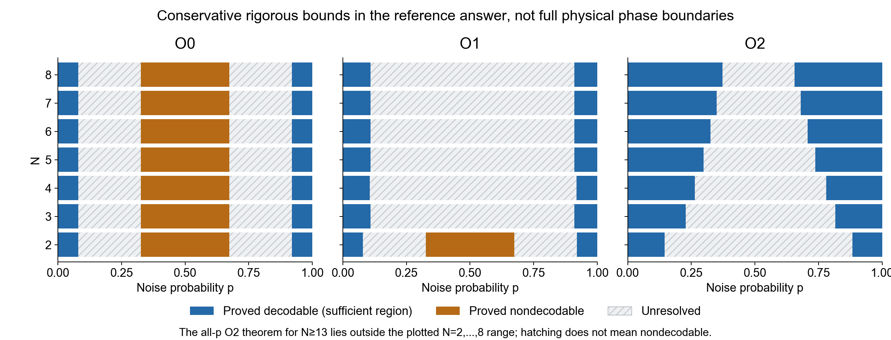

# Herald / symmetry-informed decoder: reference standard answer v1

Date: 2026-10-16. Problem version: Review draft v0.7, 12 October 2026. Original prompt SHA-256: `d89b765a4af1e50b2824d40d0c2d8590e722202219411bd49f5ea7d63c64d6a9`.

## 1. What this standard answer provides

This reference synthesizes the seven runs with scientific deliverables, existing independent posterior checks, and reviews of proof certificates. It provides a verifiable correct core, a complete but conservative R1 answer, and evidence standards for an acceptable submission; it does not claim to have resolved the full physical phase diagram, including all central phase regions. The two Fable runs that produced no deliverables because of API output limits are not scientific failures.

The original problem permits `unresolved` accompanied by justified bounds. Unknown boundaries should therefore not be filled with guesses, and roots of sufficient bounds should not be called true critical points. Valid alternative proofs, exact algorithms, and numerical phase classifications supported by sufficient evidence can all receive credit; reproducing this reference's particular method or N0 is not required.

R1 requires 21 entries and a phase diagram for O0/O1/O2, N=2,...,8; R2 requires proofs of the exact structure on which the answer relies; R3 requires an explicit, valid large-N sufficient bound covering all p; R4 requires the specified posterior and decode interfaces. Also required are answers.json, a report, source code, data, the environment, and reproduction commands. See rubric.md for detailed scoring.

## 2. Model and unambiguous notation

Each edge independently receives a binary occupation X_e with probability p. For each active edge, an additional independent fair choice determines which endpoint receives V; the other receives conjugate V. The complete microscopic edge state is absent, V-at-A, or V-at-B, with probabilities 1-p, p/2, and p/2, respectively. Given the complete microscopic configuration, observations are generated independently as specified in the problem.

| Notation | Meaning |
| --- | --- |
| e_i | The i-th edge of a fixed path; an edge label |
| X_e, C_e | True occupation and correction occupation, both taking only 0 or 1 |
| sigma_i | Hidden orientation of an active path edge; + means V is at the forward endpoint along the path, and - means V is at the rear endpoint |
| n_V(v), n_barV(v) | Numbers of V and conjugate V actually arriving at a vertex; these are not row or column indices of the orientation matrix |
| n_X(v), n_C(v) | Numbers of adjacent true active edges and correction edges |
| M_v | The smallest arrival count compatible with that vertex's actual observation and syndrome parity, restricted to 0,...,degree(v) |
| D=X xor C | The binary symmetric-difference edge set, without orientation |
| P | A component of D spanning the two rough boundaries |
| R* | The optimal decoder's unconditional average logical failure probability |

The decoder receives neither X, sigma, actual n_V/n_barV, nor rough-boundary signals; the correction need not carry orientations or reproduce all charge/irrep observations. Success requires the correct syndrome and logical sector. The problem's additional observations are generated by hidden microscopic variables, consistently with the binary recovery target.

The mathematical sigma notation is used below; orientation-matrix indices are consistently alpha,beta, taking values +,-, to avoid confusing them with arrival counts.

## 3. Geometry, differences, and logical risk

There are 3L^2-3L+1 edges and 2L(L-1) detectors. For a syndrome-compatible correction,

\[
H(X\oplus C)=0,\qquad
\ell(z)=\bigoplus_{e\in\Gamma_T}z_e.
\]

The difference degree at an interior detector can only be 0 or 2, since the original graph has degree at most three. The nonempty connected components of D are therefore simple cycles or simple paths ending at unmeasured rough leaves. Logical failure ell(D)=1 implies at least one bottom-to-top component, whose length d is at least 2L-1.

Self-avoidance here follows from the graph structure of a difference component. It is neither an additional physical repulsion nor a claim that all walk representations of an arbitrary logical operator are automatically self-avoiding. Loop deformations, multiple components, and off-path loops are allowed. The evenness constraint concerns the number of difference edges; the true n_X need not be even.

The optimal risk is

\[
R^*_{r,L}(p,N)=\mathbb E_O\frac{\min\{Z_0(O),Z_1(O)\}}{Z_0(O)+Z_1(O)}.
\]

The risk R_aux of a fixed auxiliary decoder satisfies R* <= R_aux. This compares average risks; it is not an event-inclusion statement saying that the optimal and auxiliary decoders fail together on each record.

## 4. R2: exact information relations that must be preserved

At a fixed N, the central character of an irrep gives its charge, and charge together with the syndrome can be degraded to syndrome-only information. Thus

\[
O_2\longrightarrow O_1\longrightarrow O_0,
\qquad R^*_{2,L}\le R^*_{1,L}\le R^*_{0,L}.
\]

Define D_r(N) as the set of all p for which R* tends to zero as L grows. It includes both low-noise and high-noise sides and may have other components; it does not refer only to the region just inside p=1. The relation above implies D_0(N) subset D_1(N) subset D_2(N). More information means the set cannot shrink, but does not guarantee strict enlargement.

The true integer charge q=n_V-n_barV belongs to -3,...,3, and its parity is the syndrome. Even N reveals q mod N; for odd N, the syndrome together with the charge reveals q mod 2N. This gives the following exact results:

| N for O1 | Information revealed exactly |
| --- | --- |
| 2 | Equal to O0: syndrome only |
| 3, 6 | q mod 6; only the integer values q=-3 and +3 remain confused |
| 4 | q mod 4 |
| 5, 7, 8, and all N>=7 | The full integer q |

Hence

\[
D_1(2)=D_0,\quad D_1(3)=D_1(6),\quad
D_1(5)=D_1(7)=D_1(8),
\]

\[
D_1(4)\subseteq D_1(5),\qquad
D_1(3)\subseteq D_1(5).
\]

q mod 4 and q mod 6 do not contain one another: the former confuses -3 with +1, while the latter confuses -3 with +3. The true O1 boundary cannot be required to be monotone in every integer N. Saturation for N>=7 is exact, and N=5 already provides the same information; N=6 is an exception, not a further enhancement.

O0 is independent of N, has exact risk symmetry under p and 1-p, and has R* nondecreasing on [0,1/2]. Its optimal risk is exactly zero at p=0,1 and exactly 1/2 at p=1/2. O0's complement symmetry cannot automatically be transferred to enriched records.

It is also possible to prove that O2 for N>=5 dominates O2(N=3) in the Blackwell sense, but this requires an explicit stochastic degradation map and treatment of the N=6 exception. It is not a universal monotonicity theorem for all different ranks, nor is it the only permitted R2 approach.

## 5. R1: a complete, verifiable conservative reference answer

The exact central phase regions were not consistently established by this batch of runs. The reference answers.json therefore uses unresolved with rigorous sufficient/necessary bounds, listing numerical observations separately. Scoring cannot require submitters to provide central critical points for which no reliable gold standard is available.

Let

\[
\mu=\sqrt{2+\sqrt2},\qquad
p_s=\tfrac12(1-\sqrt{1-\mu^{-2}})=0.07955179237\ldots.
\]

For all N, every record type is decodable at least on [0,p_s) and (1-p_s,1]. O0 and O1(N=2) are rigorously undecodable on

\[
\left(\frac{1-2\sin(\pi/18)}2,
1-\frac{1-2\sin(\pi/18)}2\right)
=(0.3263518\ldots,0.6736482\ldots),
\]

with risk tending to 1/2. These bounds do not determine the remaining gaps. Existing numerics place O0's low-p critical point around 0.16-0.18, but this is not an exact analytical critical point; each run's fits, sizes, and uncertainties must accompany its particular estimate.

For O1, the following verified sufficient path condition can be used:

\[
\mu\sqrt{p(1-p)}(1+\sqrt{\delta_N(p)})<1,
\quad\delta_N(p)=\sqrt{(1-p)\alpha_0^2+p\alpha_1^2},
\]

where \(N=3,5,6,7,8\) use \(\alpha_0=1/2\), \(\alpha_1=\varphi/2\); \(N=4\) uses \(\alpha_0=1/2\), \(\alpha_1=1\); \(\varphi=(1+\sqrt5)/2\). This is only a uniformly conservative bound for a particular auxiliary decoder. Different information classes receiving the same formula does not mean the channels are equivalent. The full integer q must also inherit every proven decodable subset for q mod 4 and q mod 6.

For O2, choose the following verified sufficient condition:

\[
g_N(p)=\mu\sqrt{p(1-p)}(1+\eta_N(p))<1,
\]

\[
\eta_N(p)=
\begin{cases}
\sqrt{1+p}/2,&N=2,\\
\sqrt{(1-p)/2+p(3+\sqrt{17})/4}/4,&N=4,\\
\sqrt{(1-p)/2+p\varphi}/N,&N=3\text{ or }N\ge5.
\end{cases}
\]

The reference's 21 entries define their boundaries by these strict inequalities. The accompanying reference-bounds.csv supplies safe endpoints rounded inward and verified using rational upper bounds. The unknown regions outside all sufficient intervals remain unresolved. Each O2 also inherits the proven O1 and O0 intervals at the same N.

This figure combines only the selected rigorous bounds; hatching does not denote an undecodable region. Central phase classifications on which different runs still disagree are not combined into a false definite boundary. The same sufficient-bound formula in the table does not imply equivalence of different charge channels.

A numerical phase diagram may be richer than this conservative reference, but it should distinguish rigorously sufficient regions, rigorously undecodable regions, finite-size numerical classifications, and unresolved regions. N0=13 is consistent with plotting only N=2,...,8. Crossings of sufficient-bound curves do not directly contradict information inclusion. If a reliable classification of the true phase region violates inclusion, statistical uncertainty, extrapolation, approximation, or labels must be checked.

## 6. Proper limits of explanations for the Z4 anomaly

Three same-sign arrivals with q=+3 are identified modulo 4 with one conjugate arrival of q=-1; similarly for q=-3. Mixed triple arrivals with q=+1 or -1 already share the charge of one arrival of the same sign. Z4 therefore additionally confuses pure triple inputs compared with the full integer q. This information loss cannot make the true D_1(4) exceed D_1(5).

A stronger standalone sufficient bound for Z4 on the low-p side, or a more prominent appearance than another unresolved curve, cannot be interpreted as "less information improves optimal decoding." Differences in proof tightness, strength of numerical evidence, or plotting without information inheritance can all produce this appearance. The full integer q must inherit reliable Z4 decodable subsets.

At high p, the active graph is close to connected. For O1(N=4), summing over orientations reduces to a constraint on the sum of charges modulo 4 within each active connected component; components touching unmeasured boundaries have no such global constraint. This identity explains a mechanism by which Z4's additional information may weaken, but it does not by itself prove that its critical point exactly equals O0's. GPT01 and Opus03 independently derive this identity.

O1 saturates because it already recovers the full integer q. Full q still cannot see a neutral V/conjugate-V pair, so increasing N cannot remove this residual ambiguity. O2 more often distinguishes these pairs through irreps, with hiding probabilities decreasing as N increases. This is the mechanism behind improved large-N sufficient bounds for O2; a single sufficient bound cannot establish strict monotonicity of the true boundaries for all ranks.

## 7. R4: standard construction of the exact posterior

Assign each canonical edge a three-state microscopic variable t_e=0,+,-, with weights w(0)=1-p, w(+)=w(-)=p/2. The edge's endpoints receive opposite representations; their orientations cannot be independently resampled at the two vertices. Let L_v be the local likelihood of the observation. Then

\[
Z_\lambda(o)=\sum_{\{t_e\}}
\prod_e w(t_e)\prod_v L_v(t_{\partial v};o_v)
\,\mathbf1\!\left\{\bigoplus_{e\in\Gamma_T}[t_e\ne0]=\lambda\right\}.
\]

For O0, L_v is the syndrome indicator; O1 also requires the matching charge; O2 further multiplies by the specified multiplicity times dimension / N^(arrival count). The posterior returns Z0/(Z0+Z1). This is an exact positive-weight tensor network / partition sum and requires no assumption of free-fermion solvability.

One valid implementation sweeps the honeycomb by columns or rows, retaining L-1 three-state edges and one logical parity bit at the frontier. The number of states is at most 2 times 3^(L-1), with time O(L^2 times 3^(L-1)) and fixed-size local gates. Applicable binary special cases reduce to two states. Other exact enumeration, elimination, junction-tree, or tensor-contraction methods are also acceptable.

The small-size R4 requirement must be exact up to floating-point roundoff or accompanied by certified bounds. MPS truncation at larger L is a separate numerical tool; an exact small-size API cannot automatically guarantee the larger-size approximation. Agreement between two bond dimensions is a convergence diagnostic, not an upper bound on the error relative to the truth.

Decode first chooses the logical sector with the larger posterior, then solves the binary linear equations Hc=s, ell(c)=chosen sector to return a valid correction. It need not infer the unique true error or assign arrows to the correction.

Basic SU(2) checks are: n=0 gives spin0 and n=1 gives spin1/2; n=2 gives spin0 with probability 1/4 and spin1 with probability 3/4; n=3 gives spin1/2 with probability 1/2 and spin3/2 with probability 1/2. O1(N=2)=O0, but O2(N=2) is not O0.

## 8. R3: a valid standard theorem and proof chain

Theorem: for all N>=13 and every fixed p in [0,1], O2's optimal logical risk tends to zero as L grows. The supported value 13 is sufficient, not claimed minimal. Other valid sufficient proofs with 19, 15, or 14 also satisfy R3.

First construct an auxiliary decoder constrained by the observed coarse record, requiring \(n_C(v)\in\{M_v,M_v+2\}\) and n_C(v) no greater than degree(v). The true X is always feasible. At a vertex of its failed difference component P, the two path edges flip, while the third edge is the same in X and C. If the true path pattern is 11 and the correction pattern is 00, feasibility forces \(n_X=M_v+2\), hiding a pair. 01/10 does not change the arrival count; 00/11 adds a pair in the candidate without requiring true hiding.

Hiding is a necessary condition for this auxiliary decoder, not a universal necessary condition for any syndrome-compatible correction, and certainly not a sufficient condition for failure. Corrections compatible with the full record, corrections feasible under auxiliary coarse constraints, and geometric paths must not be conflated.

Fix the path occupation and every off-path microscopic state. Sum the \(\sigma\) orientations of each consecutive active run, using row and column indices \(\alpha,\beta\in\{+,-\}\) for F. If the third edge is inactive, \(F=I/N^2\); if it supplies V,

\[
F=\frac2{N^2}\begin{pmatrix}1&0\\1&1\end{pmatrix},
\]

and if it supplies conjugate V, transpose the matrix. An element is a conditional hiding-readout probability given orientations, not a normalized Markov transition. For r active edges, the joint hiding probability is

\[
2^{-r}\mathbf1^{\mathsf T}F_1\cdots F_{r-1}\mathbf1.
\]

The Euclidean operator norms of \(T=F/2\) are respectively \(\tau_0=1/(2N^2)\) and \(\tau_1=\varphi/N^2\). Shared path-edge orientations have therefore been correctly summed, rather than multiplying independent vertex marginal probabilities.

The scalar version can take the uniform joint-hiding bound \(t=\varphi/N^2\) and choose

\[
W(y)=p^{|y|}(1-p)^{|E|-|y|}t^{K(y)},\qquad
K(y)=\sum_v\frac{n_y(v)-M_v}{2}.
\]

If P is a wrongly selected component, locally flipping it back to X remains feasible, so

\[
A=\frac{W(C)}{W(C\oplus P)}
=\left(\frac p{1-p}\right)^{d-2u}t^{h_{00}-h_{11}}\ge1.
\]

Here u is the number of true active path edges, and \(h_{00},h_{11}\) count the corresponding adjacent pairs. Using the joint-hiding bound \(t^{h_{11}}\) and \(\mathbf1_{A\ge1}\le\sqrt A\) gives

\[
\Pr(E_P)\le[p(1-p)]^{d/2}
\sum_{z_1,\ldots,z_d}(\sqrt t)^{h_{00}+h_{11}}.
\]

The second matrix's states are occupation bits z=0,1, not orientations:

\[
K=\begin{pmatrix}\sqrt t&1\\1&\sqrt t\end{pmatrix},
\quad\mathbf1^{\mathsf T}K^{d-1}\mathbf1=2(1+\sqrt t)^{d-1}.
\]

Thus the fixed-path probability is controlled by \(C_N\rho_N^d\). The \(\sqrt t\) for 00 comes from the decoder-selection condition; it does not mean true hiding occurs at that vertex. Counting hiding events alone cannot control alternating occupation paths.

The actual auxiliary score in the final N=13 version is

\[
W_N(y)=p^{|y|}(1-p)^{|E|-|y|}
\prod_{v:n_y(v)=M_v+2}\tau_{M_v},
\quad\tau_0=\frac1{2N^2},\quad\tau_1=\frac\varphi{N^2}.
\]

If the third edge's occupation is h, then \(M_v=h\) at a 00 vertex, and the square-root score ratio contributes \(\sqrt{\tau_h}\). A feasible 11 vertex likewise has \(M_v=h\); multiplying its inverse square-root score ratio by the orientation norm \(\tau_h\) also gives \(\sqrt{\tau_h}\). This shows how the scalar illustration extends to parity-dependent penalties.

An off-path edge can be the third edge at one or two path vertices, including a chord; its shared occupation cannot be independently resampled. For k=1 or 2 appearances,

\[
(1-p)\tau_0^{k/2}+p\tau_1^{k/2}
\le[(1-p)\tau_0+p\tau_1]^{k/2}.
\]

k=1 is Cauchy-Schwarz, and k=2 is equality, giving rho_N=sqrt(p(1-p))(1+eta_N(p)). Path counting gives C_epsilon times (mu+epsilon)^d for any epsilon>0; summing over d>=2L-1 yields

\[
R^*\le R_{\rm aux}\le
C_{N,\epsilon}L\frac{r^{2L-1}}{1-r},
\quad r=(\mu+\epsilon)\rho_N(p)<1.
\]

For fixed p,N this is an exponentially decaying upper bound, not the true critical exponent. r>=1 means only that this proof has not decided that parameter, not that it is undecodable.

## 9. All-p arithmetic certification for N=13

Use the strict rational upper bounds mu<1.848 and phi<1.619, splitting p into three intervals. At N=13,

| p interval | Strict upper bound for mu times rho13 |
| --- | --- |
| [0,0.55] | 0.924 times (1+1.057/13) < 0.999129 |
| [0.55,0.65] | 1.848 times 0.498 times (1+1.108/13) < 0.998743 |
| [0.65,1] | 1.848 times 0.477 times (1+1.273/13) < 0.967815 |

Squaring verifies each square-root enclosure. Increasing N only decreases this sufficient factor, covering every N>=13. At p=0,1, choose the known configuration directly. GPT02 also provides an N=13 positive-cycle / return-walk proof; Fable, Opus, and GPT03 use different stochastic coarse-graining or Cauchy-Schwarz approaches that avoid the direct orientation matrix, and these are valid proofs too. Scoring cannot treat "not using this reference's matrix" as an omission.

## 10. Minimum evidence for numerical validation and phase classification

Report increasing two-dimensional L, the p grid, trial counts, seeds, stopping rules, and decoder and posterior methods. Hard logical failure is Bernoulli; posterior loss is a continuous quantity in [0,1/2], so uncertainty calculations must match the statistic used. Decreasing sample risk, changes in log-odds, or flux variance are evidence, not automatic proofs of a zero limit.

Report statistical uncertainty, finite-size/extrapolation uncertainty, and approximation bias separately. If a Gaussian/BKT model is used to rule out all undecodable behavior, it must be proved that the model actually constrains the problem's quenched posterior, boundaries, and parameters; excluding one heuristic model does not exclude every positive-risk limit.

Retain every actual attempt in the unconditional denominator. Exceptions or invalid corrections count as failures under the problem statement; setting the posterior to 1/2 does not replace conservative accounting of a failed attempt. Separate reserved but unexecuted trial slots from actual physical trials. CPU<=8, memory<=32GiB, no GPU; record the actual environment and reproduction commands.

Existing independent review tested 210 ordinary posterior/correction cases for each valid submission, including 140 within R4 and 70 O0 controls. All seven passed, with a maximum difference of about 1.033e-14. On another 18 strictly positive-probability stress inputs at extremely low p, all three GPT submissions passed, while Fable/Opus exhibited underflow gaps. For the latter, note differences in the longdouble range between the original Linux environment and the macOS review environment. Platform differences must not all be counted as failures of the original environment, but the cross-platform risk of p/2 becoming zero at the Python float stage must not be ignored. These finite tests are not a formal proof of bug-free behavior over the entire parameter domain.

## 11. Reference evidence and unresolved items

Main sources: P=original prompt.md; G1=GPT01/proofs.md and report.md; G2=GPT02/proofs.md, large_N_13.md, and report.md; O3=Opus03/report.md and docs/proofs.md. Detailed locations are in audits/ and the itemized scorecards in this directory.

Independent evidence is in the parent directory's results/: oracle-check.json, heldout-cases.json, each run-checks.json, proof-certificate-checks.json, and saved-data-audit.json. The old REPORT.md and scores.json retain the original judgments. This version adds a detailed rubric without overwriting history.

Still unestablished: the true central O1 phase regions and exact boundaries, all-p O2 theorems for every small N, the smallest sufficient N0, and the true critical scaling exponent. Numerical conjectures, sufficient bounds, and rigorously unresolved ranges must be preserved together; majority voting cannot remove these unknowns.
