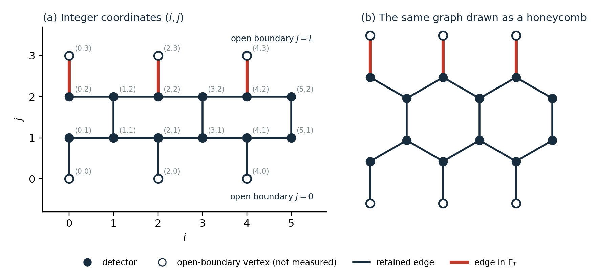

# How Much Symmetry Knowledge Does Decoding Need?

The logical value of charge and irrep records under hidden-orientation SU(N) pair noise

## 1. Research objective

For the channel defined below, determine when a full local SU(N) irrep record improves logical recovery beyond the local $\mathbb Z_N$ charge record, and how much of that information advantage a computationally practical decoder can retain as the patch grows. Focus on $N=3,4$, with $N=2$ as a control, and compare both richer records with syndrome-only decoding.

Choose and justify a range of error rates $p\in[0,1]$ that can distinguish an information advantage, a small or absent advantage, and an algorithmic limitation. The principal result is a controlled finite-size comparison and an explanation tested on reserved inputs. A supported null result or informative bound is acceptable. A complete thermodynamic phase diagram and a large-$N$ theorem are optional extensions.

## 2. Why this is unresolved

More informative observations cannot worsen the optimal decision when they are nested, but that ordering does not give the size or physical mechanism of the logical gain. Practical decoding can lose information that the record contains. A single most likely microscopic error also need not belong to the most probable logical class. The scientific challenge is to separate intrinsic information value from inference error, explain where a gain comes from, and determine what remains supported as genuinely two-dimensional patches grow.

The channel below is a stipulated classical noise-and-observation model. Conditional independence of local irrep readouts, given the microscopic configuration, is part of its definition.

## 3. Geometry and logical recovery

For integer $L\geq2$, consider points $(i,j)$ with $0\leq i\leq2L-1$ and $0\leq j\leq L$. The edges are:

- horizontal edges $((i,j),(i+1,j))$ for $0\leq i\leq2L-2$, only in the rows $1\leq j\leq L-1$ (rows $j=0$ and $j=L$ have no horizontal edges);
- vertical edges $((i,j),(i,j+1))$ for $0\leq j\leq L-1$, present exactly when $i+j$ is even.

The vertices are the endpoints of these edges; points of rows $0$ and $L$ that meet no edge are not vertices. Every vertex with $1\leq j\leq L-1$ has exactly one vertical edge, so the graph is a brick-wall drawing of a honeycomb patch whose interior faces are hexagons. Figure 1 shows $L=3$.

The rows $j=0$ and $j=L$ are the two open (rough) boundaries. Each contains $L$ vertices of degree one, which are not measured. All vertices with $1\leq j\leq L-1$ are measured detectors; they have degree three, except the $2(L-1)$ detectors in the columns $i=0$ and $i=2L-1$, which form the closed (smooth) boundaries and have degree two. There are $3L^2-3L+1$ edges and $2L(L-1)$ detectors, and the shortest path between the two open boundaries has $2L-1$ edges.

Let $H$ be the detector-edge incidence matrix over $\mathbb F_2$, and let $\Gamma_T$ be the $L$ vertical edges that meet the top row $j=L$. For a binary edge vector $z$, define

$$\ell(z)=\bigoplus_{e\in\Gamma_T} z_e.$$

A decoder returns a binary correction $c$. On error vector $x$, it succeeds exactly when $Hc=Hx$ and $\ell(x\oplus c)=0$.

## 4. Noise and public records

Independently on each edge, draw $x_e\sim\mathrm{Bernoulli}(p)$. For each active edge, independently choose one endpoint with probability $1/2$; it receives $V$ and the other endpoint receives $\bar V$. At detector $v$, let $a_v$ and $b_v$ be the numbers of $V$ and $\bar V$ received, and $s_v=(a_v+b_v)\ \mathrm{mod}\ 2$.

Conditional on the microscopic configuration, each detector independently yields an irrep $R_v$ of SU(N) with

$$P(R_v=R)=\frac{m_R(a_v,b_v)\,\mathrm{dim}\,R}{N^{a_v+b_v}},$$

where $m_R(a,b)$ is the multiplicity of $R$ in $V^{\otimes a}\otimes\bar V^{\otimes b}$. Labels are isomorphism classes of SU(N) irreps. For example, $(a,b)=(1,1)$ gives the trivial irrep with probability $1/N^2$; at $N=2$, $n_v=2$ gives total spin $0$ or $1$ with probabilities $1/4$ and $3/4$.

The three records, all given together with $(G_L,p,N)$, are:

| Record | Decoder-visible information |
| --- | --- |
| $O_0$ | syndrome $s$ |
| $O_1$ | $s$ and the charges $k_v=(a_v-b_v)\ \mathrm{mod}\ N$ |
| $O_2$ | $s$ and the irreps $R_v$ |

No decoder receives $x$, the orientations, $a_v$, $b_v$, or anything at the open boundaries. There is one round and no measurement error.

An irrep with Dynkin labels $(w_1,\ldots,w_{N-1})$ has center charge $k(R)=\sum_{j=1}^{N-1}j w_j\pmod N$. Every irrep in the stipulated local tensor product has charge $(a_v-b_v)\pmod N$. Thus the irrep record determines the charge record, and either richer record determines the syndrome. Coupled comparisons can generate one microscopic trial and its irrep outcomes, then derive the coarser observations from that same trial.

## 5. Logical risk and the value of information

For record type $r$ and a supported record $o$, let $Z_{r,\lambda}(o)$ be the total probability of microscopic errors, orientations and readout outcomes that produce $o$ and have $\ell(x)=\lambda$. Define

$$q_{r,\lambda}(o)=\frac{Z_{r,\lambda}(o)}{Z_{r,0}(o)+Z_{r,1}(o)},\qquad R_{r,L}^*(p,N)=\mathbb E_o[1-\max_\lambda q_{r,\lambda}(o)].$$

The expectation uses the physical record law. Unsupported records do not enter it; zero-mass sectors and ties must be handled explicitly. A submitted decoder $D_r$ has risk $R_{D_r,L}$ equal to its unconditional correction-failure probability under that same law, including randomness and invalid or missing outputs. The comparisons of interest are

$$\Delta_{\rm info}=R_{1,L}^*-R_{2,L}^*,\qquad \Delta_{{\rm alg},r}=R_{D_r,L}-R_{r,L}^*.$$

Report the syndrome-only baseline $R_{0,L}^*$ or controlled bounds as well. A difference between two practical decoders is not automatically $\Delta_{\rm info}$. Distinguish uncertainty in a Bayes reference from actual failures of a submitted decoder.

## 6. Scientific investigation and evidence

Develop a public-input inference method for charge and irrep records. Establish independently checkable logical posteriors on small patches, including orientation averaging, local readout probabilities, sector sums, zero masses and ties. Then investigate increasing two-dimensional patches, including a regime beyond direct enumeration of all microscopic configurations. A valid exact reduction is welcome; its domain and complexity must be justified.

Determine or informatively bound the information gain and the loss of at least one practical decoder under matched physical conditions. Where Bayes risk is not computed exactly, justify the reference uncertainty sufficiently to support the claimed comparison. Agreement between methods sharing the same approximation is not independent validation. Direct correction-success measurements validate practical risk; they do not alone establish posterior accuracy or Bayes optimality.

Explain which public record structures are associated with the gain or the remaining ambiguity. Develop a quantitative prediction that distinguishes the proposed explanation from a plausible alternative, and check it on a size or parameter cohort reserved before tuning that explanation. Include the reserved result even when it contradicts the explanation. Methods, sizes, sampling allocation, representations and diagnostics remain researcher choices.

Separate physical sampling, posterior approximation and finite-size uncertainty. Retain the mass of every sampled record: a failed reference calculation contributes unresolved probability to a bound, rather than disappearing from the average or becoming a physical Bayes failure. A decoder exception or invalid correction counts as an actual decoder failure. Unresolved results must give informative constraints and identify the missing evidence; vacuous intervals and unvalidated curves do not complete the investigation.

## 7. Scope, resources and deliverables

Provide a concise English report stating the information comparison, practical-versus-optimal performance, mechanism, reserved prediction check, costs and limitations. Supply source, public or fully specified input generation, seeds, environment and commands reproducing the evidence. No private research record is required.

Provide `decode(L, p, N, record_type, record, rng=None)` returning a correction, and `posterior(L, p, N, record_type, record)` returning $q_{r,0}$ or an explicitly qualified interval or estimate. Document how numerical uncertainty is justified; an empirical convergence diagnostic must not be presented as a rigorous certificate. Use `record_type` equal to `O0`, `O1` or `O2`. A detector is its coordinate tuple `(i, j)`. Its record entry is `s` for `O0`, `(s, k)` for `O1`, and `(s, w)` for `O2`, where `w` is the tuple of $N-1$ Dynkin labels (for $N=2$, `(2J,)`). An edge is its endpoint pair in lexicographic order; a correction is the set of edges with bit one. Decoders receive only the stipulated public inputs.

Design a study feasible on a scientific workstation. Declare a resource allowance, stopping rules and comparison protocol before the main study, and report actual time and memory. Choose accuracy in relation to the scientific claim instead of assuming a universal numerical tolerance. No inference algorithm, positive information gain, exact transition location or prescribed scaling form is required.
