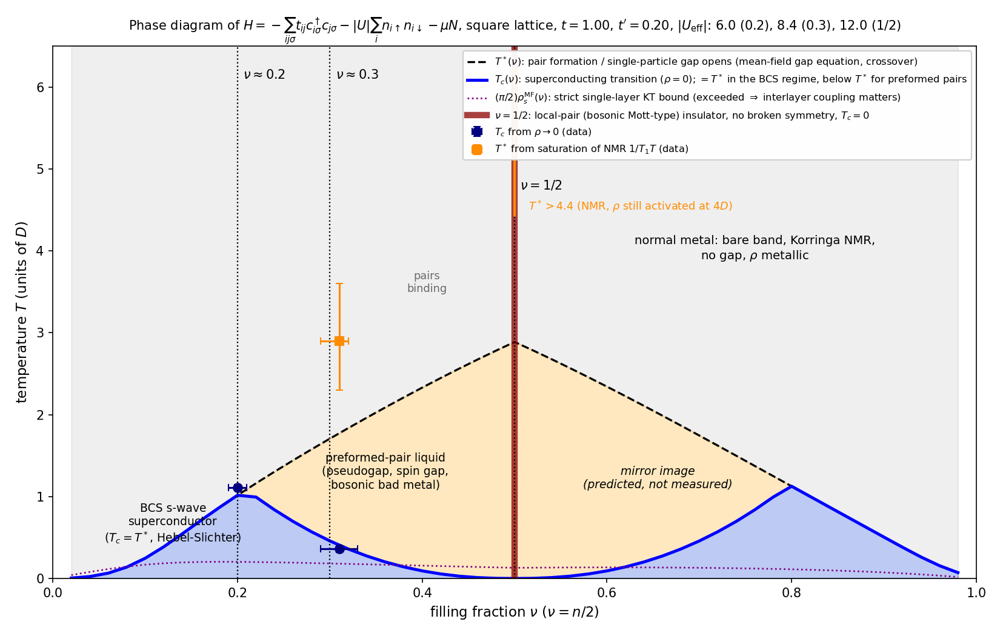
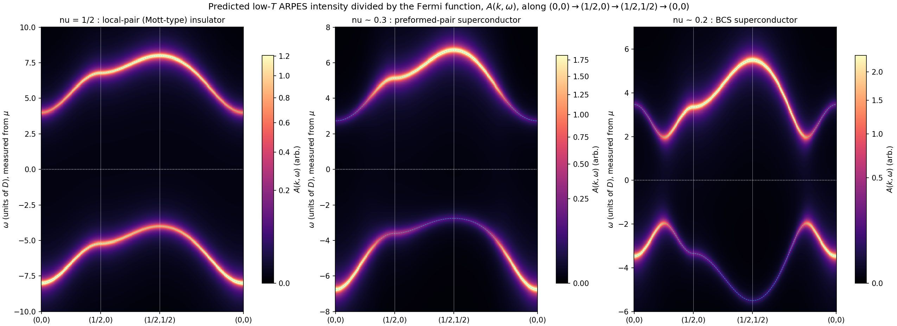
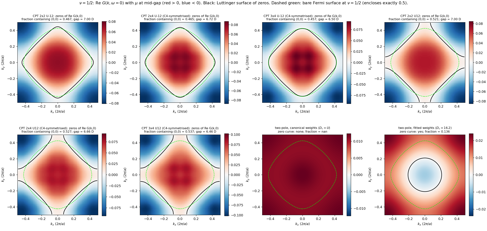

# A layered perovskite-block oxide at and near half filling: effective theory, phase diagram, and predictions

All energies and temperatures are in units of $D$. All numbers below are extracted from `measurements.json` (scripts in `analysis/`, `theory/`; fitted parameters in `results.json`; figures in `figures/`).

**Summary.** The high-temperature tunnelling spectrum fixes the bare band: a square-lattice tight-binding band with nearest-neighbour hopping $t=1.00\,D$ and next-nearest-neighbour hopping $t'=0.20\,D$ (bandwidth $8\,D$, van Hove singularity $0.8\,D$ above the band centre). At half filling the low-temperature spectrum consists of two bands that are exact half-width replicas of the bare band, separated by $12.0\,D$ and dispersing as $\varepsilon_k/2$; the charge gap is $8.0\,D=|U|-W/2$. The resistivity is activated with $E_g/2$, and the NMR relaxation is activated with a *spin* gap of $5.7\,D$ — five decades of suppression — with a single resonance line and no new diffraction peaks. A charge gap and a spin gap of the same magnitude, without broken symmetry, identify the half-filled state as a **local-pair (preformed-pair, spin-singlet) insulator**: the pseudospin image of a paramagnetic Mott insulator, produced by a *local attraction* $U=-12\,D$. Exact diagonalisation confirms the sign: for $U=+12\,D$ the spin gap of the same clusters is $0.15\,D$, for $U=-12\,D$ it equals the charge gap. On hole doping the same local pairing gives $s$-wave superconductivity: a preformed-pair superconductor with a pseudogap at $\nu\approx0.3$ ($T_c=0.36\,D\ll T^*\approx3\,D$) and a weak-coupling BCS superconductor at $\nu\approx0.2$ ($\Delta=1.97\,D$, $T_c=1.10\,D$, Hebel–Slichter peak), the effective attraction being screened by the doped carriers from $12\,D$ to $8.5\,D$ to $6.0\,D$. A cluster-perturbation-theory calculation (clusters of 4, 8 and 12 sites) gives a closed Luttinger surface of zeros of $G(k,0)$ at half filling that encloses $0.46\pm0.02$ of the zone, close to but measurably below $\nu=1/2$.

---

## 0. What the data say (data reduction)

| Observable | Result | How obtained |
|---|---|---|
| Bare band (STS panel d) | $t=1.000\pm0.004$, $t'=0.196\pm0.002$, $t''=-0.005\pm0.003\ (\approx0)$, $\mu(\nu{=}0.3)=-0.89\pm0.01$ (filling 0.302), Lorentzian width 0.10 | least-squares fit of the tight-binding DOS (Fig. `fig_sts_fits.png` d) |
| $\nu=1/2$ (panel a) | two bands $[-8.0,-4.0]$ and $[4.0,8.0]$; peaks at $-5.2$ and $+6.8$; gap $8.00\pm0.05$; best model $E_\pm(k)=\pm U/2+(\varepsilon_k-\bar\varepsilon)/2$ with $U=12.00\pm0.01$ (stat) and weights $\tfrac12(1\mp\varepsilon_k/D_c)$, $D_c=16\pm4$ (canonical value $D_c=|U|$ fits almost as well); rms 0.015 vs noise 0.008 | Fig. `fig_sts_fits.png` a; `analysis/fit_gapped.py`, `fit_a_weights.py` |
| $\nu\approx0.3$ (panel b) | bands $[-6.6,-2.6]$ and $[2.6,6.6]$ (each $W/2$ wide), gap $5.2\pm0.2$, van Hove peak at $+5.1$; the energies follow a dispersionless-partner (local-pair) self-energy $\Sigma=\Delta_{pg}^2/\omega$ with $\Delta_{pg}=4.3\pm0.1$, i.e. $|U_{\rm eff}|=2\Delta_{pg}=8.5\pm0.4$; spectral weight strongly shifted to $\varepsilon_k<\mu$ in the lower band; bare filling at the fitted $\mu$: $0.32\pm0.01$ | Fig. `fig_sts_fits.png` b |
| $\nu\approx0.2$ (panel c) | BCS on the bare band: $\Delta=1.965\pm0.03$, $\mu=-1.919\pm0.003$ (bare filling 0.200), coherence peaks at $\pm\Delta$, band edges $-3.5$ and $+5.5$, van Hove at $+3.3$; rms = noise | Fig. `fig_sts_fits.png` c |
| NMR $1/T_1T$ | $\nu=1/2$: $\propto e^{-\Delta_s/T}$, $\Delta_s=5.7\pm0.3$ (stat) $^{+0.9}_{-1.2}$ (prefactor), still rising at $4.4\,D$. $\nu\approx0.3$: $\Delta_s=2.64\pm0.06$ (with a $T$ prefactor; $2.0$–$3.3$ for other prefactors), saturates at $T^*=3.0\pm0.5$, no coherence peak. $\nu\approx0.2$: Korringa above $T_c$, Hebel–Slichter peak of height $1.81$ at $T=1.02$ (BCS with $\Delta=1.97$, Dynes $\Gamma=0.05$ gives 1.79), low-$T$ slope $2.06\pm0.04\approx\Delta$ | `analysis/fit_nmr_rho.py`, `bcs_checks.py`; Fig. `fig_nmr_rho_fits.png` |
| Resistivity | $\nu=1/2$: $\rho\propto e^{\Delta_\rho/T}$, $\Delta_\rho=3.72\pm0.05$, ratio $\rho(0.45)/\rho(4)=1600$. $\nu\approx0.3$: $\rho=0$ for $T\le0.325$, finite at $0.40$ $\Rightarrow T_c=0.36\pm0.04$; above $T_c$ weakly insulating, $\rho\simeq0.16+0.70\,e^{0.98/T}$. $\nu\approx0.2$: $T_c=1.11\pm0.04$; above, metallic $\rho=0.18+0.175\,T$ | same |
| Diffraction, NMR line | one TM site per cell at all $T$, no superlattice peaks, single NMR line | given |

Three facts organise everything: (i) the interaction scale at half filling is $12\,D=1.5\,W$ and the state has **no local moments** (activated $1/T_1$); (ii) at $\nu\approx0.3$ the gap is centred on $\mu$ although the band is 40 % away from half filling, and it survives to $T^*\approx 8\,T_c$; (iii) at $\nu\approx0.2$ everything is textbook weak-coupling $s$-wave BCS with $2\Delta/T_c=3.6$ and a Hebel–Slichter peak.

---

## 1. Effective theory

### Degrees of freedom, lattice, unit cell
Spin-1/2 electrons $c^\dagger_{i\sigma}$ in one Wannier orbital per transition-metal site (the TM orbital with its ligand admixture), on the two-dimensional square lattice of TM sites with lattice constant $a$ (the in-plane metal–metal distance). The unit cell is one site, at all temperatures. Filling $\nu=n/2$, $n=\langle n_{i\uparrow}+n_{i\downarrow}\rangle$; $\nu=1/2$ is one electron per site. Momenta are measured in $2\pi/a$.

### Hamiltonian
$$
H=-t\sum_{\langle ij\rangle\sigma}\big(c^\dagger_{i\sigma}c_{j\sigma}+{\rm h.c.}\big)
 -t'\sum_{\langle\langle ij\rangle\rangle\sigma}\big(c^\dagger_{i\sigma}c_{j\sigma}+{\rm h.c.}\big)
 -\mu\sum_{i\sigma}n_{i\sigma}
 -|U|\sum_i n_{i\uparrow}n_{i\downarrow}.
$$
Band: $\varepsilon_k=-2t(\cos k_x+\cos k_y)-4t'\cos k_x\cos k_y$, width $W=8t$, van Hove singularity at $(1/2,0)$ at $\varepsilon=+4t'$, i.e. $0.8\,D$ above the band centre $\bar\varepsilon=-4t'$; the band runs from $-4.78$ to $+3.22$.

| term | coefficient | value (units of $D$) | determined from |
|---|---|---|---|
| nearest-neighbour hopping | $t$ | $1.00\pm0.02$ | width $8t=8.0$ of the high-$T$ band (panel d); independently from the BCS band edges at $\nu\approx0.2$ ($-\sqrt{\xi_{\min}^2+\Delta^2}=-3.5$, $+\sqrt{\xi_{\max}^2+\Delta^2}=+5.5$) and from the $W/2$ widths of the Hubbard-type bands at $\nu=1/2$ |
| next-nearest-neighbour hopping | $t'$ | $0.20\pm0.01$ | position of the van Hove peak, $0.8\,D$ above the band centre (panel d), reproduced at $-5.2/+6.8$ (panel a, half-compressed) and $+3.3$ (panel c, in quadrature with $\Delta$) |
| third-neighbour hopping | $t''$ | $0.00\pm0.01$ | fitted $-0.005\pm0.003$; dropped |
| chemical potential | $\mu$ | fixed by $\nu$: at the gap centre for $\nu=1/2$; $-0.89\pm0.01$ ($\nu=0.30$), $-1.92\pm0.01$ ($\nu=0.20$) | panels d and c |
| local attraction at $\nu=1/2$ | $\lvert U\rvert$ | $12.0\pm0.2$ | separation of the band centres in panel a ($=\lvert U\rvert$); charge gap $E_g=\lvert U\rvert-W/2=8.0$; NMR spin gap $5.7\approx\lvert U\rvert/2$; exact diagonalisation charge gap $8.1$–$8.7$ |
| local attraction at $\nu\approx0.3$ | $\lvert U_{\rm eff}\rvert$ | $8.5\pm0.4$ | pair-binding scale $2\Delta_{pg}$ from the band edges and van Hove position of panel b; NMR $\Delta_s=2.6\approx E_g/2$ |
| local attraction at $\nu\approx0.2$ | $\lvert U_{\rm eff}\rvert$ | $6.0\pm0.3$ | BCS gap equation $1=\frac{\lvert U\rvert}{N}\sum_k\frac{1}{2E_k}$ with $\Delta=1.97$ and the bare $\mu$; the same value gives the mean-field $T_c=1.10$, inside the measured interval $1.075$–$1.15$ |

The single-site attraction is the only interaction needed; its magnitude is, however, **renormalised by the carrier density**: $|U_{\rm eff}(\nu)|=12.0,\ 8.5,\ 6.0$ at $\nu=0.5,\ 0.3,\ 0.2$, well described by $|U_{\rm eff}|\simeq6.0+20(\nu-0.2)$ for $\nu\le1/2$. This is the expected behaviour of a lattice-mediated (bipolaronic, valence-skipping-type) negative-$U$ centre whose binding is screened by itinerant carriers: at half filling there are no free carriers and the bare attraction is seen; at $\nu=0.2$ the metallic carriers screen it to half its value. I treat $|U_{\rm eff}|$ as the coupling constant of the effective theory at the filling of each crystal (a running coupling), and quote it with the uncertainties above. The effective pair hopping in the local-pair regime is $J_p=2t^2/|U|=0.17\,D$ ($\nu=1/2$) and $0.24\,D$ ($\nu\approx0.3$).

### Symmetries the model has
Square-lattice translations with one site per cell; point group $C_{4v}$ (the fourfold axis exchanging the two in-plane axes, mirrors); time reversal; spin SU(2); charge U(1). For $t'=0$ and $\nu=1/2$ it would also have the pseudospin SU(2) that rotates superconducting into checkerboard pair-density order; $t'=0.2$ reduces this to U(1) and breaks particle–hole symmetry, so the diagram under $\nu\to1-\nu$ is only approximately symmetric.

### Symmetries and ingredients it lacks
No spin–orbit coupling (spin is conserved; the NMR single line and absence of any magnetic response at every filling are consistent). No inter-site Coulomb repulsion $V$ (would favour a checkerboard pair crystal; excluded by diffraction in the measured range). No explicit lattice/boson dynamics — they are integrated into $U_{\rm eff}(\nu)$. No disorder (STS is spatially uniform). No interlayer hopping: the model is two-dimensional; the weak interlayer coupling of the real material only converts the two-dimensional pair-liquid crossovers into sharp transitions.

### Why a local attraction and not a repulsive (Mott) Hubbard model
The two-band spectrum at $\nu=1/2$ (bands at $\pm U/2+\varepsilon_k/2$, weights $\tfrac12(1\mp\varepsilon_k/U)$) is the first-order strong-coupling result for **either** sign of a local interaction; the particle–hole transformation on one spin species maps the repulsive Mott insulator onto the attractive pair insulator with the same single-particle spectrum. The spin sector decides the sign:

| cluster (ED, $t'=0.196$) | $U=+12$: charge gap / spin gap | $U=-12$: charge gap / spin gap |
|---|---|---|
| $2\times2$ | 9.45 / 0.27 | 9.59 / 9.84 |
| $2\times4$ | 8.68 / 0.21 | 8.73 / 8.89 |
| $3\times4$ (Hilbert dimension 853 776) | 8.14 / 0.15 | 8.24 / 8.34 |

The measured NMR activation energy at half filling, $5.7\,D$ ($\approx |U|/2$, the energy per thermally unpaired spin), is forty times the spin gap of the repulsive model ($J=4t^2/U=0.33$, and in the thermodynamic limit the repulsive Mott insulator has gapless spin waves, so $1/T_1T$ would *grow* on cooling). It is of the order of the charge gap, as for broken local pairs. Three further facts point the same way: the gap at $\nu\approx0.3$ is centred on the chemical potential although the band is 40 % hole doped (a doped Mott insulator would have $\mu$ inside the lower Hubbard band); the superconducting gap is a full isotropic $s$-wave gap with a Hebel–Slichter peak, i.e. on-site pairing; and the spin gap persists at all three fillings. A repulsive $U$ with an additional pairing channel would need a second, unrelated interaction of $6\,D$ and would still leave the half-filled spin gap unexplained. I therefore take $U<0$ as the most credible effective theory; the Mott (repulsive) alternative is kept in mind where its predictions coincide (single-particle spectra at $\nu=1/2$, Luttinger surface).

### The half-filled state of matter
A **pair (bipolaronic) insulator**: every site is either empty or doubly occupied by a spin-singlet pair, with the pair positions disordered. It is the pseudospin image of the paramagnetic Mott insulator — charge gap $E_g=|U|-W/2$, two "Hubbard" bands — but with a spin gap instead of local moments. It breaks no symmetry: the checkerboard pair-density (CDW) and superconducting orders are degenerate partners under the (approximate) pseudospin SU(2); in two dimensions such order is destroyed at any finite temperature (Mermin–Wagner), and $t'$ frustrates the CDW. The ordering scale is set by the pair hopping $J_p=0.17\,D$, far below the measured range ($T\ge0.45\,D$ for $\rho$). Prediction: below $T\sim0.1$–$0.2\,D$ the half-filled crystal should either develop weak superlattice peaks at $(1/2,1/2)$ or become superconducting.

---

## 2. Phase diagram

`figures/fig_phase_diagram.png`. Horizontal axis $\nu$ from 0 to 1, vertical axis $T$. Lines: $T^*(\nu)$ (black dashed) is the pair-formation / gap-opening crossover, computed from the mean-field gap equation with the number equation on a $400\times400$ $k$-mesh using $|U_{\rm eff}(\nu)|$ (values 1.02, 1.7, 2.9 at $\nu=0.2,0.3,0.5$); $T_c(\nu)$ (blue) is the superconducting transition: it coincides with $T^*$ in the BCS regime ($|U_{\rm eff}|<W$, $\nu\lesssim0.22$) and lies far below $T^*$ in the preformed-pair regime, where it is the phase-ordering temperature of the pair liquid, drawn through the measured $T_c(0.31)=0.36$ and vanishing at $\nu=1/2$ because the pair superfluid and the checkerboard pair order are degenerate there. The dotted purple line is the strict single-layer Kosterlitz–Thouless bound $(\pi/2)\rho_s^{\rm MF}$ from the mean-field stiffness ($0.13$–$0.2\,D$); the measured $T_c$ at $\nu\approx0.2$ exceeds it, which is the signature that interlayer coupling makes the transition three-dimensional there. The electron-doped side $\nu>1/2$ is the mirror image (dashed region), modified by $t'$, and is a prediction. The three crystals are marked by vertical lines.

Phases from low to high temperature:

* **$\nu=1/2$:** local-pair insulator (charge gap 8.0, spin gap $\approx6$, no order, activated $\rho$ and $1/T_1$) for all measured $T$ up to at least $4.4\,D$; pairs dissociate in a crossover at $T^*\gtrsim4.4$–$6\,D$ into an incoherent (bad) metal with the bare band. Below the measured range ($T\lesssim0.2\,D$): weak pair-density or superconducting order (prediction).
* **$\nu\approx0.3$:** $s$-wave superconductor of preformed pairs below $T_c=0.36\pm0.04$; preformed-pair liquid (pseudogap $2\Delta_g=5.2$, spin gap $2.6$, weakly insulating bosonic bad metal) for $0.36<T<T^*\approx3\pm0.5$; normal metal with the bare band and Korringa relaxation above.
* **$\nu\approx0.2$:** BCS $s$-wave superconductor below $T_c=T^*=1.11\pm0.04$ ($\Delta=1.97$, $2\Delta/T_c=3.6$); normal metal above, $\rho$ linear in $T$, Korringa NMR, no gap.

---

## 3. What produces each measurement

**Diffraction (no new peaks, no splitting, one site per cell at every $T$).** The gap at half filling is produced by an on-site interaction, i.e. by *local* pair binding; it needs no superlattice. The only competing order of the attractive model, checkerboard pair-density order, is degenerate with superconductivity (pseudospin SU(2)), frustrated by $t'$, and suppressed in two dimensions to temperatures $\sim J_p=2t^2/|U|\approx0.17\,D$, below the measured window. Short-range pair-density correlations give diffuse scattering only. In the doped crystals the pairs condense into a uniform $s$-wave superconductor, which does not change the lattice periodicity. (A Slater antiferromagnet or a CDW would double the cell: excluded.) The spatial uniformity of the STS spectra follows from the same fact: a translation-invariant pair liquid or condensate, with no phase separation or stripe order.

**STS.**
* Panel a ($\nu=1/2$): the two bands are electron removal from a pair and electron addition to an empty site, split by the pair-binding energy $|U|=12.0$; each disperses as $\varepsilon_k/2$ because the added particle can hop only onto a site in the appropriate local state (probability $1/2$ in the pair liquid), giving $W/2$ wide replicas of the bare band and the gap $E_g=|U|-W/2=8.0$. The peaks at $-5.2$ and $+6.8$ are the bare van Hove singularity (at $4t'$ above the band centre) after the factor-of-two compression, and the shoulders at $-7$/$+7.3$ are the compressed band edges. The weight factors $\tfrac12(1\mp\varepsilon_k/|U|)$ put more weight at the bottom of the lower band and the top of the upper band, as observed.
* Panel b ($\nu\approx0.3$): the same two-branch local-pair structure, $E_\pm(k)=\xi_k/2\pm\sqrt{\xi_k^2/4+\Delta_{pg}^2}$ with $\Delta_{pg}=|U_{\rm eff}|/2=4.3$, reproduces the band edges $\pm2.6$ and $\pm6.6$ and the van Hove peak at $+5.1$. The gap is centred on $\mu$ at any filling because adding or removing one electron breaks a pair. The spectral weight is now concentrated below $\mu$ for $k$ inside the bare Fermi surface and above $\mu$ outside it, with a crossover width $\approx2\,D$: the pairs retain Fermi-surface memory (finite pair size), which is what distinguishes a preformed-pair metal from the half-filled insulator. The occupied fraction of the weight (0.3) is the filling.
* Panel c ($\nu\approx0.2$): Bogoliubov quasiparticles $E_k=\sqrt{\xi_k^2+\Delta^2}$ with coherence factors on the unrenormalised band: coherence peaks at $\pm\Delta=\pm1.97$, lower edge $-\sqrt{2.86^2+\Delta^2}=-3.5$, van Hove at $\sqrt{2.70^2+\Delta^2}=3.3$, upper edge $\sqrt{5.14^2+\Delta^2}=5.5$. The fit reaches the noise level.
* Panel d (high $T$): with the pairs dissociated the spectrum is the bare band; it fixes $t,t',\mu$ (filling 0.30). The $\propto V^2$ background present in all panels is a tunnelling-barrier term.

**NMR.** The single line at every filling and temperature follows from the absence of local moments (pairs are singlets) and of charge order. $1/T_1T$ is activated because a nuclear spin can only relax on an *unpaired* electron: at $\nu=1/2$ the density of thermally broken pairs gives $\Delta_s\approx|U|/2=6$ (measured $5.7\pm0.3$, between the atomic estimate $|U|/2$ and the band estimate $E_g/2=4$); at $\nu\approx0.3$ the gap is the single-particle gap $E_g/2=2.6$ and it disappears only at $T^*\approx3\gg T_c$ (no feature at $T_c$ because the pairs already exist above $T_c$); at $\nu\approx0.2$ the BCS coherence factor $(1+\Delta^2/E^2)$ and the singular quasiparticle DOS produce the Hebel–Slichter peak just below $T_c$ (height ratio 1.79 computed vs 1.81 measured, with a lifetime broadening $\Gamma=0.05$), followed by $e^{-\Delta/T}$ with $\Delta=2.0$. Above $T^*$ all crystals show the Korringa law of the bare band.

**Resistivity.** $\nu=1/2$: charge is carried by thermally excited unpaired electrons, $\rho\propto e^{E_g/2T}$ with $E_g/2=3.7$–$4.0$; the pairs themselves are immobile on this scale ($J_p=0.17\,D$, incoherent at $T\ge0.45$), and the measured 1600-fold rise bounds their contribution. $\nu\approx0.3$: $\rho=0$ below $T_c=0.36$ when the preformed pairs condense; above $T_c$ the carriers are an incoherent liquid of pairs plus activated unpaired electrons, giving the weakly insulating $d\rho/dT<0$ "bosonic bad metal" ($\rho\simeq0.16+0.70e^{0.98/T}$; the effective activation $\sim1\,D\sim4J_p$ is the pair-hopping scale, much smaller than the spectral gap, which is why $\rho$ is not activated with $E_g/2$). $\nu\approx0.2$: BCS, $\rho=0$ below $T_c=T_{\rm MF}=1.1$; above, the pairs are gone and the metal shows $\rho\propto T$ with a residual term.

---

## 4. Predicted low-temperature ARPES, $A(k,\omega)$ (intensity divided by the Fermi function)

`figures/fig_arpes.png`: density plots along $(0,0)\to(1/2,0)\to(1/2,1/2)\to(0,0)$, energy measured from $\mu$. Approximations: first-order strong-coupling two-pole spectral function for $\nu=1/2$ (canonical weights); local-pair self-energy with coherence-factor weights for $\nu\approx0.3$ (parameters of the panel-b fit); BCS for $\nu\approx0.2$; Lorentzian width $0.12$–$0.15$; 600 $k$-points along the path. Windows: $[-10,10]$, $[-8,8]$, $[-6,7]$. The strong-coupling spectrum at $\nu=1/2$ was cross-checked by cluster perturbation theory on $2\times4$ sites (`figures/fig_cpt_2x4_U-12.png`), which gives the same two-branch structure with a gap of $6.7\,D$ (cluster-size underestimate).

**$\nu=1/2$.** Two branches, $E_\pm(k)=\pm6.0+(\varepsilon_k-\bar\varepsilon)/2$, each a half-compressed replica of the bare dispersion: lower branch from $-8.0$ at $(0,0)$ through the flat van Hove region $-5.2$ at $(1/2,0)$ to $-4.0$ at $(1/2,1/2)$; upper branch from $+4.0$ at $(0,0)$ through $+6.8$ at $(1/2,0)$ to $+8.0$ at $(1/2,1/2)$. Features and what they imply: (i) no branch crosses $\mu$ and nothing disperses towards it — an interaction-driven insulator, not a band insulator (one electron per cell); (ii) the halved bandwidth of both branches measures the probability $1/2$ that a neighbour is in the right local state: a disordered pair (or Mott) background; (iii) the indirect gap $8.0$ (lower top at $(1/2,1/2)$, upper bottom at $(0,0)$) equals the STS gap; the direct gap is $k$-independent and equal to $|U|=12$, so an optical absorption edge is predicted at $12\,D$; (iv) the weight moves from the lower branch (0.70 at $(0,0)$) to the upper one (0.63 at $(1/2,1/2)$); the locus where the two weights are equal is where the bare band would cross $\mu$ and is where the Luttinger surface of Task 5 lies.

**$\nu\approx0.3$.** The same two-branch topology with the centres moved to $\pm4.3$: lower branch $-6.8$ at $(0,0)$ to $-2.7$ at $(1/2,1/2)$, upper $+2.7$ at $(0,0)$ to $+6.7$ at $(1/2,1/2)$, gap $5.3\pm0.2$ at $\mu$. The new feature is the **weight switch**: the lower branch is bright for $k$ inside the bare Fermi surface (crossing points at $|k|=0.32$ along $(0,0)\to(1/2,0)$ and at $(0.19,0.19)$ along the diagonal) and fades beyond it, the upper branch does the opposite, while neither branch bends back. This "ghost Fermi surface" with a pseudogap, and the absence of a Bogoliubov back-bending, is the fingerprint of preformed local pairs with finite size: pairing without coherence above $T_c$ and a condensate fraction too small ($\Delta_{sc}\approx1.76T_c\approx0.6$) to reshape the dispersion. The branch separation $8.5$ measures $|U_{\rm eff}|$, smaller than at half filling: the attraction is screened by doping.

**$\nu\approx0.2$.** Bogoliubov bands $\pm E_k$ with back-bending at the Fermi momenta ($|k_F|=0.254$ along $(0,0)\to(1/2,0)$; $(0.178,0.178)$ on the diagonal), minimum gap $2\Delta=3.9$ at $k_F$, lower branch from $-3.5$ at $(0,0)$ with a weak shadow (weight $v_k^2$) following $-E_k$ up to $-5.5$ at $(1/2,1/2)$, upper branch from $+3.5$ at $(0,0)$ through the van Hove flat part at $+3.3$ near $(1/2,0)$ to $+5.5$ at $(1/2,1/2)$. The back-bending, the particle–hole-symmetric branches of weights $u_k^2,v_k^2$ and the unrenormalised bandwidth identify a weak-coupling BCS condensate of the bare quasiparticles ($\lambda=|U|\rho_0=0.53$); the isotropy of the gap along the Fermi surface (same minimum gap at both crossings) is the $s$-wave, on-site pairing.

**Comparison.** From $\nu=0.2$ to $0.5$ the spectrum evolves from BCS back-bending bands with the bare bandwidth, to two local-pair branches with a ghost Fermi surface, to two half-width branches with no Fermi-surface memory: a BCS-to-local-pair crossover driven by the growth of $|U_{\rm eff}|$ from $0.75W$ to $1.5W$. The gap grows ($3.9\to5.3\to8.0$) while $T_c$ falls ($1.1\to0.36\to0$) — the hallmark of pairing without phase coherence.

---

## 5. Luttinger surface at $\nu=1/2$

Method: $\mathrm{Re}\,G(k,0)=\mathcal P\!\int d\omega'\,A(k,\omega')/(0-\omega')$ evaluated on a symmetric frequency grid (principal value) with $\mu$ at the mid-gap; the zero set of $\mathrm{Re}\,G(k,0)$ is located by contouring on a $k$-grid, and the fraction of the zone on the side containing $(0,0)$ is the area of the connected region containing $(0,0)$ (`theory/luttinger_twopole.py`, `theory/cpt_run.py`, `theory/kk_cpt_check.py`, `figures/fig_luttinger.png`).

*Two-pole spectrum.* With the canonical strong-coupling weights $\tfrac12(1\mp\varepsilon_k/|U|)$ the pole of $\Sigma$ sits $0.39\,D$ above the mid-gap for every $k$: $\mathrm{Re}\,G(k,0)\approx+0.012/D$ everywhere and there is **no** zero curve — the exact result for any theory with a $k$-independent self-energy (Hubbard-I, single-site DMFT) in a particle–hole-asymmetric band. With the slightly stronger tilt preferred by the STS fit ($D_c=16$) a small zero curve appears around $(0,0)$ enclosing $0.14$ of the zone. The two-pole truncation is therefore unreliable for the zeros: their position is controlled by the $k$-dependence of the self-energy, which it does not contain.

*Cluster perturbation theory (k-dependent $\Sigma$).* Exact diagonalisation of open $2\times2$, $2\times4$ and $3\times4$ clusters with $t=1$, $t'=0.196$, $U=-12$ at half filling, periodised CPT Green's function on a $64\times64$ grid, $\mu$ at the mid-gap of the CPT spectrum, results $C_4$-symmetrised for the rectangular cluster. $\mathrm{Re}\,G(k,0)$ is positive around $(0,0)$ and negative around $(1/2,1/2)$; the zeros form a **closed curve** close to the bare Fermi surface, slightly flattened along the axes (Fig. `fig_luttinger.png`, top row). The fraction of the zone on the $(0,0)$ side is

| | $2\times2$ | $2\times4$ ($C_4$-symmetrised) | $3\times4$ ($C_4$-symmetrised) |
|---|---|---|---|
| $U=-12$ (this theory) | 0.467 | 0.465 | 0.457 |
| $U=+12$ (Mott alternative) | 0.521 | 0.527 | 0.537 |

**Result: fraction $=0.46\pm0.02$, compared with $\nu=0.50$.** The Luttinger surface encloses the filling to within $0.04$ (8 %), with a slow drift away from $1/2$ as the cluster grows. The residual deviation is real within the theory: in an insulator the zero surface moves as $\mu$ is swept across the gap, so it is pinned to $\nu$ only by particle–hole symmetry ($t'=0$, where the curve would be the exact diamond with fraction $1/2$); $t'=0.2$ and the mid-gap convention shift it by a few per cent (in opposite directions for the two signs of $U$, $0.46$ versus $0.54$ for the $3\times4$ cluster, as the particle–hole mapping requires). A literal Kramers–Kronig transform of the CPT $A(k,\omega)$ ($\eta=0.05$, 2000 frequencies on a grid symmetric about $\mu$, $2\times4$ cluster) reproduces the direct $\mathrm{Re}\,G(k,0)$ to $2\times10^{-5}$ (sum rule 0.998) and gives the same fraction, $0.462$ on a $48\times48$ grid (`theory/kk_cpt_check.log`). The cluster Green's function matrix is built from the exact Lehmann representation (full diagonalisation of the $N\pm1$ sectors, 3 920 states each for $2\times4$), which guarantees a causal matrix; a block-Lanczos version is used for the $3\times4$ cluster.

---

## 6. Limitations and tests

* The line shape of the occupied band at $\nu\approx0.3$ is reproduced only approximately (rms 0.047 vs noise 0.009): the local-pair form gives the right edges, gap and van Hove position, but the measured weight is shifted even more strongly towards $k$ inside the bare Fermi surface than any single two-pole form allows. A treatment of pairs of finite size (momentum-dependent pair propagator) is needed for the detailed shape.
* The doping dependence of $|U_{\rm eff}|$ (12 → 8.5 → 6.0) is taken from the data; a microscopic model of the screened lattice-mediated attraction is not attempted.
* $T_c=1.1\,D$ at $\nu\approx0.2$ equals the mean-field value and exceeds the single-layer Kosterlitz–Thouless bound ($\approx0.2\,D$); interlayer coupling must be appreciable. For the preformed-pair regime the mean-field stiffness gives $T_c\sim0.3\,D$, the right order of magnitude but not the full factor-of-three drop between $\nu=0.2$ and $0.3$, which is drawn empirically.
* Decisive tests of the proposed theory: (i) Knight shift (spin susceptibility) at $\nu=1/2$ should be activated with the same $\Delta_s$, not Curie–Weiss; (ii) ARPES at $\nu\approx0.3$ above $T_c$ should show the two gapped branches with the weight switch and no back-bending; (iii) at $\nu=1/2$, weak $(1/2,1/2)$ superlattice peaks or superconductivity below $\sim0.2\,D$; (iv) an optical absorption edge at $12\,D$ at half filling; (v) the $s$-wave gap should be insensitive to non-magnetic disorder but the Hebel–Slichter peak should survive only at $\nu\approx0.2$.

## 7. Calculations performed and their sizes

* Tight-binding DOS and all two-pole / BCS spectral functions: $k$-meshes of $600^2$–$1200^2$; Lorentzian broadening; least-squares fits with finite-difference Jacobians (`analysis/`).
* BCS gap equation, mean-field $T_c$ and $T=0$ superfluid stiffness with the number equation: $400^2$ and $1200^2$ meshes (`theory/phase_diagram.py`, `analysis/bcs_checks.py`).
* Hebel–Slichter $1/T_1$ with a Dynes-broadened BCS DOS (`analysis/bcs_checks.py`).
* Exact diagonalisation (Lanczos, scipy ARPACK) of open Hubbard clusters $2\times2$, $2\times4$, $3\times4$ (Hilbert dimensions 36, 4 900, 853 776 at half filling; 731 808 in the $N\pm1$ sectors) for $U=\pm12$: charge and spin gaps (`theory/ed_cpt.py`).
* Cluster perturbation theory from the $2\times2$ and $2\times4$ cluster Green's functions (exact Lehmann representation: full diagonalisation of the $N\pm1$ sectors, 24 and 3 920 states; for $3\times4$, 731 808 states, a block Lanczos with full orthogonalisation), periodised on $64\times64$ $k$-points and 240 path points (`theory/cpt_run.py`, `theory/luttinger_combined.py`). Wall time: seconds to minutes on one CPU core ($3\times4$: tens of minutes).

Files: `report.md` (this document), `results.json` (all fitted numbers), `figures/*.png`, `analysis/*.py` (data fits), `theory/*.py` (model, ARPES, phase diagram, ED/CPT, Kramers–Kronig).
