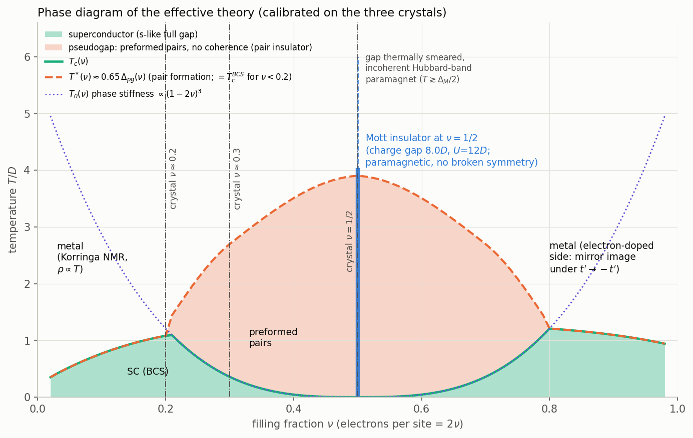
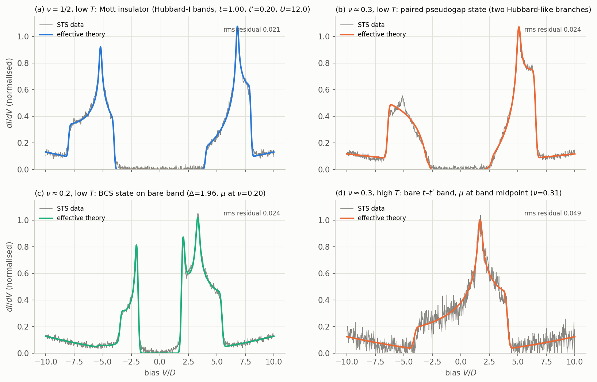
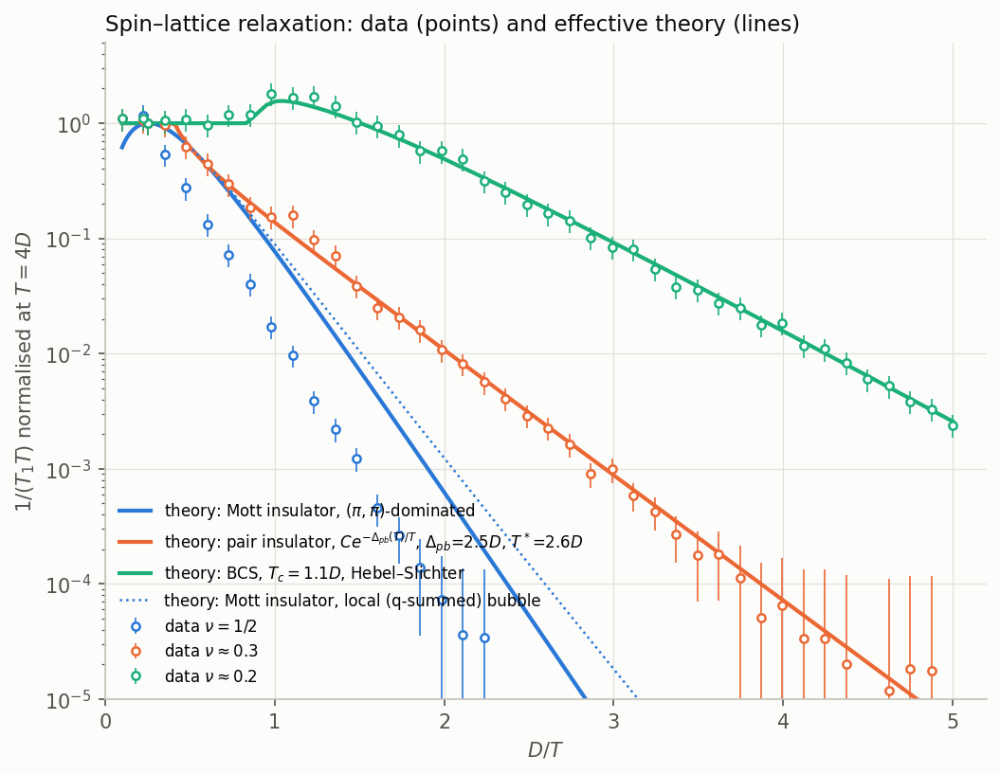
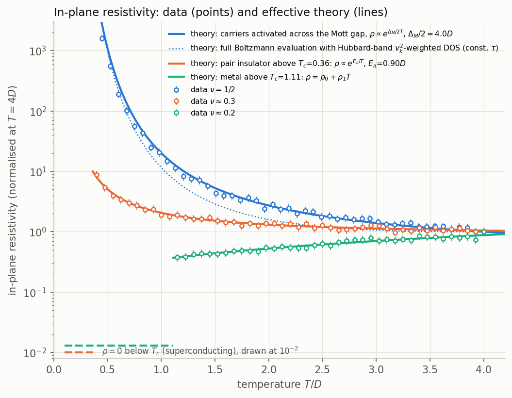
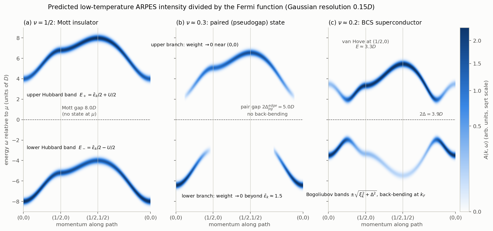
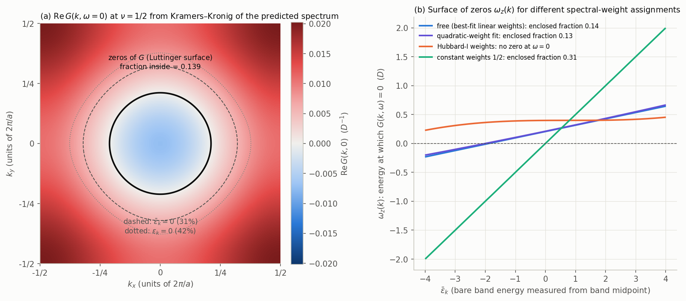

# Low-temperature state at half filling of a layered perovskite-block oxide — effective theory from the STS, NMR and resistivity data

All energies and temperatures are in units of $D$; momenta in units of $2\pi/a$ with $a$ the in-plane metal–metal distance, so $(1/2,0)\equiv(\pi,0)$.
Every number below was extracted from `measurements.json` (code in `work/`, figures in `figures/`, machine-readable parameters in `parameters.json`).

## Summary

* The half-filled crystal is a **paramagnetic Mott insulator** of a single-band Hubbard model on the square lattice: $t=1.00(1)$, $t'=+0.20(1)$, $U=12.0(1)$. Its tunnelling spectrum is two Hubbard bands of width $4t=W/2$, centred at $\pm U/2$, separated by the charge gap $U-4t=8.0$; nothing is ordered (one site per cell, single NMR line, homogeneous STS).
* Hole doping to $\nu\approx0.2$ gives a weak-coupling **s-wave BCS superconductor on the bare band** ($\Delta=1.96$, $T_c=1.11$, $2\Delta/T_c=3.56$, Hebel–Slichter peak, Korringa metal above $T_c$).
* $\nu\approx0.3$ is a **strong-coupling paired state of the doped Mott insulator**: electrons are bound into local pairs; the one-electron spectrum consists of two Hubbard-like branches (compressed to $\approx0.6$ of the bare dispersion, split by $8.2$, gap edges at $\pm2.5$) whose spectral weight crosses over smoothly in $k$-space. Pairs form at $T^*\approx2.7$ (pseudogap: activated NMR and transport without any Hebel–Slichter anomaly) and condense at $T_c=0.36$.
* The predicted ARPES spectra differ qualitatively: Hubbard bands with $k$-dependent weight transfer at $\nu=1/2$; same-orientation gapped branches without back-bending at $\nu\approx0.3$; Bogoliubov back-bending at $\nu\approx0.2$.
* Kramers–Kronig of the predicted $\nu=1/2$ spectrum gives a closed curve of zeros of $G(k,0)$ around $(0,0)$, the contour $\bar\varepsilon_k\simeq-1.9$, enclosing **$0.14\pm0.04$** of the Brillouin zone — far from $\nu=1/2$: the Luttinger surface of the Mott insulator does not count electrons.

---

## 0. What the data say (model-independent features)

| observable | $\nu=1/2$ | $\nu\approx0.3$ | $\nu\approx0.2$ |
|---|---|---|---|
| STS low $T$: zero-conductance interval | $[-4.0,4.0]$, sharp step edges | $[-2.5,2.5]$, **linear (soft) onsets** | $[-1.95,1.95]$, divergent coherence peaks |
| STS low $T$: outer band edges | $-8.0$, $+8.0$ (steps) | $-6.5$, $+6.55$ (steps) | $-3.5$ (step), $+5.5$ (step) |
| STS low $T$: van Hove cusp | $-5.2$ and $+6.8$ (both bands) | $+5.1$ (upper only; weak hump at $-5.1$) | $+3.3$ |
| integrated weight below gap / total | $0.50\pm0.01$ | $0.37\pm0.02$ | $0.23\pm0.01$ |
| STS high $T$ ($\nu\approx0.3$) | — | single band $[-4.0,4.15]$, cusp at $+1.6$, $\mu$ at band midpoint | — |
| $1/(T_1T)$ | $\propto e^{-5.6(2)/T}$, no plateau | $\propto e^{-2.6(2)/T}$ below $T^*\!\approx\!2.7$, plateau above; **no anomaly at $T_c$** | Korringa plateau, Hebel–Slichter peak ($1.8\times$) at $T\approx1.0$, $e^{-1.8/T}$ below |
| resistivity | $\propto e^{3.72(5)/T}$ (insulator) | $0$ for $T<0.36(4)$; $0.84\,e^{0.90(4)/T}$ above (insulating-like) | $0$ for $T<1.11(4)$; $0.18+0.175\,T$ above (metal) |
| diffraction / NMR line | no new peaks, no splitting, single line at all $T$ | same | same |

Three facts fix the model. (i) The high-$T$ spectrum of the $\nu\approx0.3$ crystal is a bare two-dimensional tight-binding band of width $8.1$ with its saddle point $1.6$ above the band midpoint, and the chemical potential sits at the midpoint — for a $t$–$t'$ band with $8|t'|=1.6$ that is exactly the filling $\nu=0.31$. (ii) The two bands of the half-filled crystal are each a copy of this band **compressed by one half** ($\pm$ translated by $6.0$): their cusps sit at $0.8\times$(1/2)$\times$… i.e. at $\mp6.0\pm0.8$, and their spectral weights are complementary and $k$-dependent (upper/lower intensity ratio $0.55\to1.5$ from band bottom to top). This is the first-order strong-coupling (Hubbard-I) structure $E_\pm(k)=\bar\varepsilon_k/2\pm U/2$, $Z_\pm=\tfrac12\pm\varepsilon_k/2U$. (iii) The $\nu\approx0.2$ spectrum is a textbook BCS density of states built on the *same bare band* with $\mu$ at the filling 0.20.

## 1. Effective theory

**Degrees of freedom.** One Wannier orbital per transition-metal site (the metal $d$ orbital with ligand admixture), spin-1/2 fermions $c_{i\sigma}$. Filling $\nu=1$ ⇔ two electrons per site; $n=2\nu$ electrons per site.

**Lattice and unit cell.** Square lattice of the metal sites, lattice constant $a$, **one site per unit cell** in every phase and at every temperature (the diffraction data forbid any enlargement; the NMR data forbid inequivalent sites).

**Hamiltonian** (hole-doped side $\nu<1/2$; electron-doped side follows by particle–hole conjugation with $t'\to-t'$):

$$
H=-t\sum_{\langle ij\rangle\sigma}\big(c^\dagger_{i\sigma}c_{j\sigma}+\mathrm{h.c.}\big)
-t'\sum_{\langle\langle ij\rangle\rangle\sigma}\big(c^\dagger_{i\sigma}c_{j\sigma}+\mathrm{h.c.}\big)
-\mu\sum_{i\sigma}n_{i\sigma}
+U\sum_i n_{i\uparrow}n_{i\downarrow}
-\frac{V}{N}\sum_{k,k',q}c^\dagger_{k+q\uparrow}c^\dagger_{-k\downarrow}c_{-k'\downarrow}c_{k'+q\uparrow}.
$$

$\varepsilon_k=-2t(\cos k_x+\cos k_y)-4t'\cos k_x\cos k_y$; the band midpoint is at $4t'$ so that $\bar\varepsilon_k\equiv\varepsilon_k-4t'\in[-4t,4t]$ and the saddle point $(\pi,0)$ lies at $\bar\varepsilon=+8t'$. The last term is the $s$-wave ($k$-independent) projection of a retarded attraction between carriers (phonon/bipolaron-like; its microscopic origin is not resolvable from these data). It is distinct from the instantaneous on-site $U$ and acts only on the doped carriers' pairing channel.

**Coefficients determined from the data** (statistical errors from $\chi^2$ profiles; the quoted uncertainty is dominated by the spread between the independent determinations):

| coefficient | value | determined from |
|---|---|---|
| $t$ | $1.00\pm0.01$ | width $8t$ of the high-$T$ band ($1.025$), width $4t$ of each Hubbard band ($1.000$), BCS fit of panel (c) ($1.005$) |
| $t'$ | $+0.20\pm0.01$ | cusp position $8t'=1.6$ above the band midpoint in panels (a),(c),(d) ($0.199$, $0.203$, $0.211$); sign fixed by $\mu$ at the band midpoint ⇔ $\nu=0.31$ |
| $U$ | $12.0\pm0.1$ | Hubbard-band separation $12.00\pm0.03$ and charge gap $U-4t=8.0\pm0.1$ |
| $V$ | $6.0\pm0.5$ | BCS gap equation on the bare band at $\nu=0.20$ reproducing $\Delta=1.96\pm0.02$ and $T_c=1.11\pm0.04$ ($2\Delta/T_c=3.56$; the nearest-neighbour extended-$s$ channel would give $2.7$ and is disfavoured) |

Derived scales: Mott gap $8.0$; pair-breaking energy at $\nu\approx0.3$: $2\Delta_{pg}=8.2\pm0.3$ (branch-centre splitting; gap edges at $\pm2.5\pm0.1$); branch compression $s=0.60\pm0.03$; $T^*=2.7\pm0.3$; $T_c(0.3)=0.36\pm0.04$; $T_c(0.2)=1.11\pm0.04$; transport activation $E_a(0.3)=0.90\pm0.05$.

**Symmetries.** The Hamiltonian has lattice translations (Bravais lattice $a$), the point group $C_{4v}$ (fourfold axis), spin SU(2), time reversal and charge U(1). It lacks particle–hole symmetry ($t'\neq0$) and any term coupling to a translational or orbital order parameter. The Mott insulator and the paired pseudogap state break **none** of these symmetries (the gaps are produced by interactions, not by order); the superconducting states break only U(1), with an $s$-like, nodeless, translation-invariant gap.

**Approximations and system size.** (i) $\nu=1/2$: first-order strong-coupling (Hubbard-I-type two-pole) spectral function, $A(k,\omega)=Z_-(k)\delta(\omega-E_-(k))+Z_+(k)\delta(\omega-E_+(k))$, $E_\pm=\bar\varepsilon_k/2\pm U/2$; the weights fitted to the STS are $Z_\pm=\tfrac12\pm(\bar\varepsilon_k-0.53)/(2\times15.4)$, close to the Hubbard-I value $\tfrac12\pm\varepsilon_k/2U$ (they are compared in §5). (ii) $\nu\approx0.2$: BCS mean field on the bare band, $E_k=\sqrt{\xi_k^2+\Delta^2}$, coherence factors $u_k^2,v_k^2$. (iii) $\nu\approx0.3$: strong-coupling pair state, $A(k,\omega)=Z_L(k)\delta(\omega-E_L(k))+Z_U(k)\delta(\omega-E_U(k))$ with $E_{U,L}=\pm4.1+0.6\,\bar\varepsilon_k$ (small convex corrections) and weights $Z_L\propto(1.5-\bar\varepsilon_k)_+$, $Z_U\propto(\bar\varepsilon_k+3.3)_+$ — a smeared momentum distribution of the paired electrons. (iv) Probes: one-loop spin susceptibility with a $(\pi,\pi)$-peaked transferred-hyperfine form factor for NMR; Boltzmann/Arrhenius transport. All sums are on $k$-meshes of $400^2$–$1600^2$ points (seconds to minutes on one core); no finite-cluster solver was required. Gaussian broadening $0.08$–$0.12$ (fitted) represents the instrumental resolution.

**Why this is the most credible theory.** A band insulator or any ordered insulator is excluded: the unit cell never changes, every metal site stays equivalent, and the low-$T$ spectrum is not the bare band gapped by a potential but two half-width copies of it separated by an energy ($12$) that does not exist in the band structure — the fingerprint of on-site repulsion. The doped crystals show the *same* bare band, once with a BCS gap and once with a pair gap, so the single-band description is consistent across doping. The qualitative difference between $\nu\approx0.3$ (gap without coherence peaks, no Hebel–Slichter peak, Mott-compressed branches, insulating normal state, $T_c\ll T^*$) and $\nu\approx0.2$ (textbook BCS) is the BEC–BCS crossover of the same attraction: near the Mott insulator the kinetic energy is quenched, so $V$ binds local pairs (pair-breaking energy $8.2\approx1.4V$ with the $0.6$-compressed band), whereas at $\nu\approx0.2$ the full bandwidth is available and $V/W=0.75$ is weak coupling.

## 2. Phase diagram

Construction (all lines calibrated on the three crystals): $T^*(\nu)=0.65\,\Delta_{pg}(\nu)$ with $\Delta_{pg}$ interpolating the measured pair/Mott half-gaps ($1.96$ at $0.20$, $4.15$ at $0.30$, $6.0=U/2$ at $0.5$); for $\nu<0.2$, $T^*=T_c^{BCS}(\nu)$ from the gap equation with $V=6.0$. The phase-coherence temperature $T_\theta\propto(1-2\nu)^3$ is fixed by $T_c(0.3)=0.36$ and $T_\theta(0.2)>1.1$ (pairs become heavy as the Mott insulator is approached). $T_c=\min(T^*,T_\theta)$; the BEC–BCS crossover ($T^*=T_\theta$) is at $\nu\approx0.21$. The electron-doped side is the mirror image under $\nu\to1-\nu$, $t'\to-t'$. The Mott insulator is the line $\nu=1/2$; its gap is thermally smeared only for $T\gtrsim\Delta_M/2\approx4$ (a crossover, not a transition).

Phases from low to high $T$:

* **$\nu=1/2$:** paramagnetic Mott insulator (charge gap $8.0$, Hubbard bands, no order at any $T$) → crossover near $T\sim4$ to an incoherent, thermally excited Hubbard-band paramagnet. No phase transition in the measured range (the resistivity is still activated at $T=4$).
* **$\nu\approx0.3$:** superconductor ($T<T_c=0.36\pm0.04$, condensate of preformed pairs) → pseudogap / pair insulator ($0.36<T<T^*\approx2.7$: gapped single-particle spectrum, activated NMR and resistivity, no coherence) → metal ($T>T^*$: bare band, Korringa NMR, resistivity plateau).
* **$\nu\approx0.2$:** BCS superconductor ($T<T_c=1.11\pm0.04$) → metal ($T>T_c$: Korringa NMR, $\rho\propto T$).

## 3. Explanation of each data set

**Diffraction (no new peaks, no splitting; single NMR line; homogeneous STS).** All phases keep one metal site per cell: the Mott gap is produced by $U$ acting on singly occupied sites (no charge or spin modulation), the pair gap by zero-momentum pairs, the BCS gap by an $s$-like condensate. Produced by: the absence of any symmetry-breaking order parameter in the theory. The single NMR line excludes static moments (Néel order would split or shift the line by the hyperfine field) and charge disproportionation; the Mott insulator here is a quantum paramagnet.

**STS.**
(a) $\nu=1/2$: the two bands are the Hubbard bands $E_\pm=\bar\varepsilon_k/2\pm U/2$ — steps at $\pm4,\pm8$ (2D band edges), logarithmic cusps at $\mp6.0\pm0.8$ (the saddle point of the compressed band), zero conductance in $[-4,4]$ (Mott gap $U-4t$), and the asymmetric intensity (lower band bright at its bottom, upper band bright at its top) from the weights $Z_\pm=\tfrac12\pm\varepsilon_k/2U$. Produced by: $U\gg W$ with hopping-induced dispersion of doublons and holons in a spin-disordered background. rms residual $0.021$.
(b) $\nu\approx0.3$ low $T$: pair gap $\pm2.5$ with *linear* onsets (the spectral weight of each branch vanishes at the band extremum where the gap edge is reached: $Z_U\to0$ at $(0,0)$, $Z_L\to0$ beyond $\bar\varepsilon\approx1.5$), outer steps at $\mp6.5$, cusp at $+5.1=4.1+0.6\times1.6$ in the upper branch and only a weak hump at $-5.1$ because the lower branch has almost no weight at the saddle point. Produced by: local pairs in the Mott-compressed band (both branches disperse the same way — a Hubbard-like, not a Bogoliubov, splitting). rms residual $0.024$.
(c) $\nu\approx0.2$ low $T$: BCS density of states $N_0(\xi)\,E/\sqrt{E^2-\Delta^2}$ on the bare band with $\mu$ at $\nu=0.20$ ($\bar\varepsilon=-1.10$): coherence peaks at $\pm1.96$, band bottom at $-\sqrt{2.9^2+\Delta^2}=-3.5$, saddle point at $\sqrt{2.7^2+\Delta^2}=3.3$, band top at $5.5$. Produced by: $V$ in weak coupling. rms residual $0.024$.
(d) $\nu\approx0.3$ high $T$: above $T^*$ the pairs are gone and so is the compression: bare band $[-4,4]$ with the saddle point at $+1.6$ and $\mu$ at its midpoint ($\nu=0.31$). rms residual $0.049$ (noisier, deconvolved data). The weak, slowly rising background outside the bands (≈0.05–0.12) is incoherent weight from the admixed orbitals and is not part of the single-band model.

**NMR $1/(T_1T)$.** Produced by the one-loop spin susceptibility $\sum_q|A_q|^2\chi''(q,\omega_0)/\omega_0$ built from the same spectral functions.
* $\nu\approx0.2$: Korringa constant above $T_c$ (metal); below $T_c$ the case-II coherence factors $(u u'+v v')^2$ give the Hebel–Slichter peak and then $e^{-\Delta(T)/T}$; the theory (BCS $\Delta(T)$, $T_c=1.1$, resolution $0.11$) reproduces the whole curve with no free parameter.
* $\nu\approx0.3$: no Hebel–Slichter peak and nothing at $T_c=0.36$ — the single-particle gap is already open above $T_c$ and does not change at the condensation of preformed pairs. Relaxation requires thermally broken pairs: $1/(T_1T)=C\,e^{-\Delta_{pb}(T)/T}$ relative to Korringa, $\Delta_{pb}(0)=2.5$ (the STS gap edge), closing at $T^*=2.6$; fitted $C=1.6$ (pile-up of weight at the pair-breaking threshold). The pseudogap closes where the data return to the plateau ($T\approx2.6$–$2.9$).
* $\nu=1/2$: activated, $\Delta_{NMR}=5.6\pm0.2$, i.e. larger than the gap edge $4.0$. In the theory the transferred hyperfine form factor $(A+2B\sum\cos q_i)^2$ of a perovskite $B$-site nucleus vanishes at $q=0$ ($A\simeq-4B$) and the short-range antiferromagnetic correlations of the Mott insulator peak $\chi''$ at $(\pi,\pi)$; intraband relaxation with momentum transfer $(\pi,\pi)$ requires $E(k)=E(k+Q)$, which happens only on the antiferromagnetic zone boundary where the lower Hubbard band lies $5.2$–$5.6$ below $\mu$. The $(\pi,\pi)$-dominated bubble gives an activation energy $5.2$–$5.4$ ($5.6$ measured); the $q$-summed (local) bubble would give $4.0$ and is clearly excluded. The remaining factor (a power of $T$ in the prefactor) is beyond the two-pole approximation.

**Resistivity.**
* $\nu=1/2$: insulating, $\rho\propto e^{3.72/T}$. Produced by thermal activation of doublon/holon carriers across the half gap $\Delta_M/2=4.0$ ($\rho\propto e^{\Delta_M/2T}$ matches the data within $\pm40\%$ over three decades); a full Boltzmann evaluation with the velocity-weighted Hubbard-band DOS gives the same low-$T$ slope.
* $\nu\approx0.3$: $\rho=0$ below $T_c=0.36$ (pair condensate). Above $T_c$ the state is a pair insulator with no fermionic quasiparticles at $\mu$: the resistivity is insulating-like, $\rho=0.84\,e^{0.90/T}$, with an activation energy $E_a=0.90\pm0.05$ well below the single-particle gap because charge is carried by thermally activated (incoherent) motion of the pairs themselves, not by broken pairs. The plateau above $T\approx2$ marks the loss of the pair gap at $T^*$.
* $\nu\approx0.2$: $\rho=0$ below $T_c=1.11$; above, $\rho=0.18+0.175\,T$ — a metal with a $T$-linear scattering rate. Produced by: an ungapped Fermi surface (enclosing $20\%$ of the zone) above $T_c$.

## 4. Predicted ARPES intensity (divided by the Fermi function)

Energy window $[-9,9]$ for all three fillings (resolution $0.15$); the spectral weights along the path are shown in `figures/fig_arpes_weights.png`.

* **$\nu=1/2$ (a):** two Hubbard bands, each with the full shape of the bare band compressed by $1/2$: lower band from $-8.0$ at $(0,0)$ through $-5.2$ at $(1/2,0)$ to $-4.0$ at $(1/2,1/2)$; upper band from $4.0$ to $6.8$ to $8.0$. Nothing crosses $\mu$ (Mott gap $8.0$). The intensity of the lower band falls from $Z_-=0.65$ at $(0,0)$ to $0.39$ at $(1/2,1/2)$ while the upper band gains the complementary weight — the "remnant Fermi surface" where $Z_-=Z_+$ lies on the contour $\bar\varepsilon_k\simeq0.5$, not on a Fermi surface. Implication: the insulator is a Mott insulator with coherent doublon/holon propagation ($t$-scale dispersion), and the spectral-weight transfer is set by $\varepsilon_k/U$.
* **$\nu\approx0.3$ (b):** two branches that disperse in the *same* direction ($0.6\,\bar\varepsilon_k\pm4.1$) — no Bogoliubov back-bending, no mirror symmetry about $\mu$. The lower branch is bright at $(0,0)$ ($-6.4$) and fades out before $(1/2,0)$; the upper branch is absent near $(0,0)$ and bright from $(1/2,0)$ ($5.1$) to $(1/2,1/2)$ ($6.6$). Implication: the gap is a pair-breaking (Hubbard-like) gap of local pairs in a Mott-compressed band, with the pair occupation of $k$ states smeared over the whole lower half of the zone; the electronic structure is not that of a BCS condensate on a Fermi surface.
* **$\nu\approx0.2$ (c):** Bogoliubov bands $\pm\sqrt{\xi_k^2+\Delta^2}$ with back-bending at the Fermi momenta (where $\bar\varepsilon_k=-1.1$, enclosing $20\%$ of the zone around $(0,0)$), minimum gap $2\Delta=3.9$, weight switching from the lower to the upper branch across $k_F$ ($v_k^2\leftrightarrow u_k^2$), band bottom at $-3.5$ and saddle point at $+3.3$. Implication: weak-coupling $s$-wave pairing on a well-defined Fermi surface of the unrenormalised band.

Comparison: the band width visible in ARPES doubles from $\nu=1/2$ (4.0 per band) to $\nu\approx0.2$ (8.0), with $\nu\approx0.3$ in between ($0.6\times8$); the gap changes character from Mott ($8.0$, no particle–hole mixing) to pair-breaking ($5.0$ at the edges, same-orientation branches) to BCS ($3.9$, mirror branches).

## 5. Luttinger surface at $\nu=1/2$

$\mathrm{Re}\,G(k,0)=\int d\omega'\,A(k,\omega')/(0-\omega')$ was evaluated numerically on a $400\times400$ mesh from the predicted (Gaussian-broadened) spectrum, $\omega$ measured from the mid-gap chemical potential. For a two-pole spectrum $G(k,\omega)$ has a single zero at $\omega_z(k)=Z_-E_++Z_+E_-$.

* With the spectral weights fitted to the STS, $\omega_z(k)=0.11\,\bar\varepsilon_k+0.21$ crosses $\omega=0$ on the closed curve $\bar\varepsilon_k=-1.9\pm0.3$ around $(0,0)$. $\mathrm{Re}\,G(k,0)<0$ inside, $>0$ outside. **The fraction of the Brillouin zone on the side containing $(0,0)$ is $0.14\pm0.04$** ($0.139$ for the linear-weight fit, $0.130$ for the quadratic-weight fit). The Luttinger count $2\times\{\text{fraction with }\mathrm{Re}\,G>0\}=1.72$ electrons per site.
* Compared with $\nu=1/2$: the enclosed fraction is not $\nu$. It is not even close to the $0.31$ one would get if the zeros sat on the band-midpoint contour, or to the $0.42$ of the non-interacting Fermi surface at half filling ($\varepsilon_k=0$). With strict Hubbard-I weights ($\tfrac12\pm\varepsilon_k/2U$) the zero sheet lies flat at $\omega_z=2t'=+0.4$ above $\mu$ and never reaches $\omega=0$ ($\mathrm{Re}\,G>0$ everywhere, Luttinger count $2$). The location of the Luttinger surface is therefore a sub-leading ($t^2/U$) effect, extremely sensitive to the $k$-dependence of the spectral weights, and in no variant does it enclose half the zone.

Conclusion: in this Mott insulator the generalised Luttinger theorem (volume bounded by poles **and** zeros of $G$ equals the density) fails — the zeros of $G$ are tied to the band structure (a contour of $\bar\varepsilon_k$ whose position is set by $t'$ and the weight asymmetry $\varepsilon_k/U$), not to the electron number. Only for a particle–hole-symmetric band ($t'=0$) would the surface of zeros coincide with the half-filling Fermi surface by symmetry. The $0.14$ enclosed here is a property of the Hubbard-band weights, not an electron count.

---

### Files
* `REPORT.md` (this document), `parameters.json` (all coefficients, uncertainties, derived scales).
* `figures/`: `fig_sts_fits.png`, `fig_nmr.png`, `fig_rho.png`, `fig_phase_diagram.png`, `fig_arpes.png`, `fig_arpes_weights.png`, `fig_luttinger.png`.
* `work/`: all scripts (`README.md` lists them), fit results (`fit_*.npy`) and model arrays (`*.npz`).
