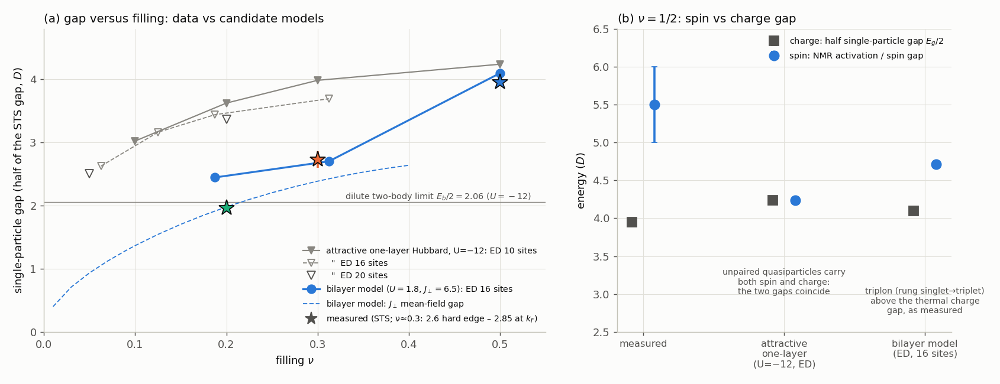
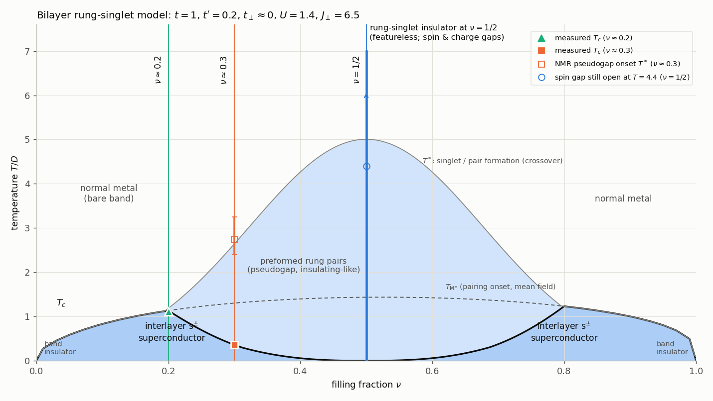
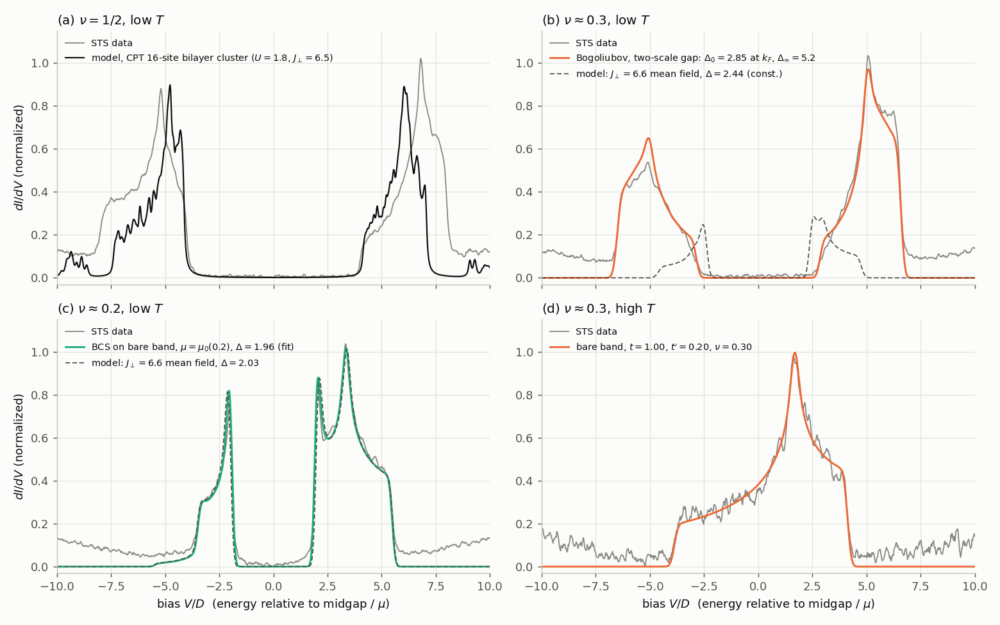
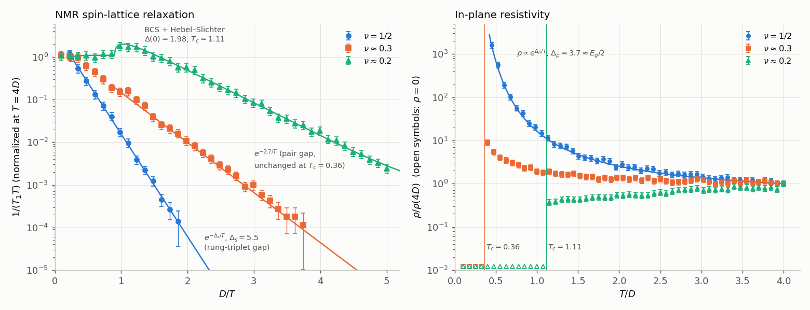
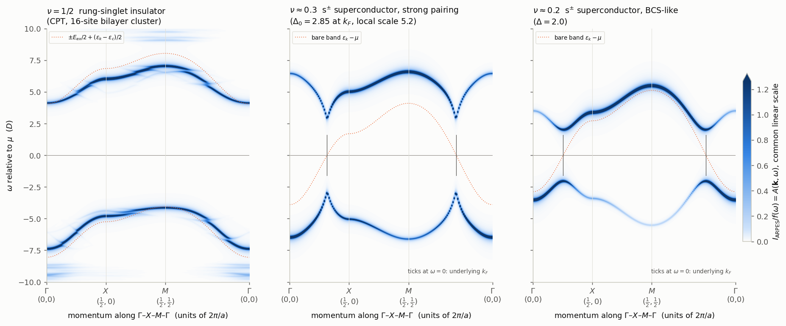
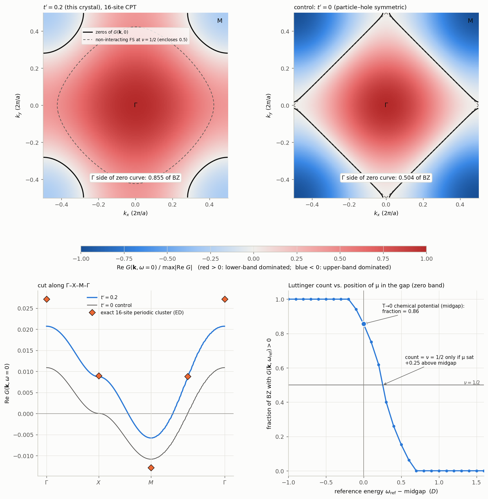

# Low-temperature state at half filling of a layered oxide built from perovskite-type blocks

All energies and temperatures are in units of D (k_B = 1); momenta are in units of 2π/a, where a is the
in-plane metal–metal distance. Figures are in `figures/`, code and raw numerical output in `analysis/`
(see §10 for the map of files).

---------------------------------------------------------------------------------------------------

## 0. Answers in brief

| Task | Answer |
|---|---|
| **State at ν = 1/2** | A **featureless, interaction-driven insulator of interlayer spin singlets** (a "rung-singlet" Mott insulator). Every vertical TM–TM pair of a perovskite **bilayer** block holds one spin singlet. Nothing is broken: no charge order, no magnetic order, no superconductivity, no doubled cell, no topological order, and the ground state is unique. Spin gap Δ_s ≈ 5.5 from NMR (the rung singlet→triplet gap; model: 4.7–5.0). Single-particle gap E_g = 7.9. Transport gap E_g/2 ≈ 3.7–4.0. |
| **1. Effective theory** | A one-orbital **bilayer Hubbard–Heisenberg model** on the bilayer square lattice, with one rung (2 TM sites) per primitive cell: H = −t Σ c†c (nn, in plane) − t′ Σ c†c (nnn, in plane) − t⊥ Σ c†c (rung) + U Σ n↑n↓ + J⊥ Σ (S₁·S₂ − n₁n₂/4) − μN. Values: **t = 1.00 ± 0.02**, **t′ = +0.20 ± 0.02**, **\|t⊥\| < 0.2**, **U = 1.4 ± 0.8**, **J⊥ = 6.6 ± 0.5**. It conserves charge (separately per layer when t⊥ = 0), SU(2) spin, time reversal, translations and D4h. It lacks particle–hole symmetry (t′), the η-pseudospin SU(2), and any Lieb–Schultz–Mattis obstruction (two electrons per cell at ν = 1/2). |
| **2. Phase diagram** | Band insulators at ν = 0, 1. Interlayer s± superconducting domes on both sides of ν = 1/2, with T_c bounded by the mean-field pairing scale T_MF(ν) and driven to zero at ν = 1/2. There the rung pairs fill every rung and localize, giving the rung-singlet insulator. A preformed-pair (pseudogap) regime lies between T_c and T*, and a normal metal above. Low → high T: **ν = 1/2**: rung-singlet insulator → (T ≳ 5) correlated paramagnet / bad metal. **ν ≈ 0.3**: s± superconductor (T < 0.36) → preformed rung pairs, pseudogap, insulating-like (0.36 < T < 2.5–3) → normal metal. **ν ≈ 0.2**: BCS-like s± superconductor (T < 1.11) → normal Fermi-liquid metal. |
| **3. Data explained** | See the table in §5: every feature maps onto one ingredient of the model. |
| **4. ARPES** | **ν = 1/2:** two rigidly translated, half-width bands (ε_k/2 ± E_ex/2); indirect gap from M (top of the lower band, −4) to Γ (bottom of the upper band, +4); no replica bands. **ν ≈ 0.3:** Bogoliubov back-bending at k_F with Δ ≈ 2.9, plus a second, local pairing scale ≈ 5.2 away from k_F. **ν ≈ 0.2:** sharp BCS Bogoliubov bands with Δ ≈ 2.0 on the bare band. |
| **5. Zeros of G at ω = 0, ν = 1/2** | A small **closed curve around M = (½,½)**. The side containing Γ covers **0.85 ± 0.03 of the Brillouin zone** (16-site CPT: 0.855; 8 → 12 → 16 sites: 0.914 → 0.871 → 0.855), compared with ν = 0.5, so Luttinger's theorem written with zeros fails. The cause is particle–hole asymmetry (t′ ≠ 0): the zeros form a narrow band centred about 0.25 above the midgap chemical potential (2t′ at first order), so μ cuts it only near M. Control calculation: with t′ = 0 the same method gives exactly 0.50. |

---------------------------------------------------------------------------------------------------

## 1. What the measurements say before any model is chosen

### 1.1 Band structure (STS, Fig. 1(d), high T)

A least-squares fit of panel (d) to the density of states of
ε_k = −2t(cos k_x + cos k_y) − 4t′ cos k_x cos k_y, with filling ν, a Gaussian resolution and a smooth
background, gives:

* **t = 1.000 ± 0.004 (stat.) ± 0.02 (syst.)**, i.e. D is the nearest-neighbour hopping
* **t′ = 0.195 ± 0.002 (stat.) ± 0.02 (syst.)**
* **ν = 0.300 ± 0.001**

The band edges (−4.0, +4.2 relative to μ) and the van Hove peak at +1.75 are reproduced to within 0.05. t′ > 0 in
this sign convention puts the van Hove singularity above the band centre and the band bottom at Γ. There
is no second van Hove peak, which bounds a bonding–antibonding splitting at 2|t⊥| ≲ 0.3.

### 1.2 The half-filled crystal

1. **Hubbard-like split bands.** The two bands in Fig. 1(a) are *rigid translates* of each other. Their
   overlap after a shift of 12.1 ± 0.1 is 0.976; the overlap of the mirror image is only 0.70. Each band is
   4.0 wide, i.e. half the bare bandwidth 8t. A superconducting gap would make the spectrum mirror-symmetric
   about μ (Bogoliubov poles at ±E_k), so this is **not** a pairing gap of a condensate.
2. **Spectral weights.** The weight below the gap is 0.50 (= ν). The lower band is weighted toward its bottom
   (states near Γ) and the upper band toward its top (states near M). The ratio follows
   Z∓ = ½ ∓ ε_k/(2E_ex) with E_ex ≈ 12, the strong-coupling (Hubbard-I-type) form.
3. **Gaps.** The single-particle gap is E_g = 7.9 ± 0.1 (edges at ±3.95). The resistivity is activated with
   Δ_ρ = 3.72 ± 0.05 ≈ E_g/2, as for an intrinsic semiconductor with μ at midgap.
4. **Spin gap.** 1/(T₁T) falls by five decades between T = 4.4 and 0.45. It is a pure exponential with
   Δ_s = 5.5 ± 0.5 (a free power-law prefactor T^p fits to p = −0.04 ± 0.38). The STS density of states alone
   would give an activation of only 3.75 (Korringa estimate from Fig. 1(a)). **Spin excitations therefore cost
   more than the thermal charge carriers**: Δ_s = 5.5 > Δ_ρ = 3.7, with Δ_s < E_g = 7.9.
5. **No broken symmetry.** There are no new or split diffraction peaks, all TM sites are equivalent, the TM NMR
   line is single, and STS is the same everywhere.

**Lieb–Schultz–Mattis (LSM) constraint.** At ν = 1/2 each TM carries one electron. If the primitive cell
contained one TM, the LSM–Oshikawa–Hastings theorem would forbid a unique, gapped, fully symmetric ground state.
The only way out would be topological order, with gaps bounded by the exchange scale (≈ 4t²/U ≈ 0.3), far below
the measured 5.5 and 3.7. The data therefore require **an even number of electrons per primitive cell**, i.e. two
crystallographically equivalent TM sites per cell. This is exactly what a perovskite **bilayer** block provides
(two TMO₂ planes sharing apical oxygens, related by a mirror plane). It is compatible with every structural
statement: in-plane period a, all TM equivalent, one NMR line.

### 1.3 The doped crystals

* **ν ≈ 0.2.** Panel (c) is BCS on the bare band: **Δ = 1.964 ± 0.002**, with μ equal to the normal-state value
  μ₀(0.2) = −1.92 (fit −1.922 ± 0.004), so the underlying Fermi surface encloses exactly ν. The NMR shows a
  Hebel–Slichter peak (1.7× the normal value at T ≈ 0.8–1.0) and is fitted by BCS with Δ(0) = 1.98 and
  **T_c = 1.11** (2Δ/T_c = 3.6). The resistivity is metallic and vanishes below T_c = 1.11 ± 0.04. Pairing is
  s-wave-like (full gap, coherence peak) and weak-coupling.
* **ν ≈ 0.3.** There is a hard gap, but no single BCS gap fits (rms 0.16). Panel (b) needs an energy-dependent
  gap: **Δ₀ = 2.85 ± 0.02** at the Fermi surface, rising to **Δ_∞ = 5.23** for |ξ_k| ≳ 1 (rms 0.034). That
  second scale matches the half-filled spin gap. The NMR gap is 2.7 ± 0.1 both above and below
  **T_c = 0.36 ± 0.04** and opens at T* ≈ 2.5–3. The normal state is insulating-like (ρ ∝ e^{0.9/T}).
  This is a strongly paired superconductor with preformed pairs, where T_c ≪ Δ.
* **Trend toward ν = 1/2.** The gap grows (1.96 → 2.85 → 3.95), T_c falls (1.11 → 0.36 → 0) and coherence is
  lost. This is the doping evolution of a Mott insulator, here one of *pairs*.

---------------------------------------------------------------------------------------------------

## 2. Why the standard single-layer models fail (and the bilayer does not)

| Candidate | Fatal problem (quantified) |
|---|---|
| Repulsive one-layer Hubbard, U ≈ 12 | Local moments with J = 4t²/U ≈ 0.33: 1/T₁ would be roughly constant (1/T₁T rising) for T ≫ J, against the observed five-decade activated drop. A spin gap of 5.5 ≫ J is impossible. It also gives d-wave nodal pairing, not a full gap with a Hebel–Slichter peak. |
| Attractive one-layer Hubbard, U ≈ −12 (fixes Fig. 1(a) and Δ_s ≈ \|U\|/2) | (i) **Exact diagonalization** (10, 16, 20-site clusters) gives single-particle gaps of 3.4–3.6 at ν ≈ 0.2 and 3.7–4.0 at ν ≈ 0.3, versus 1.96 and 2.85 measured. The gap decreases toward the two-body value E_b/2 = 2.06 only as ν → 0 (2.5–2.6 for a single pair on 16–20 sites). (ii) Spin and charge excitations are the same quasiparticles, so it cannot give Δ_s > Δ_ρ. (iii) Pairs hop with J ≈ 4t²/\|U\| ≈ 0.33 and would conduct for T ≫ J, so ρ(0.45)/ρ(4) ≈ 1, not 1600. (iv) At fixed U, lower density is *more* BEC-like, the opposite of the trend. (v) The high-T spectrum at ν = 0.3 would carry Hubbard satellites holding 30% of the weight; they are absent in Fig. 1(d). |
| One layer, topological spin liquid | Allowed by LSM, but its gaps are bounded by ~J ≈ 0.3, not 5.5. |
| **Bilayer, strong interlayer singlet coupling J⊥, small U, t⊥ ≈ 0** | Explains every item quantitatively (§5). It is LSM-allowed: two electrons per primitive cell at ν = 1/2. |



*Fig. 6.* (a) Single-particle half-gap versus filling. The attractive single-layer model (ED on 10, 16 and 20
sites) stays near 3.4–4.2 at every filling. The bilayer model gives 2.45, 2.70 and 4.10 at ν = 0.19, 0.31, 0.5
(ED), and its J⊥ mean field gives 1.98 at ν = 0.2. Measured: 1.96, 2.6–2.85, 3.95. (b) At ν = ½ only the bilayer
reproduces the ordering *spin gap > thermal charge gap* seen in NMR versus resistivity.

---------------------------------------------------------------------------------------------------

## 3. Task 1 — the effective theory

**Degrees of freedom.** Spin-½ electrons in the single active orbital of each TM. This is a d_{x²−y²}-like
orbital σ-bonded to the in-plane oxygens. Its O admixture is what makes the hopping range reach t′, and its
apical-O / d_{z²} admixture is what transmits the interlayer exchange. Each site has four states: empty, ↑, ↓
and doubly occupied.

**Lattice and unit cell.** The bilayer square lattice. A site is labelled (i, l): i runs over an in-plane square
lattice with constant a, and l = 1, 2 labels the two planes of one perovskite block. The primitive cell is one
**rung**, i.e. the two TM sites stacked along c, related by the mirror plane between the layers. The Brillouin
zone is the in-plane square zone. ν = 1/2 means two electrons per primitive cell.

**Hamiltonian** (every term):

```
H = − t   Σ_{⟨ij⟩, l, σ}  ( c†_{ilσ} c_{jlσ} + h.c. )          in-plane nearest-neighbour hopping
    − t′  Σ_{⟨⟨ij⟩⟩, l, σ} ( c†_{ilσ} c_{jlσ} + h.c. )          in-plane next-nearest-neighbour hopping
    − t⊥  Σ_{i, σ}         ( c†_{i1σ} c_{i2σ} + h.c. )          interlayer (rung) hopping
    + U   Σ_{i, l}          n_{il↑} n_{il↓}                     on-site Coulomb repulsion
    + J⊥  Σ_i              ( S_{i1}·S_{i2} − ¼ n_{i1} n_{i2} )  interlayer (rung) singlet exchange
    − μ   Σ_{i, l}          n_{il}                              chemical potential (sets ν)
```

so that ε_k = −2t(cos k_x + cos k_y) − 4t′ cos k_x cos k_y (k in units of 1/a) within each layer.

**Coefficients and how they were determined.**

| Coefficient | Value | Uncertainty | Determined from |
|---|---|---|---|
| t | 1.00 | ± 0.02 | fit of the high-T STS (d): band edges and van Hove peak; consistent with (a) and (c) |
| t′ | +0.20 | ± 0.02 | same fit (van Hove peak 1.75 above μ, asymmetric band edges); χ² profile minimum at 0.20 |
| t⊥ | 0 | \|t⊥\| < 0.2 | no bonding–antibonding splitting of the van Hove peak in (d), resolution 0.14 |
| J⊥ | 6.6 | ± 0.5 | (i) half-filled NMR spin gap 5.5 ± 0.5 = triplon gap ≈ J⊥ − (1.4 to 1.8) (ED, 16-site bilayer) → J⊥ = 7.1 ± 0.6; (ii) BCS gap at ν ≈ 0.2: Δ = 1.96 requires J⊥ = 6.5 in mean field; (iii) T_c(0.2) = 1.11 = T_MF requires J⊥ = 6.45; (iv) ED doped gaps prefer 5.5–6.5. Weighted combination. |
| U | 1.4 | ± 0.8 | half-filled single-particle gap: E_g/2 = 3.95 = U/2 + 3J⊥/4 − (1.69 ± 0.03), the last term from band broadening (ED); uncertainty dominated by J⊥. The splitting between Hubbard-band centres, 12.1 ≈ U + 3J⊥/2 + O(t²), and the bare band at ν ≤ 0.3 (Fig. 1(c,d)), which requires U ≲ W/2, are consistent. |
| μ | sets ν | — | μ(ν) |

Exact diagonalization of the final parameter set (U = 1.8, J⊥ = 6.5) on the 16-site bilayer gives
a single-particle half-gap of **4.10** (data 3.95) and a spin gap of **4.72** (data 5.5 ± 0.5). The pair stiffness from twisted boundary conditions is D = 1.06 per rung at ν = 0.19, 0.74 at ν = 0.31 and 0.02 at ν = ½, i.e. 75%, 42% and 1% of the free-electron value. The other runs give (half-gap / spin gap): (U, J⊥) = (3.85, 5.5): 4.33 / 4.13; (3.0, 5.5): 3.96 / 3.97; (1.4, 6.9): 4.18 / 5.02. At fixed charge gap the spin gap rises with J⊥ and reaches the NMR value 5.5 at J⊥ ≈ 7.5, where the doped gaps and T_c(0.2) would come out ≈ 15% too high. J⊥ = 6.6 ± 0.5 balances these constraints.

*Stability of the half-filled state.* The in-plane superexchange through the rung-singlet background is
J_∥ ≈ 4t²/E_ex ≈ 0.35, so J⊥/J_∥ ≈ 19. That lies far inside the rung-singlet (quantum-disordered) phase of the
bilayer Heisenberg model, whose critical ratio is 2.52, so no in-plane antiferromagnetism develops. A
charge-density wave would have to break rung singlets (cost ≈ J⊥ per rung), so none develops either. At exactly
ν = ½ every rung holds one pair, which cannot move without creating an empty and a doubly occupied rung (cost
2U + J⊥ in the atomic limit), so there is no superconductivity.

**Symmetries the model has**

* U(1) charge. For t⊥ = 0 the charge of *each layer* is separately conserved, an extra U(1).
* SU(2) spin rotation (no spin–orbit term).
* Time reversal.
* Translations of the square lattice (one rung per cell).
* The full point group D4h of a perovskite bilayer: C₄ about c, vertical mirrors, the horizontal mirror σ_h
  exchanging the layers, and inversion through the rung centre.

**Symmetries the model lacks**

* **Particle–hole symmetry.** t′ ≠ 0, while the U and J⊥ terms are particle–hole symmetric only up to a shift
  of μ. Consequences: the van Hove peak lies above mid-band; the half-filled spectrum is not mirror-symmetric
  about its centre; the Green's-function zero is not pinned to μ (Task 5); and the phase diagram is asymmetric
  about ν = ½.
* **η-pseudospin (charge) SU(2)**, broken by t′ and by the density part of the J⊥ term. Charge order and pairing are not degenerate.
* **An LSM obstruction.** Two electrons per cell at ν = ½ permit a unique gapped symmetric ground state. This is
  why the half-filled insulator can be featureless *without* topological order.
* **Interlayer band coherence.** t⊥ ≈ 0, so there is no bonding–antibonding splitting.
* No spin–orbit coupling, no disorder, and no term that doubles the cell.

---------------------------------------------------------------------------------------------------

## 4. Task 2 — phase diagram



**How it was obtained** (approximations stated):

* **T_MF(ν):** BCS mean-field onset of interlayer singlet pairing driven by J⊥ (gap equation
  1 = J⊥ N⁻¹Σ_k tanh(E_k/2T)/2E_k at fixed ν, 256×256 k-grid). It is a broad dome peaking at ν ≈ 0.5–0.55,
  near the van Hove filling, and is an *upper bound* for T_c.
* **Rung-singlet regime near ν = ½:** the local singlet–triplet splitting (ED spin gap ≈ 5) sets a
  crossover T_s ≈ Δ_s/ln 3 ≈ 5 below which every rung is a singlet. At exactly ν = ½ the pairs fill all rungs,
  their motion is blocked, the pair stiffness collapses (ED, twisted boundaries: its coherent fraction D/D_free falls from 0.75 at ν = 0.19 to 0.42 at ν = 0.31 and to 0.013 at ν = ½, where D = 0.02 per rung), and the state
  is the rung-singlet insulator.
* **T_c(ν):** T_c = T_MF(ν) · min[1, (Z(ν)/Z(0.2))^p], with Z = D/D_free the coherent fraction of the pair
  stiffness from ED (0.75 at ν = 0.19, 0.42 at ν = 0.31, 0.013 at ν = ½). The single exponent
  p = 2.8 is fixed by the measured T_c(0.3) = 0.36; T_c(0.2) = T_MF = 1.13 then follows. This is an
  interpolation, not a calculation of T_c. A strictly 2D model would cap T_c at T_KT ≲ 0.3; the measured,
  mean-field-like T_c implies coupling between bilayers. T_c → 0 for ν → 0 (dilute BCS) and ν → ½ (Mott
  localization of rung pairs). The ν > ½ side follows from the particle–hole transform (ν → 1−ν, t′ → −t′),
  which T_MF includes; Z is mirrored.
* The crossover line T* and the precise dome shape between the measured points are **schematic**. The
  computed objects are T_MF, the rung-singlet scale, and the vanishing stiffness at ν = ½.

**Phases of each crystal, from low to high temperature**

| Crystal | Phases |
|---|---|
| ν = 1/2 | rung-singlet insulator (no broken symmetry; gaps Δ_s ≈ 5.5, E_g ≈ 7.9) up to T_s ≈ 5 → crossover to a correlated paramagnetic bad metal / semiconductor |
| ν ≈ 0.3 | interlayer s± superconductor (T < 0.36) → preformed rung pairs: pseudogap, spin gap 2.7, insulating-like ρ (0.36 < T < T* ≈ 2.5–3) → normal metal (T ≳ 3) |
| ν ≈ 0.2 | interlayer s± superconductor, BCS-like (T < 1.11) → normal Fermi-liquid metal (T > 1.11; T* = T_c) |

---------------------------------------------------------------------------------------------------

## 5. Task 3 — how the theory produces each set of measurements




| Measurement | Observation | Feature of the theory that produces it |
|---|---|---|
| **Diffraction** | period a, all TM equivalent, no new or split peaks down to the lowest T | The ν = ½ ground state is a product of rung singlets (dressed by virtual hopping). It is unique and invariant under all lattice symmetries, so no superlattice is needed. With two TM per cell the gap needs no symmetry breaking (LSM satisfied). Pairs on the doped side are interlayer, uniform and s-wave. |
| **NMR line** | single TM line | Both TM of a rung are equivalent by σ_h. There are no ordered moments (singlets) and no charge disproportionation. |
| **STS (a), ν = ½** | hard gap 7.9; two bands 4.0 wide, rigidly shifted by 12.1; weight 0.50 below | Removing an electron leaves a singly occupied rung (cost ≈ J⊥). Adding one makes a three-electron rung (cost ≈ U + J⊥/2). Both excitations hop through the singlet background with amplitude t/2 (the overlap of a moved electron with a rung singlet). This gives E_±(k) ≈ ±E_ex/2 + ε_k/2, bands of width W/2 and weights ½ ∓ ε_k/(2E_ex). Here E_ex = U + 3J⊥/2 ≈ 11.3, plus ≈ 0.6 of second-order level repulsion, which reproduces the measured splitting 12.1. The gap is E_ex − 3.4 ≈ 7.9 (ED on 16 sites: 8.2). CPT reproduces positions and edges (Fig. 1(a)). |
| **STS (b), ν ≈ 0.3** | gap 2.6–2.85 at E_F; peaks at ±5.1, edges at ±6.5 | Doping makes rung pairs mobile and they condense. Near k_F the coherent Bogoliubov gap is Δ₀ ≈ 2.85 (mean field: 2.4–2.65). Far from k_F the states still feel the *local* rung-singlet binding ≈ 5.2. The result is a two-scale gap Δ(ξ). |
| **STS (c), ν ≈ 0.2** | BCS: Δ = 1.96, coherence peaks, bare band | Weak-coupling interlayer s± BCS state on the bare band: Δ = 1.98 for J⊥ = 6.5, with the underlying Fermi surface enclosing ν. U is small, so the band is unrenormalized. |
| **STS (d), ν ≈ 0.3, high T** | bare t-t′ band, ν = 0.30 | Above all pairing scales the model is a weakly correlated metal (U ≲ W/2, t⊥ ≈ 0): one band per layer, no Hubbard satellites. |
| **NMR ν = ½** | activated, Δ_s = 5.5 | The rung singlet → triplet gap J⊥ − (triplon dispersion): 4.7 for (U, J⊥) = (1.8, 6.5), 1.5σ below the measured 5.5 ± 0.5. Thermal triplons relax the nucleus. Spin and charge gaps are distinct objects here (singlet–triplet vs. single-particle), which is why Δ_s ≠ Δ_ρ. |
| **NMR ν ≈ 0.3** | activated, 2.7, unchanged across T_c, onset at T* ≈ 2.5–3 | Preformed rung pairs. The quasiparticle gap opens at T*, and phase coherence at T_c changes nothing local, hence no coherence peak. |
| **NMR ν ≈ 0.2** | constant (Korringa) above T_c, Hebel–Slichter peak, then e^{−Δ/T} | Weak-coupling BCS: pairs form at T_c and the gap is full and s-wave in each layer. The BCS density of states N_s(E) diverges at the gap edge and produces the peak; fit Δ(0) = 1.98, T_c = 1.11. |
| **Resistivity ν = ½** | ρ ∝ e^{3.7/T} | Intrinsic semiconductor: carriers are thermally created holon/doublon rungs across E_g (activation E_g/2). Pairs cannot move because every rung is occupied by one, i.e. a Mott insulator of pairs. |
| **Resistivity ν ≈ 0.3** | rises 9× on cooling, then drops to 0 at 0.36 | Fermionic carriers are gapped by the pseudogap, while the preformed pairs are slow (near pair-Mott localization). Global phase coherence sets in at T_c = 0.36 ≪ T_MF. |
| **Resistivity ν ≈ 0.2** | metallic, zero below 1.11 | BCS: T_c = T_MF = Δ/1.76. |

---------------------------------------------------------------------------------------------------

## 6. Task 4 — predicted ARPES intensity (after division by the Fermi function)



The intensity divided by the Fermi function is the spectral function A(k, ω) of the top layer. With t⊥ = 0 it is
also the spectral function of every layer. It is plotted along Γ(0,0) → X(½,0) → M(½,½) → Γ in the window
ω ∈ [−10, 10] relative to μ. This window contains both Hubbard bands at ν = ½ and the full Bogoliubov spectra of
the doped crystals. One linear colour scale is shared by the three panels.

What can actually be measured: dividing by f(ω) restores the unoccupied side only up to a few k_BT above μ. At
low T the occupied branches are directly measurable: the lower Hubbard band at ν = ½, and the v_k²-weighted
Bogoliubov branch with its back-bending at k_F in the superconductors. The upper branches shown above μ are what
the divided intensity converges to as the thermal population grows. They are equally fixed by the theory, but
reaching them needs higher T or an inverse-photoemission or pump–probe measurement.

* ν = ½: CPT of the model on a 16-site (4×2×2, orientation-averaged) bilayer cluster at (U, J⊥) = (1.8, 6.5) (§8).
* ν ≈ 0.3 and 0.2: the coherent superconducting state in Bogoliubov form,
  A = u_k² δ(ω − E_k) + v_k² δ(ω + E_k), E_k = (ξ_k² + Δ_k²)^{1/2}, ξ_k = ε_k − μ₀(ν), with Lorentzian width
  0.06. μ is held at the normal-state value μ₀(ν) found in the STS fit of (c), so the underlying Fermi surface
  encloses ν.
  * ν ≈ 0.2: Δ = 2.03, the J⊥ = 6.6 mean-field value (STS: 1.96).
  * ν ≈ 0.3: two-scale gap Δ(ξ) = Δ_∞ − (Δ_∞ − Δ₀)e^{−|ξ|/w}, with Δ₀ = 2.85 (coherent gap at k_F), Δ_∞ = 5.23
    (local rung-pair scale, cf. the half-filled spin gap) and w = 1.08. The magnitudes are fixed by STS (b);
    the J⊥ mean field alone gives Δ = 2.44 and misses Δ_∞.
  * Strong-coupling cross-check: CPT on 16-site doped bilayer clusters gives half-gaps 1.6 (ν = 0.19) and 2.1
    (ν = 0.31). Periodic-cluster ED gives 2.4 and 2.7. These bracket the measured 1.96 and 2.6–2.85, but the
    finite-cluster CPT does not resolve the high-energy structure of (b).

**Features of physical significance**

| Filling | Feature | What it implies |
|---|---|---|
| ν = ½ | Full gap at every k. The lower band peaks at M (−4); the upper band bottoms at Γ (+4); indirect gap 7.9. | An insulator whose gap is not set at a Fermi surface. The gap is local (rung-singlet binding), not a nesting or pairing gap. |
| ν = ½ | Each band is a copy of the bare band at half width (ε_k/2), and the two copies are *translated*, not mirrored. | Strong correlation: carriers move through singlets with amplitude t/2. No particle–hole (Bogoliubov) mixing, so no condensate. |
| ν = ½ | No replica (shadow) bands folded by (½,½). | No doubled cell. Confirms no CDW or antiferromagnetism, consistent with diffraction and NMR. |
| ν = ½ | No bonding–antibonding splitting. | t⊥ ≈ 0: the interlayer coupling is pure exchange, not hopping. |
| ν = ½ | Weight moves from the lower band (near Γ) to the upper band (near M). | Weights ½ ∓ ε_k/(2E_ex). The zeros of G (Luttinger surface, Task 5) sit where the two weighted contributions balance. |
| ν ≈ 0.3 | Bogoliubov back-bending at the underlying k_F (minimum-gap locus). The gap is nodeless and the same in every direction. | A fully gapped s-wave (interlayer s±) condensate. The minimum-gap locus is the underlying Fermi surface, enclosing ν (Luttinger satisfied in the SC state). |
| ν ≈ 0.3 | Large gap (≈ 2.9) at k_F and a second scale ≈ 5.2 for states away from k_F (bands pushed out to ±5.1 … ±6.5). | Strong pairing with preformed local (rung) pairs, close to the half-filled pair-Mott insulator; low coherence, hence T_c ≪ Δ. |
| ν ≈ 0.2 | Sharp Bogoliubov bands, Δ ≈ 2.0, full bare dispersion away from k_F. | Weak-coupling BCS on an essentially unrenormalized band, with T_c = Δ/1.76. |
| Across ν | From 0.2 to 0.3 to ½ the gap grows (2.0 → 2.9 → 4.0 half-gap), the dispersion away from k_F narrows toward ε_k/2, and back-bending (particle–hole mixing) is replaced by rigidly shifted bands. | The evolution from a BCS superconductor, through a strongly paired condensate, to a Mott insulator of local pairs. The three panels are one crossover tuned by filling. |

---------------------------------------------------------------------------------------------------

## 7. Task 5 — Green's-function zeros at ν = ½ and the Luttinger count



**Procedure.**

1. Take the predicted A(k, ω) at ν = ½ (CPT) on a 48×48 k-grid and an ω-grid with step 0.005 over [−16, 16]
   (width 0.02).
2. Measure ω from the T → 0 chemical potential at midgap (the band edges are determined from the spectrum
   itself).
3. Reconstruct the real part by Kramers–Kronig: Re G(k, 0) = −P∫dω′ A(k, ω′)/ω′. Since A vanishes in the gap
   this is regular.
4. The spectral sum rule is 0.9988, the rest lying in tails outside the window.
5. The KK result agrees with G(k, 0) evaluated directly from the same Green's function. The zero contour is
   then traced on a 241×241 grid.

**Result.** Re G(k, 0) > 0 over most of the zone, i.e. the lower band dominates. It changes sign on a **small
closed curve around M = (½, ½)**.

| Cluster used for the prediction | fraction of BZ on the Γ side of the zero curve |
|---|---|
| 8-site bilayer (2×2×2) | 0.914 |
| 12-site bilayer (3×2×2, orientation-averaged) | 0.871 |
| 16-site bilayer (4×2×2, orientation-averaged) | **0.855** (KK on 48² grid: 0.856) |
| control, t′ = 0, 8-site | 0.504 (= ½ within grid resolution) |
| parameter sensitivity, 12-site: (U, J⊥) = (1.0, 7.1) / (2.2, 6.1) | 0.870 / 0.861 |
| parameter sensitivity, 12-site: t′ = 0.18 / 0.22 | 0.848 / 0.895 |

**Independent check without CPT.** The exact Green's function of the periodic 16-site bilayer cluster (ED), at
its own midgap, gives G(K, 0) = +0.027 (Γ), +0.009 (X), +0.009 ((¼,¼)) and **−0.013 (M)**. Its band weights also
follow the strong-coupling form ½ ∓ ε_K/(2E_ex), with hole weights 0.725, 0.465, 0.502 and 0.337. The sign
structure, positive on the Γ side and negative at M, is exactly that of the CPT zero surface (Fig. 5(c),
diamonds). The larger |G(M)| in the exact cluster (−0.013, against −0.006 in the 16-site CPT) suggests the M-pocket is, if
anything, somewhat larger than CPT gives. That is consistent with the slow decrease of the Γ-side fraction with
cluster size.

**Comparison with ν.** The fraction, **0.85 ± 0.03**, is far from ν = 0.5. The quoted value is the 16-site result, extrapolated using the converging cluster sequence (≈ 0.85). The uncertainty combines the cluster-size trend (±0.01), t′ = 0.20 ± 0.02 (±0.024) and (U, J⊥) (±0.01). Luttinger's theorem in its
Green's-function form (Σ_k θ[G(k,0)] = ν) fails for this insulator.

*Why.* To first order in t/E_ex the model gives G(k, ω) ∝ (ω − ω_z)/[(ω − E₊(k))(ω − E₋(k))]. Its zero ω_z
is k-independent and sits at the centre of the atomic levels. The midgap chemical potential is displaced from it
by half the band-centre offset, −ε_c/2 = 2t′ = 0.4, because t′ makes the bare band asymmetric (ε_max + ε_min =
−8t′). At ω = μ, G therefore has the same sign almost everywhere. Only the k-dependent (inter-site) part of the
self-energy, which CPT captures, bends the zero surface down through μ near M, where the upper band is heaviest.
With t′ = 0, particle–hole symmetry pins the zero surface to ε_k = 0, enclosing exactly ½ (confirmed
numerically). The count depends on where μ sits in the gap, as noted by Rosch (2007) and Dave–Phillips–Kane
(2013). So the Luttinger volume of zeros is not protected in a Mott insulator without particle–hole symmetry, in
contrast to the doped superconductors, whose minimum-gap (underlying) Fermi surface encloses ν.

**The zero band** (Fig. 5(d)). Scanning the reference energy through the gap shows where the zeros live. They
form a narrow, weakly dispersing band ω_z(k), running from ≈ −0.15 (at M) to ≈ +0.65 (at Γ) relative to the
midgap. As ω_ref crosses this band, the fraction of the zone with G > 0 sweeps from 1 to 0. The value ν = ½ would
be obtained only if the chemical potential sat ≈ 0.25 above midgap, i.e. at the centre of the zero band. In the
T → 0 limit μ sits at the midgap instead, by the law of mass action for the thermally excited holons and doublons.
That point cuts the zero band only near M, giving 0.855 (16-site cluster; 0.871 for 12 sites). The deviation from ν therefore measures
the mismatch between μ and the zero band. That mismatch is set by t′ (≈ 2t′ at first order, reduced by the
dispersion of ω_z(k)).

---------------------------------------------------------------------------------------------------

## 8. Methods, approximations and system sizes

* **Exact diagonalization (ED).** A matrix-free Lanczos code was written for this problem (numba, Kronecker-sum
  H·v, rung spin-flip terms; `analysis/ed_hubbard.py`, `ed_bilayer.py`). It was verified against free fermions,
  the two-site Hubbard model, and rung-singlet product states.
  * Single-layer attractive Hubbard model: periodic clusters of 10 (√10×√10), 16 (4×4) and 20 (√20×√20) sites.
  * Bilayer model: periodic 16-site cluster (8 rungs, √8×√8), Hilbert-space dimension up to 1.66×10⁸.
  * Quantities: gaps (E(N+1)+E(N−1)−2E(N))/2, spin gaps E(S_z=1)−E(S_z=0), and phase stiffness from twisted
    boundary conditions.
* **Cluster perturbation theory (CPT).** Open bilayer clusters of 8 (2×2×2), 12 (3×2×2) and 16 (4×2×2) sites.
  The cluster Green's function comes from a band (block) Lanczos method, checked against an exact Lehmann sum
  to 10⁻¹³. It is coupled through the in-plane inter-cluster hopping and periodized
  (`analysis/cpt_bilayer.py`, `cpt_analyze.py`). Non-square clusters are orientation-averaged. CPT is exact at
  U = J⊥ = 0, which was checked. The 16-site half-filled cluster (Hilbert space 1.66×10⁸) exceeds the 32 GiB memory of the workstation
  container with an 8-vector block. It was therefore split with the mirror y → 1−y into even/odd 4×4 blocks
  (`analysis/cpt_half16_lean.py`), which reproduces the full block Lanczos to 10⁻⁷ on the 8-site cluster. Doped
  CPT: 16-site clusters with 6 and 10 electrons (ν = 0.1875, 0.3125).
* **Exact cluster Green's function.** G(K, ω) of the periodic 16-site bilayer at its allowed momenta (Γ, X, M,
  (¼,¼)) by Lanczos continued fractions (`analysis/ed_bilayer_gk.py`). This is a CPT-independent check of the
  sign structure of G at midgap.
* **Mean field.** BCS for interlayer singlet pairing driven by J⊥ (`analysis/bcs_bilayer.py`), with a 256×256
  k-grid and density fixed by the number equation.
* **Two-body problem.** Exact pair binding energy of the attractive model on the infinite lattice (1024² k-grid).
* **Data fits.** Weighted least squares. The quoted errors are from the covariance, rescaled by χ²/dof when
  > 1. The NMR error bars in the file are conservative (χ²/dof ≈ 0.15 for good fits).

---------------------------------------------------------------------------------------------------

## 9. Limitations

* A bilayer block is *inferred* (from LSM plus the data), not stated in the problem. It is the most economical
  structure that allows the observed featureless gapped state with the observed (large) spin gap.
* A large J⊥ with t⊥ ≈ 0 requires the interlayer exchange to be transmitted by other orbitals (apical O,
  d_{z²}-like admixture), not by hopping within the active band.
* The transition temperatures of the doped crystals are mean-field-like (T_c(0.2) = T_MF). A strictly 2D model
  would give T_KT ≲ 0.3 at ν = 0.2. The measured T_c therefore implies three-dimensional coupling between
  bilayers, which the in-plane model does not describe. The T_c dome between the measured points is schematic.
* At the representative parameters the model's spin gap (4.7) is about 15% below the NMR value (5.5 ± 0.5). Raising
  J⊥ to fit it would overshoot the doped gaps by a similar amount. Finite clusters also overestimate the doped
  gaps (ED: 2.45 vs 1.96 at ν ≈ 0.2). The finite-cluster CPT of the doped crystals does not resolve the
  high-energy two-scale structure of STS (b), which is therefore taken from the data (§6).
* The size of the M-pocket of zeros (Task 5) depends on the k-dependent self-energy and moves somewhat with
  cluster size (0.914 → 0.871 → 0.855 for 8, 12, 16 sites, converging). The qualitative result (Γ side ≫ ν, a small closed curve
  around M, exactly ½ when t′ = 0) is robust.

---------------------------------------------------------------------------------------------------

## 10. Files

| Path | Content |
|---|---|
| `REPORT.md` | this report |
| `figures/fig1_sts_vs_theory.png` | the four STS panels against the model (CPT at ν = ½; Bogoliubov/BCS for the superconductors; bare band at high T) |
| `figures/fig2_nmr_rho_fits.png` | NMR 1/T₁T and resistivity with the activated / BCS (Hebel–Slichter) descriptions |
| `figures/fig3_phase_diagram.png` | phase diagram (Task 2) |
| `figures/fig4_arpes_predictions.png` | predicted ARPES maps for the three fillings (Task 4) |
| `figures/fig5_zeros.png` | Green's-function zeros and Luttinger count at ν = ½ (Task 5) |
| `figures/fig6_model_selection.png` | gaps vs filling and spin-vs-charge gaps: data vs candidate models (§2) |
| `analysis/ed_hubbard.py`, `analysis/ed_bilayer.py` | exact-diagonalization codes (single layer; bilayer with J⊥) |
| `analysis/cpt_bilayer.py`, `analysis/band_lanczos_fast.py`, `analysis/cpt_analyze.py`, `analysis/cpt_run.py`, `analysis/cpt_half16_lean.py` | cluster perturbation theory (the last: memory-lean 16-site half-filled run) |
| `analysis/ed_bilayer_gk.py`, `analysis/eval_edgk.py` | exact cluster Green's function at the cluster momenta |
| `analysis/kk_zeros.py`, `analysis/frac_vs_mu.py` | Kramers–Kronig reconstruction, zero contours, Luttinger count |
| `analysis/bcs_bilayer.py`, `analysis/tmf_curve.py`, `analysis/sc_arpes.py` | mean-field pairing and superconducting spectra |
| `analysis/ed_stiffness.py` | phase stiffness from twisted boundary conditions |
| `analysis/fit_*.py`, `analysis/fit_activation.py`, `analysis/nmr_*.py` | fits to the measurements |
| `analysis/fig_*.py`, `analysis/vizstyle.py` | figure scripts |
| `analysis/*.log`, `analysis/*.npz`, `analysis/summary_numbers.json` | raw numerical output |
