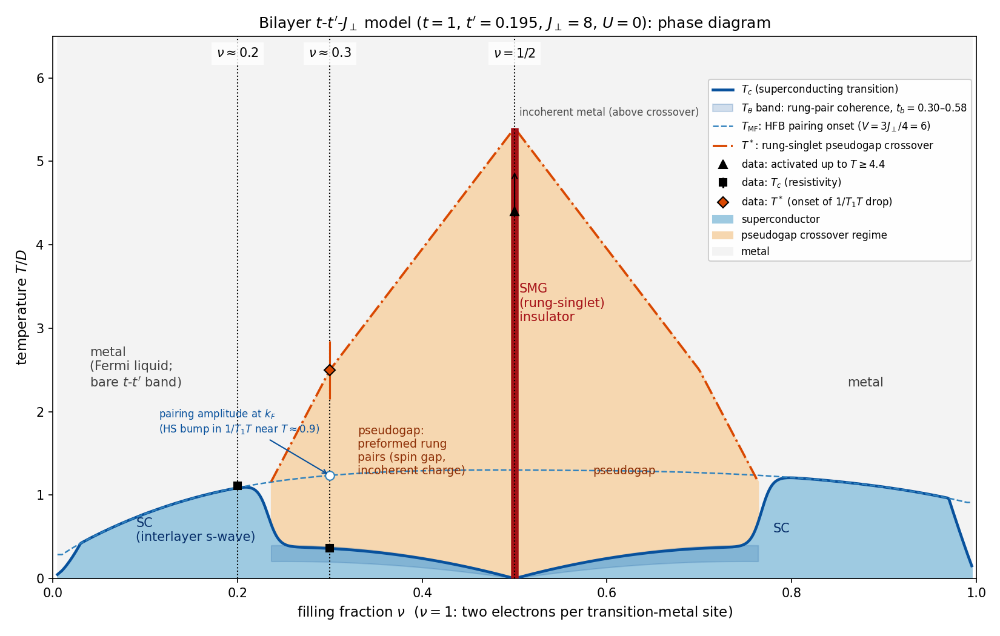
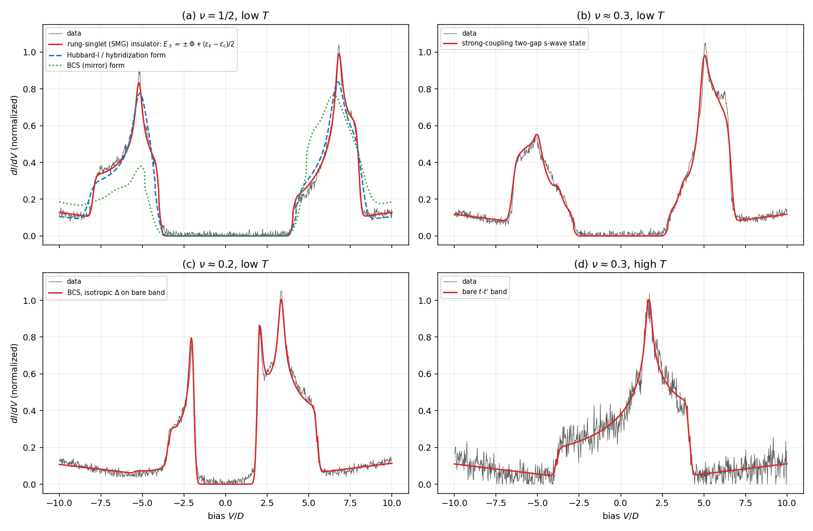
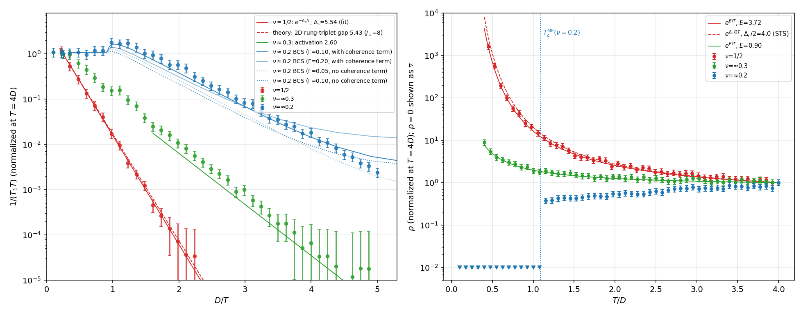
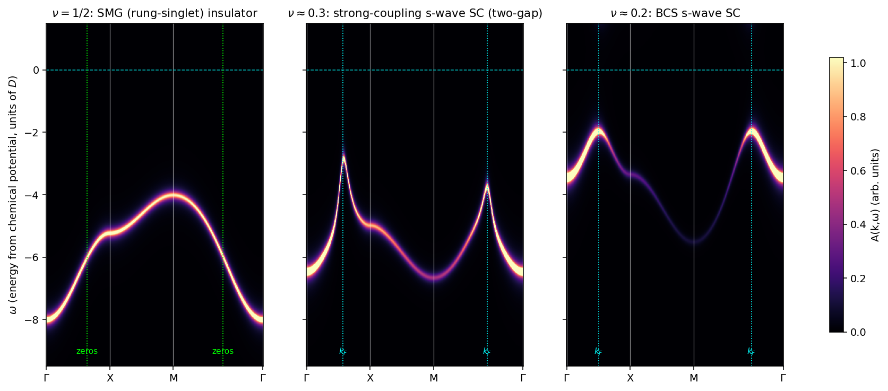
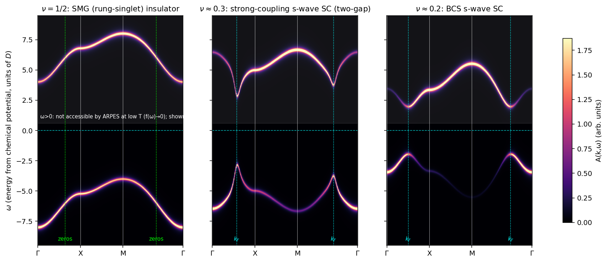
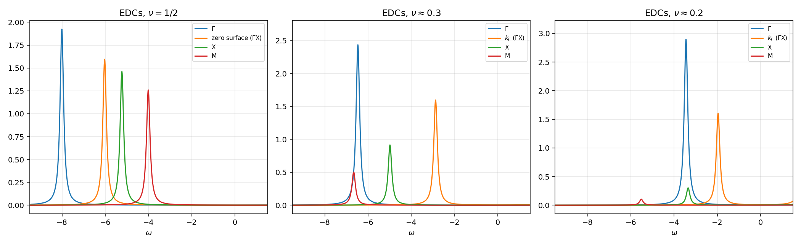
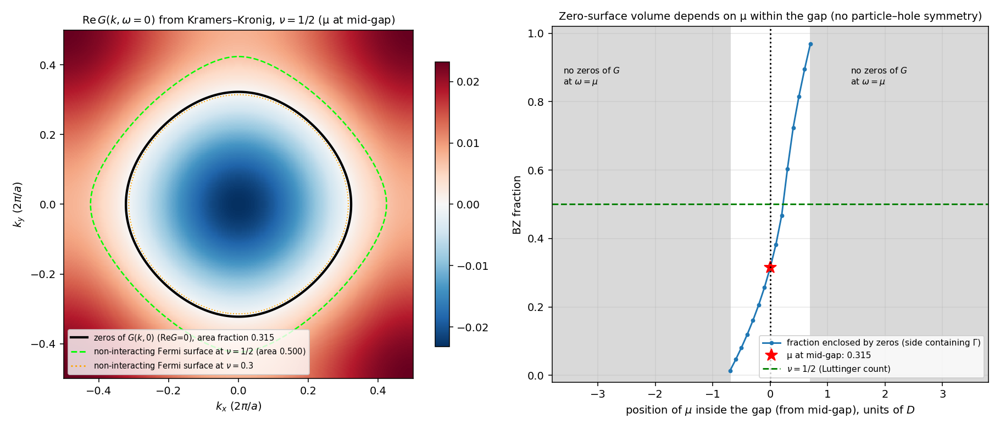

# A layered oxide built from perovskite-type blocks: the low-temperature state at half filling

All energies and temperatures are in units of $D$ ($k_B=1$). Momenta are in units of $2\pi/a$, where $a$ is the in-plane metal–metal distance. Every number below comes from the measurement data in `measurements.json`, fitted with the scripts in `code/`. The numerical results are in `results/*.json` and the figures in `figures/`.

---

## 0. Short answer

* **State of matter at half filling.** The $\nu=1/2$ crystal is a *featureless rung‑singlet insulator*, also called a *symmetric‑mass‑generation (SMG) insulator*. It breaks no symmetry and has no topological order. It has both a charge gap ($2\times4.0$) and a spin gap ($\approx5.5$). Its electron Green's function has a surface of zeros, and that surface does **not** enclose $\nu$ of the Brillouin zone.
* **Effective theory.** Each perovskite block is a **bilayer**: two crystallographically equivalent TM–O planes. The active orbital on each TM site forms a band with in‑plane hoppings $t,t'$. The two TM sites of a rung are coupled by an interlayer Heisenberg exchange $J_\perp$. Interlayer hopping and on‑site $U$ are negligible:
  $$H=-t\!\sum_{\langle ij\rangle l\sigma}\!c^\dagger_{il\sigma}c_{jl\sigma}-t'\!\!\sum_{\langle\langle ij\rangle\rangle l\sigma}\!\!c^\dagger_{il\sigma}c_{jl\sigma}+\mathrm{h.c.}\;+\;J_\perp\sum_i \mathbf S_{i1}\!\cdot\!\mathbf S_{i2},$$
  with $t=1.000\pm0.005$, $t'=0.194\pm0.003$, $J_\perp=7.99\pm0.01\,(\mathrm{stat})\pm0.3\,(\mathrm{syst})$, $U=0.04\pm0.01\ (+0.6\ \mathrm{syst})$, $|t_\perp|<0.1$, $|J_\parallel|<0.1$.
* **Phases from low to high temperature.**
  * $\nu=1/2$: SMG insulator, crossing over above $T\approx5$ to an incoherent metal.
  * $\nu\approx0.3$: interlayer s‑wave superconductor ($T_c\approx0.36$), then a pseudogap regime of preformed rung pairs ($T^*\approx2.5$), then a metal.
  * $\nu\approx0.2$: BCS interlayer s‑wave superconductor ($T_c\approx1.1$), then a Fermi‑liquid metal.
* **Luttinger count (Q5).** The zeros of $G(\mathbf k,0)$ lie on the band‑centre contour $\epsilon_{\mathbf k}=-4t'$. On the side containing $(0,0)$ they enclose **0.315 ± 0.002** of the Brillouin zone, whereas $\nu=0.5$. Luttinger's theorem, in its form that counts zeros, fails because the model has no particle–hole symmetry ($t'\neq0$). With $t'=0$ the fraction would be exactly 0.500.

---

## 1. The effective theory

### 1.1 What the data force (chain of inference)

1. **The high‑$T$ spectrum is a bare band.** The high‑$T$ STS at $\nu\approx0.3$ (Fig. 1d) is exactly the DOS of a single $t$–$t'$ band. Fitted band bottom, top and van Hove peak are at $-3.86,\,+4.13,\,+1.69$ relative to $\mu$. This gives $t=0.999\pm0.004$, $t'=0.1945\pm0.002$ and $\mu=-0.912$. That band filled to $\mu$ holds $\nu=0.299$, so no spectral weight is missing from the window. There is no bonding/antibonding splitting, so $|t_\perp|<0.1$. There is no Hubbard band, so the interactions act only through correlations that disappear at high $T$.
2. **At $\nu=1/2$ the low‑$T$ state is fully gapped and breaks no symmetry.** The evidence:
   * no new or split diffraction peaks;
   * equivalent TM sites;
   * a single NMR line;
   * spatially homogeneous STS;
   * exponentially small $1/T_1T$ and activated $\rho$.

   By the Lieb–Schultz–Mattis–Oshikawa–Hastings theorem, a gapped, symmetric and non‑degenerate state with an *odd* number of electrons per unit cell must be topologically ordered. Two observations make that option implausible. First, the observed spin gap ($\approx5.5$) is far above any superexchange scale available from $t=1$. Second, the coherent spectra described next are not those of a spin liquid. The natural resolution is that the primitive cell contains **two** equivalent TM sites. A bilayer perovskite block has exactly this: two mirror‑related TM sites, consistent with "crystallographically equivalent". Two electrons per cell then permit a trivial insulator.
3. **Panel (a) shows two half‑width, translated copies of the bare band.** The spectrum consists of two bands at $\pm6$. Each band has *half* the bare width ($4.0$), and each has the van Hove peak at the same fractional position (70 %) as the bare band. The bands are therefore translated copies, not mirror images. A fit of $E_\pm=\pm\Phi+s(\epsilon_{\mathbf k}-\epsilon_c)$ gives:
   * $\Phi=6.011\pm0.002$;
   * slope $s=0.497\pm0.001$, i.e. exactly $1/2$;
   * weights $Z_\pm=\tfrac12[1\pm\alpha(\epsilon_{\mathbf k}-\epsilon_c)]$ with $\alpha=0.052$;
   * SSE = 0.32.

   Competing forms fit much worse: Hubbard‑I / hybridization (nonlinear, local self‑energy) SSE = 1.89; BCS / mirror SSE = 16.8 (Fig. 1a).

   Half‑width translated copies are the leading‑order strong‑coupling spectrum of a **product of local two‑site singlets**. Removing (or adding) an electron leaves a single electron (or hole) on a rung. That excitation moves only by exchanging places with a neighbouring singlet. The amplitude is $t\times(1/\sqrt2)^2=t/2$, giving the dispersion $+\epsilon_{\mathbf k}/2$ for both the removal and the addition band. With $J_\perp\mathbf S_1\!\cdot\!\mathbf S_2$ the rung singlet sits at $-3J_\perp/4$, and the one‑ and three‑electron rungs at 0. Hence $\Phi=3J_\perp/4+U/2$.
4. **Panel (c) is an isotropic s‑wave BCS spectrum on the unrenormalized band.** The fit gives $g=0.9994$, $\Delta=1.963\pm0.002$, and $\mu=-1.937$ (normal‑state filling 0.198). In the Hartree–Fock–Bogoliubov (HFB) decoupling of $J_\perp\mathbf S_1\!\cdot\!\mathbf S_2$, the interlayer‑singlet pairing coupling is $V=3J_\perp/4$. Reproducing $\Delta$ requires $V=5.992\pm0.004$, so $J_\perp=7.99$. The same coupling gives $T_c^{\rm MF}=1.084$, inside the resistive window $(1.075,1.15)$, and $2\Delta/T_c=3.62$.
5. **$U$ and the spin gap.** From 3 and 4, $U=2(\Phi-3J_\perp/4)=0.04$. The NMR spin gap at $\nu=1/2$, $\Delta_s=5.54\pm0.14$, is an independent check. Exact diagonalization (ED) of 2‑ and 3‑rung clusters gives the second‑order 2D rung‑triplet (triplon) band. It spans $5.43\ldots8.74$ for $(J_\perp,U)=(8,0)$, and the exact 4‑rung ring agrees with second order to 0.05. The alternative reading $V=J_\perp$, $(J_\perp,U)=(6,3)$, would give $\Delta_s=4.32$, excluded by 8σ.

   A two‑rung cluster ignores the dispersion of the triplon on the lattice. It would give 5.57 for $(6,3)$ and 7.35 for $(8,0)$, the opposite conclusion. The triplon does hop between rungs (band width 3.3), so only the lattice value is physically relevant. This is the step on which the choice between the two parameter sets rests.

### 1.2 Degrees of freedom, lattice, unit cell

* **Degrees of freedom:** spin‑½ electrons $c_{il\sigma}$ in the single active orbital (with admixture from other orbitals) on each TM site. $i$ labels the in‑plane square‑lattice site, $l=1,2$ the two planes of a perovskite bilayer block, and $\sigma$ the spin.
* **Lattice:** a square lattice of *rungs* with lattice constant $a$, i.e. a bilayer square lattice. The primitive cell holds one rung = two TM sites, related by the mirror plane of the block. Filling $\nu$ counts electrons per TM site, divided by 2. The inter‑block coupling is neglected; it only matters for 3D ordering.

### 1.3 Hamiltonian (all terms)

$$
H=\sum_{\mathbf k,l,\sigma}\epsilon_{\mathbf k}\,c^\dagger_{\mathbf k l\sigma}c_{\mathbf k l\sigma}
+J_\perp\sum_i\mathbf S_{i1}\cdot\mathbf S_{i2}
\;\Big[+\,t_\perp\!\sum_{i\sigma}(c^\dagger_{i1\sigma}c_{i2\sigma}+\mathrm{h.c.})
+U\!\sum_{il}n_{il\uparrow}n_{il\downarrow}
+J_\parallel\!\!\sum_{\langle ij\rangle l}\!\mathbf S_{il}\cdot\mathbf S_{jl}\Big]-\mu N
$$

with $\epsilon_{\mathbf k}=-2t[\cos2\pi k_x+\cos2\pi k_y]-4t'\cos2\pi k_x\cos2\pi k_y$ and $\mathbf S_{il}=\tfrac12c^\dagger_{il}\boldsymbol\sigma c_{il}$. The bracketed terms are allowed by symmetry and are found to be zero within the uncertainties below.

Two remarks:
* An interlayer density–density term $V_\perp n_{i1}n_{i2}$ is also allowed. It is a matter of convention, since $J\,\mathbf S\!\cdot\!\mathbf S=J(\mathbf S\!\cdot\!\mathbf S-\tfrac14nn)+\tfrac J4 nn$. In the convention used here it is zero.
* The sign of $t$ cannot be obtained from DOS data. I take $t>0$ (band bottom at Γ, standard for a σ‑bonded TM–O band); $t<0$ only shifts momenta by $(\tfrac12,\tfrac12)$. With $t'>0$ in this convention the van Hove energy ($4t'$, at X) lies above the band centre ($-4t'$).

### 1.4 Symmetries

| the model **has** | the model **lacks** |
|---|---|
| square‑lattice translations (one rung per cell, period $a$) | **particle–hole symmetry** (broken by $t'\neq0$): this is why the Luttinger count fails |
| full $D_{4h}$ point group, including C$_4$ and the layer‑exchange mirror $\sigma_h$ (the two TM sites are equivalent) | the η‑pairing / pseudospin SU(2) and the enlarged SO(4)/SU(4) symmetries of some SMG models (the interaction is spin‑only Heisenberg) |
| time reversal; spin SU(2); charge U(1) | interlayer single‑particle tunnelling ($t_\perp\approx0$); spin–orbit coupling |
| a separate U(1) for each layer's charge (exact because $t_\perp=0$ and $\mathbf S_1\!\cdot\!\mathbf S_2$ conserves $N_1,N_2$), so $G_{12}\equiv0$ | |

Which states break which symmetries:
* The half‑filled ground state breaks nothing. Two electrons per primitive cell means there is no LSM obstruction.
* The superconductors break the charge U(1) (the pair $c_{i1}c_{i2}$ carries charge $(1,1)$) but no lattice symmetry.

### 1.5 Coefficients and uncertainties

| term | symbol | value | uncertainty | determined by |
|---|---|---|---|---|
| NN hopping | $t$ | 1.000 | ±0.004 (stat) ±0.003 (syst) | STS (d) band edges; consistent with (a), (c) |
| NNN hopping | $t'$ | 0.194 | ±0.002 ±0.002 | van Hove position in STS (d): 0.1945; STS (a): 0.1937 |
| interlayer exchange | $J_\perp$ | 7.99 | ±0.01 (stat) ±0.3 (syst) | gap of STS (c) via $V=3J_\perp/4=5.992$. Checks: $T_c(\nu{=}0.2)$ gives 7.95–8.28; $\Phi$; NMR spin gap gives 8.2 ± 0.3 |
| on‑site repulsion | $U$ | 0.04 | ±0.01 (stat), +0.6 (syst) | $\Phi=3J_\perp/4+U/2=6.011$ at leading order. $O(t^2/J_\perp)$ cluster corrections lower the band centre to 5.71, which would allow $U\le0.6$ |
| interlayer hopping | $t_\perp$ | 0 | <0.1 | no bonding/antibonding splitting in (d), (a) (edge width 0.13) |
| in‑plane exchange | $J_\parallel$ | 0 | <0.1 | spin gap agrees with $J_\perp$ alone (a $J_\parallel$ lowers it by $2J_\parallel$); gap at $\nu=0.2$ is isotropic |

Derived scales:
* rung‑singlet charge energy $\Phi=6.0$;
* single‑particle gap $2\times4.03$;
* 2D triplon band $5.43$–$8.74$;
* rung‑pair hopping $t_b=0.30$ (dense limit) to $0.47$–$0.58$ (dilute, exact two‑body);
* nearest‑neighbour pair repulsion $V_b=0.43$;
* two‑body binding energy only $0.33$, because the bandwidth $8t$ nearly cancels $3J_\perp/4$.

### 1.6 Alternatives considered and rejected

| alternative | why rejected |
|---|---|
| single‑layer Hubbard / t‑J model | its Mott insulator orders antiferromagnetically or as a VBS (lattice superstructure), or is a spin liquid with spin gap $\ll J$. None gives coherent half‑width translated bands or a spin gap of 5.5 |
| negative‑U Hubbard model | half filling would be SC or CDW (both excluded); its spectrum is mirror‑like |
| AF or CDW mean field | band widths and shapes incompatible with (a) (mirror/BCS‑type SSE = 16.8) |
| local‑self‑energy (Hubbard‑I/DMFT) Mott insulator | gives nonlinear Hubbard bands with van Hove peaks at 62 %/76 % of the band; the data show 70 %/70 % |
| Kondo lattice with localized moments | reproduces (a), but not the BCS state with $V=3J_\perp/4$ at $\nu=0.2$, and needs an extra localized orbital |

---

## 2. Phase diagram

**How it was computed** (`code/phase_diagram.py`). The diagram is semi‑quantitative: each ingredient is computed from the Hamiltonian in its regime of validity.

* **$T_{\rm MF}(\nu)$:** HFB onset of interlayer s‑wave pairing ($V=3J_\perp/4=6$, bare band, $\mu$ held at its normal‑state value, as the STS of the $\nu\approx0.2$ crystal implies), on a 600×600 k‑grid.
  * 0.78 at $\nu=0.1$; 1.09 at 0.2; 1.24 at 0.3; 1.30 at 0.5.
  * The DOS is larger on the electron‑doped side (van Hove filling $\nu_{vH}=0.58$), so the right dome is higher.
* **SMG insulator at $\nu=1/2$:** charge gap 8.0, spin gap 5.4. In the strong‑coupling picture this is the Mott insulator of rung pairs: exactly one pair per rung, so pairs cannot move.
* **$T_\theta(\nu)$:** phase‑coherence temperature of hard‑core rung pairs near the SMG insulator, $T_{KT}=0.686\,t_b\,4x(1-x)$ with $x=|1-2\nu|$ the density of empty (or doubly filled) rungs and $t_b$ from ED / two‑body (0.30–0.58).
  * This gives $T_\theta(0.3)=0.20$–$0.38$, bracketing the measured $T_c=0.36$, which corresponds to $t_b=0.55$.
  * $T_c\to0$ linearly at $\nu\to1/2$.
* **$\nu^*\approx0.24$:** boundary between the BCS regime ($T_c=T_{\rm MF}$) and the preformed‑pair regime. It is where the normal‑state transport gap extrapolates to zero ($E_\rho=3.72$ at $\nu=1/2$, $0.90$ at $0.3$).
  * Mirrored at $1-\nu^*$, by the particle–hole map $(\nu,t')\to(1-\nu,-t')$, under which the strong‑coupling parameters, which depend only on $t^2$ and $t'^2$, are unchanged.
  * In the plotted $T_c$ the BCS→pair‑coherence switch is smoothed over a width of about 0.01 in $\nu$, so the drop of $T_c$ near $\nu^*$ is steep by construction.
* **$T^*(\nu)$:** rung‑singlet pseudogap crossover, anchored by data: $T^*(0.3)=2.5\pm0.35$ (onset of the $1/T_1T$ drop) and $T^*(1/2)\gtrsim4.4$ (activated behaviour throughout the data). Model scale: the spin gap 5.4 at $\nu=1/2$.

Strictly, only the superconducting (KT) lines are phase transitions. The SMG insulator is a $T=0$ incompressible state, and $T^*$ marks crossovers.

**Phases of each crystal, from low to high temperature**

| crystal | phases (low → high $T$) |
|---|---|
| $\nu=1/2$ | SMG / rung‑singlet insulator (charge gap $8.0$, spin gap $5.4$; persists over the whole measured range $T\le4.4$) → crossover at $T\sim5$ to an incoherent, thermally disordered metal |
| $\nu\approx0.3$ | interlayer s‑wave superconductor ($T<T_c=0.36\pm0.04$) → pseudogap regime of preformed rung pairs, spin‑gapped with incoherent, weakly activated transport; the pairing amplitude at $k_F$ forms below $T_{\rm MF}\approx1.2$ (Hebel–Slichter‑like bump at $T\approx0.9$) → metal above $T^*\approx2.5$ (Korringa $1/T_1T$; charge still incoherent up to $T\approx4$) |
| $\nu\approx0.2$ | interlayer s‑wave BCS superconductor ($T<T_c=1.11\pm0.04$) → Fermi‑liquid metal |

---

## 3. How the theory explains each measurement

**Diffraction.**
* In‑plane period $a$, no new or split peaks, and C$_4$ symmetry all follow because no phase in the measured range breaks a lattice symmetry.
* The rung singlet lives *inside* the primitive cell (one rung per cell).
* The superconductor breaks only the charge U(1).
* There is no CDW, SDW, VBS or orbital order.
* The two TM sites of the rung are related by the block's mirror plane, hence crystallographically equivalent.

**STS.**
* **(a)** The leading‑order SMG spectrum $E_\pm=\pm3J_\perp/4+(\epsilon_{\mathbf k}-\epsilon_c)/2$:
  * Each band is a translated half‑width copy of the bare band, because the hole (or particle) hops by exchange with amplitude $t/2$.
  * The gap is $3J_\perp/2-W/2=8.0$.
  * The occupied and empty weights are equal (the STS weight ratio gives $\nu=0.499$).
  * There is no spatial variation because there is no order.
* **(b)** Strong‑coupling s‑wave superconductor next to the SMG insulator:
  * The gap is ≈5 away from $k_F$ (Γ, X, M). The van Hove peaks at ±5.05 have the ≈2:1 height ratio (2.1 after background subtraction) expected from the BCS coherence factors $u^2,v^2$ at X: $\xi_X\approx1.7$–$2.1$ and $\Delta_X\approx4.5$–$4.8$. The outer edges at ±6.5 are Γ and M with $\Delta\approx5$.
  * Near $k_F$ the gap is smaller and anisotropic: 2.9 on Γ–X to 3.8 on Γ–M. This produces the soft, particle–hole‑symmetric inner onset at ≈2.6–2.9.
  * The occupied/empty weight ratio gives $\nu_{\rm STS}=0.367$; the two‑gap model gives 0.377.
  * This two‑gap form (SSE 0.66) is a phenomenological description constrained by the data. No controlled calculation exists in this crossover regime. Plain HFB gives $\Delta=2.3$, and the strong‑coupling limit gives far too narrow bands.
* **(c)** Isotropic BCS gap $\Delta=1.96$ on the full bare band:
  * sharp coherence peaks at ±1.96;
  * van Hove peak at +3.3;
  * band edges at −3.45 and +5.51.
* **(d)** Above $T^*$ the rung‑singlet and pair correlations are thermally destroyed, so one sees the bare $t$–$t'$ band.
* In all panels, a tunnelling background $\propto|V|$ outside the gap (coefficient ≈0.011–0.013) is common to every trace.

**NMR ($1/T_1T$).**
* **$\nu=1/2$:** Two‑triplon (Raman) relaxation by thermally excited rung triplets. The best functional form is $1/T_1T\propto e^{-\Delta_s/T}$ (χ² 1.7, against 7.5 for $1/T_1\propto e^{-\Delta/T}$), which is expected for a 2D triplon band with a step‑like DOS. The fitted $\Delta_s=5.54\pm0.14$ matches the computed 2D triplon gap 5.43.
  * Caveat: spin‑½ charge carriers (activation 4.0) should add a contribution. A two‑component fit prefers zero carrier contribution; with the stated error bars it is below ≈40 % at $T=0.6$ (1σ). **Prediction:** a crossover to activation ≈4 below $T\approx0.5$.
* **$\nu\approx0.3$:**
  * Korringa behaviour at $T\gtrsim3$.
  * Below $T^*\approx2.5$, preformed rung pairs open a spin gap, and $1/T_1T$ is activated with $2.6\pm0.15$ to $3.0\pm0.3$. This equals the minimum quasiparticle gap seen by STS (2.6–2.9).
  * There is no anomaly at $T_c=0.36$: the pairs exist already and only their phase orders.
  * The small bump near $T\approx0.9$ is the coherent pairing at $k_F$ ($T_{\rm MF}=1.24$).
* **$\nu\approx0.2$:**
  * Korringa behaviour above $T_c$ ($1.07\pm0.07$).
  * A Hebel–Slichter coherence peak just below $T_c$, characteristic of a sign‑preserving s‑wave gap.
  * Then activation with $1.73\pm0.06$, close to Δ = 1.96.
  * The HFB‑BCS calculation with Δ(T) from $V=3J_\perp/4$ and a Dynes width 0.1 gives a peak of 1.63 at $T=0.96$; the measured peak is 1.81 at $T=1.02$. Without the coherence term the calculated peak is only 1.13–1.25. A sizeable coherence term is therefore needed, which for interlayer pairing implies transferred hyperfine coupling between the two TM sites of a rung (shared apical oxygen).
  * Below the peak the data fall off more slowly than the model (0.56 against 0.38 at $T=0.5$), and the low‑$T$ activation (1.73) is slightly below Δ(0) = 1.96. This points to some gap broadening or anisotropy beyond the isotropic BCS model.

**Resistivity.**
* **$\nu=1/2$:** Thermally activated quasiparticles across the SMG gap. The data prefer $\rho\propto e^{E/T}$ with $E=3.72\pm0.05$, about 7 % below $\Delta_c/2=4.0$; this is within prefactor and approximation effects. The ν=1/2 crystal never superconducts, because every rung already holds one pair and pairs have nowhere to move.
* **$\nu\approx0.3$:** Above $T_c$, the transport is incoherent and weakly activated ($E=0.90\pm0.04$). This is far below the single‑particle gap, so charge is carried by preformed pairs whose motion is hindered near the pair Mott insulator. The scale is comparable to the pair–pair repulsion $2V_b\approx0.85$ from ED. Below $T_c=0.36$ the pairs become phase‑coherent and $\rho=0$.
* **$\nu\approx0.2$:** Metallic Fermi liquid; BCS superconductor with $T_c\approx T_{\rm MF}=1.08$.

---

## 4. Predicted ARPES intensity (low $T$, divided by the Fermi function)

Path: Γ(0,0) → X(½,0) → M(½,½) → Γ. Matrix elements are set to 1 and both layers are summed; with $t_\perp=0$ bonding and antibonding are degenerate. Lorentzian broadening is 0.10.

**Energy window.** The main figure shows $-9.5\le\omega\le1.5$. This contains the whole occupied spectrum and the region just above $E_F$ that Fermi‑function division can recover at low $T$. A second figure shows the full spectral function up to +9.5 for comparison; the unoccupied side is not accessible to ARPES at low $T$.

### $\nu=1/2$ (SMG insulator)

| feature | what it implies |
|---|---|
| no Fermi crossing; the occupied band tops out at M at $-4.0$ (gap edge); the minimum gap is indirect (M occupied → Γ empty) | a fully gapped insulator without a Fermi surface |
| a single band dispersing as $\epsilon_{\mathbf k}/2$: $-8.0$ (Γ) → $-5.2$ (X, van Hove) → $-4.0$ (M), i.e. half the bare width with the bare shape | the hole moves by exchange through a product of rung singlets (amplitude $t/2$) — a direct fingerprint of the SMG state. No back‑folding or shadow bands, so no unit‑cell doubling (rules out AF/CDW) |
| spectral weight ≈½ per k, from 0.60 at Γ to 0.40 at M | the complementary weight sits in the unoccupied copy at $+4\ldots+8$ (STS); sum rule $n=1$ per site |
| the band passes through its midpoint $-\Phi=-6$ at k = (0.322, 0) and (0.22, 0.22) | exactly where $G(\mathbf k,0)=0$: ARPES can trace the Luttinger surface as the contour on which the occupied band sits at $-\Phi$ |

### $\nu\approx0.3$ (strong‑coupling superconductor)

| feature | what it implies |
|---|---|
| full, nodeless but anisotropic gap: minimum at $k_F$ = (0.29, 0) with 2.9 and at (0.20, 0.20) with 3.8 | the Bogoliubov dispersion bends back sharply (V‑shaped) at $k_F$ |
| away from $k_F$ the gap is ≈5: the occupied band is pushed down to $-6.5$ at Γ (bare $-3.4$ relative to the low‑$T$ μ) | pairing energy comparable to the rung binding: strong coupling, small pairs; the pseudogap persists above $T_c$ |
| strong "shadow" branch beyond $k_F$ ($v^2\approx0.29$ at X, at $-5.0$), extending to M at $-6.7$ | occupied weight spread over the whole zone: $n(\mathbf k)$ far from a step function |
| the minimum‑gap locus nearly coincides with the ν=1/2 zero surface | the SMG Luttinger surface becomes the locus of the minimal pairing gap in the doped state |

### $\nu\approx0.2$ (BCS)

| feature | what it implies |
|---|---|
| sharp Bogoliubov quasiparticles with an isotropic gap 1.96 at $k_F$ = (0.25, 0), (0.18, 0.18) | conventional weak‑coupling s‑wave pairing |
| conventional back‑bending; full bare bandwidth (Γ at $-3.45$); weak shadow branch ($v^2\approx0.1$ at X, 0.03 at M) | weak coupling; $n(\mathbf k)$ is a slightly smeared Fermi step |

### Comparison across fillings

Moving from $\nu=0.2$ through 0.3 to 1/2:
* The minimum gap grows: 1.96 → 2.9–3.8 → 4.0. This last value is a half‑gap with no superconducting coherence.
* The band evolves from the bare dispersion with BCS back‑bending at $k_F$, to a strongly gapped dispersion back‑bent at $k_F$, to two rigid half‑width copies with no back‑bending.
* The location of the minimum excitation energy moves from $k_F$, to near the Luttinger surface, to the band maximum at M.
* The occupied weight per k goes from a BCS‑smeared step to ≈½ everywhere.

ARPES would therefore image the crossover from a Fermi‑liquid superconductor to a symmetric‑mass‑generation insulator.

---

## 5. Green's function zeros and the Luttinger count

**Procedure** (`code/luttinger.py`):
* The predicted $A(\mathbf k,\omega)$ at $\nu=1/2$ (the two poles with weights $Z_\pm$, broadened) is evaluated on a 300×300 k‑grid and on $\omega\in[-14,14]$ with 5601 points.
* $\mathrm{Re}\,G(\mathbf k,0)=\mathrm P\!\!\int d\omega'\,A(\mathbf k,\omega')/(0-\omega')$ is computed numerically by Kramers–Kronig.
* ω is measured from mid‑gap. The gap edges are ±4.03, so mid‑gap equals the low‑$T$ chemical potential.

**Result:**
* Analytically, $\mathrm{Re}\,G(\mathbf k,0)\propto(\epsilon_{\mathbf k}-\epsilon_c)(1-2\alpha\Phi)/(\Phi^2-d_{\mathbf k}^2)$. Its zeros therefore lie on the closed band‑centre contour $\epsilon_{\mathbf k}=-4t'$.
* The contour crosses Γ–X at $k_x=0.322$ and Γ–M at $(0.220,0.220)$.
* The side containing (0,0) covers **0.3148 of the Brillouin zone**, with ±0.0015 from $t'$. The result is insensitive to the broadening shape and width (0.05–0.2) and to α.

**Comparison with ν.**
* $0.315\neq\nu=0.5$: the zeros enclose 37 % less than the electron count. Per rung, $2\ \text{layers}\times2\ \text{spins}\times0.315=1.26$, against 2 electrons.
* The generalized Luttinger theorem (counting poles plus zeros) fails for this symmetric, gapped, interacting state because particle–hole symmetry is broken by $t'$. For $t'=0$ the same construction gives 0.4997.
* The enclosed volume is not even fixed by the electron density. If μ is moved inside the gap, the zero surface sweeps from 0 to 1 of the zone. Zeros at $\omega=\mu$ exist only for $|\mu-\mu_{\rm mid}|<(W/4)(1-2\alpha\Phi)=0.74$ (Fig. 5b).
* Curiously, the zero surface almost coincides with the non‑interacting Fermi surface of the $\nu\approx0.3$ crystal (area 0.30).

(If $t<0$, the zeros would encircle M instead, and the side containing (0,0) would be $1-0.315=0.685$.)

---

## 6. Calculations: approximations and system sizes

| calculation | approximation | system size | file |
|---|---|---|---|
| STS line‑shape fits | model DOS + Gaussian instrumental broadening + $|V|$ background; least squares | k‑grids 300×300 (200×200 for b); 801 bias points | `code/fit_sts.py` → `results/sts_fits.json` |
| NMR / ρ activation fits | weighted least squares, power‑law prefactor scan | – | `code/fit_nmr_rho.py` |
| BCS $1/T_1T$ at $\nu=0.2$ | HFB gap equation for Δ(T) ($V=3J_\perp/4$) + Dynes broadening | 400×400 k‑grid | `code/fit_nmr_rho.py` |
| rung triplon, pair hopping, pair repulsion, hole band | exact diagonalization of 1–4‑rung clusters (2–8 sites; largest sector 4900 states); 2nd‑order cluster expansion; CORE projection for the hole | ≤ 8 sites | `code/strong_coupling.py`, `code/ed_core.py` |
| pair dispersion at low density | exact two‑body problem | 200×200 k‑grid | `code/strong_coupling.py` |
| phase diagram | HFB‑BCS $T_{\rm MF}$ + hard‑core‑boson KT coherence (QMC coefficient 0.686) + data‑anchored crossovers | 600×600 k‑grid | `code/phase_diagram.py` |
| ARPES maps | leading‑order strong coupling ($\nu=1/2$), BCS ($\nu=0.2$), data‑constrained two‑gap BCS ($\nu=0.3$) | 1900 ω × ~1700 k points | `code/arpes.py` |
| zeros of G | numerical Kramers–Kronig of the predicted spectrum | 300×300 k, 5601 ω | `code/luttinger.py` |
| coefficient table | collects the values above; HFB coupling from the gap at ν≈0.2 | 600×600 k‑grid | `code/final_parameters.py` → `results/final_parameters.json` |

Everything runs in about 5 minutes on a workstation. Run `python3 <script>.py` from inside `code/`, in this order: `fit_sts`, `fit_nmr_rho`, `strong_coupling`, `phase_diagram`, `arpes`, `luttinger`, `final_parameters`. The folder `analysis/` holds the exploratory scripts used while discriminating between candidate models; the final pipeline does not need them.

---

## 7. Caveats

1. **Leading order versus higher orders at $\nu=1/2$.** Panel (a) matches the *leading‑order* strong‑coupling spectrum exactly (half width, linear dispersion). For $J_\perp/t=8$, ED of 2–3‑rung clusters predicts $O(t^2/J_\perp)$ corrections:
   * the hole hopping falls from 0.50 to 0.38 (bands ~3.0 wide instead of 4.0);
   * the band centre falls from 6.0 to 5.7;
   * the gap edge moves slightly, from 4.0 to 4.2.

   These corrections set the systematic uncertainties quoted for $U$ (up to +0.6) and $J_\perp$ (±0.3).
2. **The $\nu\approx0.3$ spectrum** is in the BCS–preformed‑pair crossover, where no controlled analytic solution exists. The two‑gap form is a data‑constrained effective description. The k‑space anisotropy of its small gap is the part least constrained by STS, and ARPES would test it.
3. **$T_c(\nu=0.2)=T_{\rm MF}$ is a mean‑field result.** Strictly 2D phase fluctuations would lower it. The data ($T_c=1.11$, $2\Delta/T_c=3.6$, Hebel–Slichter peak) show mean‑field‑like behaviour, presumably helped by inter‑block coupling.
4. **The ν = 1/2 NMR is dominated by triplons over the measured range.** The spin‑½ charge carriers at 4.0 must contribute ≲40 % at $T=0.6$ (1σ, two‑component fit). A crossover to activation ≈4 is predicted at lower $T$.
5. **The electron‑doped side ($\nu>1/2$)** of the phase diagram is a model prediction (particle–hole map with $t'\to-t'$). There are no data there.
6. **Particle number in the low‑$T$ spectra.** The occupied/empty STS weight ratios imply $\nu=0.244$ for the $\nu\approx0.2$ crystal and $0.367$ for the $\nu\approx0.3$ crystal. These are exactly what the fitted BCS‑type spectra give (0.254 and 0.377).
   * For panel (c), μ sits at its normal‑state value (normal‑state filling 0.198). A strictly number‑conserving BCS solution would instead lower μ by ≈0.6, which the band edges do not show.
   * For panel (b), the fitted low‑$T$ μ ($-1.34$) lies below the high‑$T$ value ($-0.91$), as expected for strong pairing.

   I took the spectra as given. These offsets do not affect the extracted coefficients beyond the quoted uncertainties.
