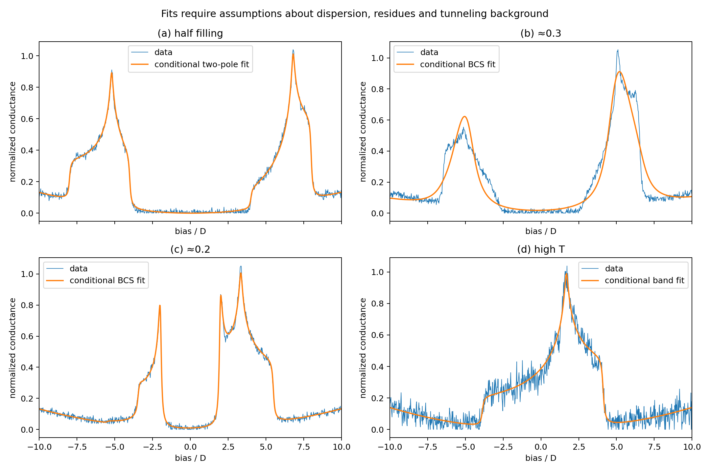
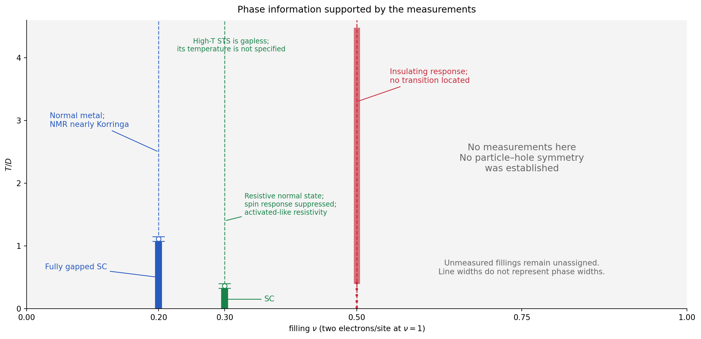
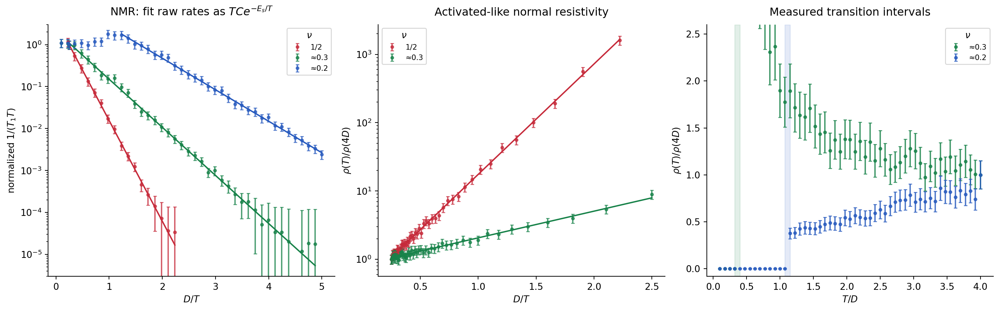
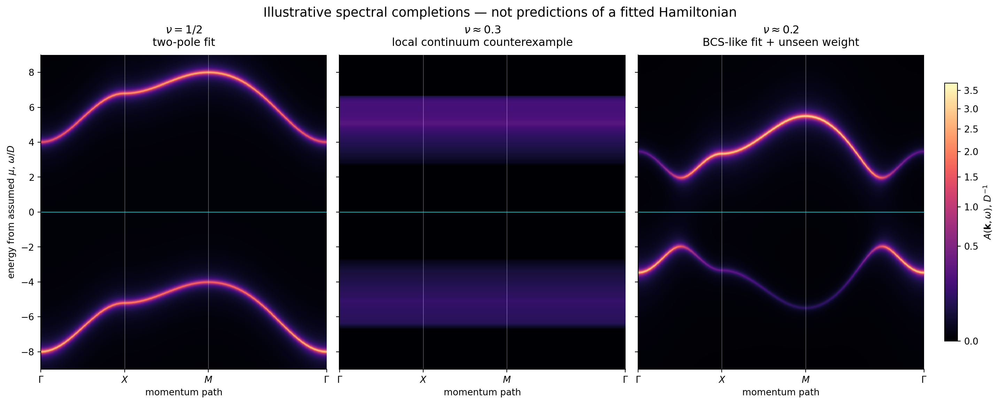
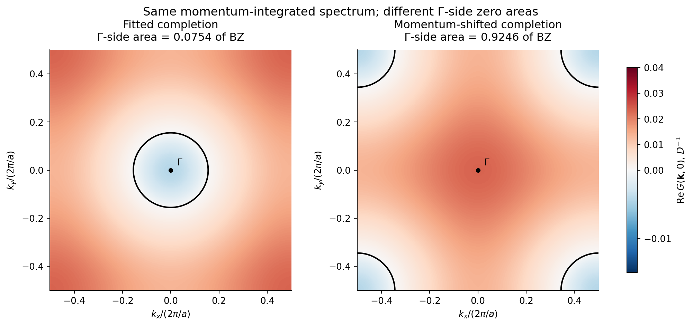
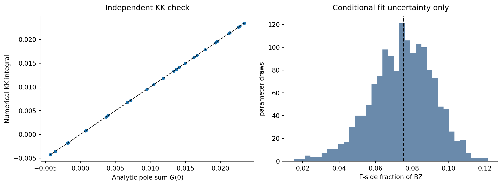

**The measurements support a gapped insulator at half filling and fully gapped superconductivity at the two lower fillings. They do not determine all the coefficients of a common microscopic Hamiltonian, its complete phase diagram, or a unique momentum-resolved spectrum.** Fixing the half-filled chemical potential at midgap does not determine the area enclosed by a Green-function zero.

This is an identifiability limitation, not a limitation of workstation computing. I give a plausible Hamiltonian to investigate, quantitative fits to the supplied JSON, the phase information established by the measurements, illustrative spectral maps, and an explicit Kramers–Kronig calculation. The latter also supplies counterexamples to assigning a unique zero-curve area from these measurements. The illustrative spectra are **not presented as solutions of the proposed microscopic Hamiltonian**.

All numerical values below come from measurements.json. No parameter or measurement for a named compound is substituted. Energies and temperatures are in units of \(D\), unless a different dimension is indicated. The convention is \(n=2\nu\) electrons per transition-metal site, including both spins.

**1. A credible effective-theory candidate, and what can be fitted.** The most credible phenomenology is a singlet-correlated, charge-gapped parent, followed upon doping by superconductivity. At \(\nu\approx0.3\), the gap and spin-suppression scales are much larger than the temperature at which resistance vanishes. At \(\nu\approx0.2\), the gap-to-transition-temperature ratio and NMR coherence enhancement are much closer to conventional, fully gapped BCS behavior. This supports a crossover in the importance of pair formation and phase coherence; it does not establish a microscopic pairing mechanism.

The in-plane primitive translations are \(a\hat x,a\hat y\). Each plane has one equivalent metal site per primitive cell. Introducing two inequivalent **in-plane** sites to explain the gap would conflict with the structural information. The number of equivalent planes in a three-dimensional primitive cell, their registry, and interplane electronic couplings have not been specified. A bilayer is a possible model assumption, not a fact established by these inputs.

If a block contains two equivalent layers, a useful candidate has spin-\(1/2\) Wannier fermions \(c_{i\ell\sigma}\), one orbital per metal, with \(\ell=1,2\). A cell contains a vertical pair of sites, not an enlarged in-plane cell. A concrete trial Hamiltonian is

\[
\begin{aligned}
K={}&
-t\sum_{\langle ij\rangle,\ell,\sigma}
 (c^\dagger_{i\ell\sigma}c_{j\ell\sigma}+\mathrm{h.c.})\\
&-t'\sum_{\langle\!\langle ij\rangle\!\rangle,\ell,\sigma}
 (c^\dagger_{i\ell\sigma}c_{j\ell\sigma}+\mathrm{h.c.})\\
&-t_\perp\sum_{i,\sigma}
 (c^\dagger_{i1\sigma}c_{i2\sigma}+\mathrm{h.c.})\\
&+U\sum_{i,\ell}(n_{i\ell\uparrow}-\tfrac12)(n_{i\ell\downarrow}-\tfrac12)\\
&+J_\perp\sum_i\left[S^z_{i1}S^z_{i2}
 +\tfrac12(S^+_{i1}S^-_{i2}+S^-_{i1}S^+_{i2})\right]\\
&-\mu\sum_{i,\ell}(n_{i\ell}-1).
\end{aligned}
\]

Here \(K\) is the grand-canonical Hamiltonian, \(n_{i\ell\sigma}=c^\dagger_{i\ell\sigma}c_{i\ell\sigma}\), \(S^z=(n_\uparrow-n_\downarrow)/2\), and \(S^+=c^\dagger_\uparrow c_\downarrow\). The two bond sums contain nearest neighbors and both in-plane diagonals, respectively, each undirected bond once. These are all the terms in this trial model. There is no imposed single-occupancy constraint and no explicit pairing field. Additional interactions, disorder, phonons, and spin-orbit terms have been omitted as modeling choices; their coefficients have not been measured to be zero.

With real, layer-independent coefficients, this Hamiltonian has lattice translations, square-lattice point-group symmetry, time reversal, common spin \(SU(2)\), total charge \(U(1)\), and layer interchange. Exchange preserves common spin rotations but not independent spin rotations in the two layers. If \(t_\perp=0\), each layer's charge is separately conserved; finite \(t_\perp\) removes that extra symmetry. Generic \(t'\ne0\) removes the usual bipartite particle–hole symmetry and associated half-filling pseudospin enhancement. Neither exact spin \(SU(2)\) nor exact separate layer charge conservation follows from orbital dominance alone. Spin-orbit coupling and orbital admixture need not respect those approximations.

For sufficiently strong antiferromagnetic rung exchange, the half-filled reference state can be a product of vertical singlets, continuously dressed by hopping. It preserves the in-plane unit cell and has no static site charge disproportionation. Doping makes paired charge configurations mobile and can favor the interlayer singlet amplitude

\[
\Delta_i=\langle c_{i1\uparrow}c_{i2\downarrow}
                 -c_{i1\downarrow}c_{i2\uparrow}\rangle.
\]

This is an established possible mechanism for a symmetry-preserving insulating parent and doped singlet pairing; it is not a deduction of the layer structure from STS. See the [bilayer singlet model of Lu and collaborators](https://arxiv.org/abs/2308.11195) for a theoretical example. The superconducting state has charge phase coherence; the singlet parent does not.

If instead there is one spin-\(1/2\) per **full** primitive cell, a fully symmetric, fully gapped insulating state of a local spin-rotation-invariant model cannot be an ordinary unique singlet product state. Symmetry breaking, topological order, or additional low-energy degrees of freedom must be considered. An activated NMR rate does not itself show that every neutral excitation is gapped. This unit-cell distinction follows from the [higher-dimensional Lieb–Schultz–Mattis constraint](https://arxiv.org/abs/cond-mat/0305505).

The following table separates estimates made within explicit assumptions from coefficients that remain unidentified.

| Coefficient or combination | What the supplied data permit |
|---|---|
| \(t\) | \(0.9987\pm0.0039\), **conditional** on fitting the high-\(T\) trace to the two-hopping dispersion below, with a constant tunneling matrix element and fitted background/broadening. |
| \(t'\) | \(+0.1957\pm0.0022\), under the same conditions and choosing \(t>0\). This is not a model-independent hopping determination. |
| \(t_\perp\) | Not identified. Setting it to zero defines a simpler trial model; it is not a measured value with a measured error bar. |
| \(U,J_\perp\) | Not separately identified. In an isolated, half-filled rung with \(t_\perp=0\), the single-electron excitation cost is \(M=U/2+3J_\perp/4\). The spectral fit below gives a band-center scale \(M\simeq6.00\), subject to hopping corrections and the spectral ansatz. |
| \(\mu\) | A thermodynamic multiplier fixed by the number equation, not a composition-independent material constant. The recentered low-\(T\) STS traces do not calibrate its absolute value relative to a bare orbital energy. |

For example, \((U,J_\perp)=(0,8)\) and \((4,16/3)\) have the same isolated-rung value \(M=6\), while their spin spectra differ. If one additionally equated the fitted half-filled NMR activation with the isolated-rung triplet gap, one would obtain the *conditional starting values* \(J_\perp\simeq5.53\pm0.15\) and \(U\simeq3.71\pm0.22\). The latter errors propagate fit errors only. That identification neglects dispersive excitations, relaxation matrix elements, and thermal prefactors; it is not a calibrated confidence region for the Hamiltonian. An ordinary one-band repulsive Hubbard model on an unfrustrated square lattice also does not automatically supply the observed singlet-like spin suppression.

Thus \(t\simeq1,t'\simeq0.2,U\simeq3.7,J_\perp\simeq5.5,t_\perp=0\) is an explicitly assumption-dependent point at which one could start testing the bilayer model. I cannot give measurement-determined error bars for **every** coefficient or claim that this point explains all three crystals quantitatively.

For the conditional high-temperature fit I used

\[
\epsilon_{\mathbf k}=-2t(\cos2\pi k_x+\cos2\pi k_y)
                     -4t'\cos2\pi k_x\cos2\pi k_y,
\]

and \(g(V)=s\rho_0(V+\mu_h;\eta)+b_0+b_2V^2\). The fitted \(\mu_h=-0.906\pm0.009\) and \(\eta=0.0876\pm0.0094\) describe this spectral fit. The high-\(T\) panel has no numerical temperature, so its filling cannot be checked using a finite-temperature number equation. The bandwidth is \(8t\simeq7.99\). The unequal distances of the van Hove peak from the two band edges favor \(t'\ne0\) within this model.

STS supplies no uncertainty array. Its quoted fit errors use the residual variance and a local least-squares covariance, assuming independent noise. They exclude matrix-element, background, self-energy, and model-selection errors. Their small size is not evidence that the microscopic hopping constants are known to that precision.

**2. Phases and temperature scales.** The defensible diagram is a diagram of constraints at the sampled fillings, shown below over the requested interval \(0\leq\nu\leq1\). There is insufficient information to calculate or infer a complete phase diagram of the trial Hamiltonian. The empty areas are intentional. In particular, \(t'\ne0\) does not permit reflecting a hole-doped diagram about \(\nu=1/2\).

| Crystal | Low to high temperature, within the supplied measurements |
|---|---|
| \(\nu=1/2\) | A charge-gapped insulator with strongly suppressed low-frequency spin response. Resistivity remains activated-like throughout \(0.45\leq T\leq4\); no finite-\(T\) phase boundary is located. A singlet-correlated insulator is a candidate, not a demonstrated topological or symmetry classification. |
| \(\nu\approx0.3\) | Fully gapped superconductivity is the natural interpretation below \(T_c\in[0.325,0.400]\). Above it is a resistive state with activated-like resistivity and suppressed NMR response. A preformed-pair or pseudogap regime is plausible. The high-\(T\) STS trace is gapless, but its temperature and any gap-closing crossover temperature are unspecified. |
| \(\nu\approx0.2\) | Fully gapped superconductivity below \(T_c\in[1.075,1.150]\), followed by a metallic normal state with roughly increasing resistivity and approximately Korringa NMR at higher \(T\). |

The intervals use the last zero-resistance and first nonzero-resistance samples. Their midpoints, \(0.3625\pm0.0375\) and \(1.1125\pm0.0375\), are interval summaries, not Gaussian uncertainty estimates. There are no measured boundaries at other fillings. Even an assumed continuous superconducting dome is an interpolation, not a measured result. The single-orbital empty and full limits are kinematically special, but their finite-temperature crossovers are not fixed here.

In a strictly two-dimensional version of the trial model, the finite-temperature superconducting transition would involve BKT phase coherence rather than ordinary long-range breaking of a continuous global \(U(1)\). Coupling between blocks can change that conclusion. Neither the interblock coupling nor a superfluid stiffness is supplied. The NMR activation scale must not be drawn as a separate thermodynamic transition line.

**3. Quantitative response fits and their physical interpretation.** An important bookkeeping point is that the JSON contains \(1/T_1\), not \(1/(T_1T)\). I fit its raw rates and errors to

\[
\frac1{T_1}=T C\exp(-E_s/T),
\]

so the ordinate of Figure 2 is \(C\exp(-E_s/T)\). I retained the small-rate points with their supplied absolute errors instead of taking logarithms of noise-floor values. The fits use \(T\leq4\) for the first two crystals and \(T\leq0.8125\) for the third, to exclude its coherence maximum. For the nonzero resistivities of the first two crystals I fitted \(\ln\rho=a+E_\rho/T\).

| Quantity | \(\nu=1/2\) | \(\nu\approx0.3\) | \(\nu\approx0.2\) |
|---|---:|---:|---:|
| Approximate full low-\(T\) STS gap | \(8.0\) | \(5.2\) | \(3.9\text{–}4.0\) |
| Effective NMR activation \(E_s\) | \(5.53\pm0.15\) | \(2.641\pm0.050\) | \(1.730\pm0.035\) |
| Effective normal-resistance activation \(E_\rho\) | \(3.724\pm0.048\) | \(0.900\pm0.043\) | Metallic slope; no positive activation inferred |
| Resistance transition interval | Not observed | \([0.325,0.400]\) | \([1.075,1.150]\) |

The STS gap entries are onset-scale estimates; broadening and background make approximately \(0.1\text{–}0.2\) uncertainty in a full gap more realistic than reading a single bias bin as an exact edge. The response-fit errors treat the supplied uncertainties as diagonal; no covariance of the common \(T=4\) normalization was supplied. Allowing an additional prefactor \(T^p\) in \(1/(T_1T)\) changes the fitted activations to \(5.65\pm0.59,\ 2.63\pm0.15,\ 1.82\pm0.19\), respectively. This illustrates why an Arrhenius slope is not automatically a bare exchange coefficient or an exact elementary excitation gap.

Diffraction is consistent with a uniform correlated gap or pairing among equivalent sites. In the bilayer candidate, rung singlets need no in-plane dimerization, charge density wave, or enlarged cell. A conventional site charge order with inequivalent metal sites is disfavored by diffraction, spatially uniform STS, and the single NMR line. These observations do not individually exclude every magnetic, orbital-current, or hidden order, nor do they prove preservation of time reversal or topological triviality.

STS probes a tunneling-weighted local spectral function, schematically

\[
g(V)\propto\sum_{\mathbf k}|M_{\rm tun}(\mathbf k,V)|^2
 A(\mathbf k,V),
\]

with thermal convolution when applicable. A singlet-correlated insulating state can have separate electron-removal and electron-addition bands; their finite dispersion gives the broad lobes in panel a. In the successful two-pole fit, each lobe has bandwidth approximately \(4D\), about half the high-\(T\) fitted bandwidth. At lower fillings, a pairing gap suppresses single-electron tunneling even though pairs carry current. For the \(0.2\) crystal, BCS coherence factors produce edge peaks and a normal-band van Hove feature produces an additional positive-bias peak. Similar-looking peaks in STS alone do not establish which momentum hosts them.

The \(0.3\) crystal has \(E_g/T_c\simeq14\), whereas the \(0.2\) crystal has \(E_g/T_c\simeq3.5\), using the full gap \(E_g=2\Delta\). The latter agrees approximately with the weak-coupling fully gapped BCS ratio; the former supports separation of a large single-particle gap scale from a much smaller phase-coherence scale. It does not by itself prove a Bose condensate or determine a pair size. Thermal broadening was removed from the high-\(T\) STS trace, so its gap filling cannot be explained solely by that convolution.

NMR measures a different correlator:

\[
\frac1{T_1T}\propto\sum_{\mathbf q}|A_{\rm hf}(\mathbf q)|^2
 \lim_{\Omega\to\omega_N}\frac{\operatorname{Im}\chi^{+-}(\mathbf q,\Omega)}{\Omega}.
\]

Singlet correlations and gapped spin-carrying excitations suppress this response. At \(\nu\approx0.3\) the suppression persists above the resistance transition, supporting pairing or spin correlations without established superconducting phase coherence. At \(\nu\approx0.2\) the enhancement near \(T\simeq1.02\), just below the resistance transition, is consistent with a Hebel–Slichter coherence maximum; its low-\(T\) decay is activated. The approximate high-\(T\) constancy of \(1/(T_1T)\) is consistent with a metallic Korringa regime. The unknown hyperfine form factor prevents reconstructing \(\chi(\mathbf q,\Omega)\) or an exchange Hamiltonian from this momentum sum.

The half-filled resistivity is naturally explained by thermally excited charge carriers; its activation is of the order of the half-gap, with transport prefactors and scattering affecting the fitted slope. Superconducting phase coherence explains zero resistance despite a one-electron gap in the doped crystals. The \(0.3\) normal state has an insulating-like slope, while the \(0.2\) normal state has a metallic slope. Resistivity additionally depends on velocities, scattering, and current vertices. Its normalization removes the absolute conductivity scale. None of these fits is a calculation of the Kubo conductivity of the trial Hamiltonian.

**4. ARPES: illustrative spectra, and the missing information.** Fermi-function division gives

\[
\frac{I(\mathbf k,\omega)}{f(\omega,T)}
 \propto |M_{\rm ARPES}(\mathbf k,\omega)|^2A(\mathbf k,\omega).
\]

It does not remove matrix elements or determine the momentum distribution of an STS spectrum. A high-symmetry path also does not specify a two-dimensional zero curve. The maps below use the requested path \(\Gamma=(0,0)\to X=(1/2,0)\to M=(1/2,1/2)\to\Gamma\), with true path length on the horizontal axis and a common energy window \([-9,9]\). They illustrate explicit possible one-particle completions and the information missing from the inverse problem. They are not three quantitative predictions from the Hamiltonian in part 1.

For **half filling**, the successful causal two-pole ansatz is

\[
\begin{split}
q_{\mathbf k}&=-2t_h(\cos2\pi k_x+\cos2\pi k_y)
                 -4t'_h\cos2\pi k_x\cos2\pi k_y,\\
E_\pm(\mathbf k)&=C+q_{\mathbf k}\pm M,\\
Z_\pm(\mathbf k)&=\tfrac12\pm bq_{\mathbf k},\\
A_a(\mathbf k,\omega)&=Z_-\delta(\omega-E_-)+Z_+\delta(\omega-E_+).
\end{split}
\]

It has positive residues, unit spectral weight at every momentum, and occupied weight \(\langle Z_-\rangle=1/2\). I enforced \(C=4t'_h\), which makes the gap midpoint exactly zero. The fit gives

| Spectral parameter | Conditional fit value |
|---|---:|
| \(t_h\) | \(0.49854\pm0.00060\) |
| \(t'_h\) | \(0.09936\pm0.00022\) |
| \(M\) | \(6.0030\pm0.0016\) |
| \(C=4t'_h\) | \(0.39743\pm0.00089\) |
| \(b\) | \(0.06469\pm0.00130\ D^{-1}\) |
| Display/fit Lorentz width \(\eta\) | \(0.07482\pm0.00191\) |

The intrinsic gap is \(2(M-4t_h)=8.0177\). The outer band edges are approximately \(\pm8.00\), and the van Hove energies are approximately \(-5.208\) and \(6.798\). The two branches have the same sign of dispersion, unlike the two branches of a simple BCS avoided crossing. This is consistent with separated removal/addition bands but is not a unique identification of Mottness. Broadening is used for plotting and fitting; the intrinsic spectral gap and Green-function zeros below use the \(\eta\to0^+\) limit.

For **\(\nu\approx0.2\)**, a simple BCS-shaped fit uses

\[
\xi_{\mathbf k}=\epsilon_{\mathbf k}-\mu_c,\quad
E_{\mathbf k}=\sqrt{\xi_{\mathbf k}^2+\Delta^2},\quad
u_{\mathbf k}^2=\frac{1+\xi_{\mathbf k}/E_{\mathbf k}}2,
\]

\[
A_{\rm BCS}=v_{\mathbf k}^2\delta(\omega+E_{\mathbf k})
            +u_{\mathbf k}^2\delta(\omega-E_{\mathbf k}),
\]

with \(\mu_c=-1.9165,\ \Delta=1.9663,\ \eta=0.0783\), using the high-\(T\) fitted \(t,t'\). Back-bending near \(\xi=0\), transfer of weight between the two branches, and a nonzero minimum excitation energy are the familiar signatures of paired quasiparticles. The second positive-energy feature comes from the van Hove structure of the chosen normal dispersion. These are conditional physical interpretations, not measured momentum-space features.

There is a useful consistency check: this unscaled BCS spectrum has

\[
\int_{\rm BZ}d^2k\int_{-\infty}^0d\omega\,A_{\rm BCS}
=0.25588,
\]

not the nominal \(0.2\). A good normalized STS fit therefore does not by itself make a self-consistent number-conserving BCS solution at the stated filling. The filling uncertainty is unspecified, so this check cannot quantify a statistical disagreement with the sample's true filling. One explicit completion used for the illustration multiplies the low-energy spectrum by \(Z=0.2/0.25588\simeq0.7816\) and places the missing positive spectral weight at \(+20D\), outside the measured window. It then has unit total weight and filling \(0.2\), with the same normalized low-energy trace. The extra peak is a mathematical choice demonstrating missing information, not a prediction of a real excitation at \(20D\).

For **\(\nu\approx0.3\)**, the constant-gap BCS form fails to reproduce the supplied trace: its residual RMS is \(0.0663\), versus \(0.0149\) for panel c, and it drives the width to the imposed upper bound \(0.6D\). It cannot be promoted to an ARPES prediction. The middle map instead deliberately shows a *momentum-independent spectral continuum* obtained from the smoothed, background-subtracted measured bands, with support chosen near \([-6.65,-2.6]\cup[2.6,6.65]\). Its arbitrary absolute scale is fixed by occupied weight \(0.3\), with the remaining positive weight, approximately \(0.195\), placed at \(+20D\). It is a positive, normalized causal spectral completion. The horizontal structures are a counterexample to inferring dispersion from local spectroscopy, not a claim that this crystal has flat bands.

Alternatively, one can redistribute the same positive and negative spectral densities among momenta to produce dispersing peaks with the same STS trace. Normalized local spectroscopy cannot distinguish these constructions. A physically controlled calculation of the proposed interacting Hamiltonian, additional structural information, and momentum-resolved measurements would be needed to choose between them. Suppressing NMR or observing zero resistance does not supply the missing single-particle dispersion and residues. The positive-energy parts shown are theoretical spectra; division by a very small Fermi function at low temperature would not provide experimentally reliable intensity arbitrarily far above the chemical potential.

**5. Kramers–Kronig reconstruction and the zero area.** For a normalized retarded spectral function,

\[
G^R(\mathbf k,z)=\int_{-\infty}^{\infty}
 \frac{A(\mathbf k,\omega')}{z-\omega'}\,d\omega',\qquad
\operatorname{Re}G^R(\mathbf k,0)
=-\mathcal P\int\frac{A(\mathbf k,\omega')}{\omega'}\,d\omega'.
\]

Apply this relation to the **explicit half-filled two-pole completion**, keeping the prescribed midgap chemical potential. The two delta functions give

\[
\begin{aligned}
G(\mathbf k,z)
&=\frac{Z_-}{z-C-q_{\mathbf k}+M}
 +\frac{Z_+}{z-C-q_{\mathbf k}-M}\\
&=\frac{z-C+(2bM-1)q_{\mathbf k}}
         {(z-C-q_{\mathbf k})^2-M^2}.
\end{aligned}
\]

Writing \(\alpha=1-2bM=0.22336\), its zero dispersion is

\[
\omega_0(\mathbf k)=C+\alpha q_{\mathbf k}.
\]

Consequently the \(\omega=0\) zero curve obeys

\[
q_{\mathbf k}=-\frac C\alpha=-1.77933.
\]

It is a closed curve around \(\Gamma\). The fraction of the Brillouin zone on its \(\Gamma\) side is

\[
\boxed{f_\Gamma=0.07540\quad\text{for this spectral ansatz}.}
\]

Propagation of the conditional fit covariance gives an approximate standard deviation \(0.0172\), with a parameter-draw 95% interval \([0.0372,0.1061]\). This is **not** an experimental confidence interval for the zero area. It excludes ambiguity in spectral weights, tunneling matrix elements, momentum assignment, and unmeasured energies. The conditional value is much smaller than \(\nu=0.5\).

In this particular completion \(G(\mathbf k,0)<0\) on the \(\Gamma\) side. Thus the \(\Gamma\)-side fraction is not even the positive-\(G\) sign volume: that sign volume is \(1-f_\Gamma=0.92460\). A zero is a cancellation in the propagator, not a pole or a set of gapless electronic states. One should not call either geometric area a measured carrier density. A generic gapped correlated system does not automatically obey a sign-volume version of Luttinger's theorem; see [Rosch's explicit Mott-insulator analysis](https://arxiv.org/abs/cond-mat/0602656).

There are two concrete sources of nonuniqueness even after accepting a closed zero curve and the midgap chemical potential.

First, \(A'(\mathbf k,\omega)=A(\mathbf k+\mathbf Q,\omega)\), with \(\mathbf Q=(1/2,1/2)\), has exactly the same momentum-integrated STS and filling, retains square-lattice symmetry, and moves the small zero pocket to the zone corner. The side containing \(\Gamma\) then occupies \(0.92460\), as shown; the corner pieces form one closed curve on the Brillouin-zone torus. Within the class of hopping-plus-local-interaction Hamiltonians, the transformation \(c_{i\ell\sigma}\mapsto(-1)^{i_x+i_y}c_{i\ell\sigma}\) flips the nearest-neighbor hopping sign while preserving local charge and spin operators. With the consistently transformed current, local spin response and uniform transport do not resolve this momentum assignment either. An orbital/ARPES matrix-element convention or momentum-resolved information is needed to attach the spectral structure to physical crystal momentum.

Second, even fixing that assignment, the normalized STS window does not determine the tails needed in Kramers–Kronig. Consider

\[
A_w(\mathbf k,\omega)=(1-2w)A_a(\mathbf k,\omega)
 +w\delta(\omega+\Lambda_-)+w\delta(\omega-\Lambda_+),
\]

where both \(\Lambda_\pm>10D\). This is positive, has unit total weight, still has filling \(1/2\), and has exactly the same gap midpoint. Inside the intrinsic spectral window it differs only by an overall scale, removed by the specified normalization. Broadening the added peaks with the illustrative linewidth would give tails smaller than the STS fit residuals. Yet

\[
G_w(\mathbf k,0)=(1-2w)G_a(\mathbf k,0)
                 +\frac w{\Lambda_-}-\frac w{\Lambda_+}.
\]

All three examples below have a closed zero curve:

| \(w\) in each unmeasured peak | \(\Lambda_-\) | \(\Lambda_+\) | \(\Gamma\)-side fraction |
|---:|---:|---:|---:|
| \(0\) | — | — | \(0.07540\) |
| \(0.03\) | \(12\) | \(30\) | \(0.04460\) |
| \(0.03\) | \(30\) | \(12\) | \(0.10972\) |

The peaks are counterexamples, not proposed extra bands. They show why the normalization and finite energy window matter even when the energy origin is fixed correctly. The experiment also lacks momentum resolution in the first place. The asserted existence of a closed curve supplies a geometric condition, not its area. Neither \(f_\Gamma=\nu\) nor a specific unequal numerical value follows from the supplied data.

The numerical work uses direct spectral fitting and quadrature, not a finite-cluster solution of an interacting lattice. The normal square-lattice resolvent integrates one momentum analytically and the other with 768 points. Spectral maps use 752 path points and 1,801 energies. Spectral number checks use a \(900\times900\) momentum grid. Zero-area counts on \(512^2,1024^2,2048^2\) grids give \(0.075382,0.075360,0.075392\); a one-dimensional area quadrature with 16,384 points gives \(0.075403\). An independent numerical Kramers–Kronig check uses Gaussian approximations of width \(0.01D\) to the two delta peaks, a \(0.001D\) energy step over \([-12D,12D]\), and agrees with the analytic pole sum within \(5\times10^{-7}D^{-1}\). These checks validate the conditional computation, not the proposed microscopic mechanism.

The additional information needed for a fully calibrated Hamiltonian includes the layer basis and interlayer dispersion, spin excitation dispersion or susceptibility with known hyperfine coupling, a pairing symmetry/stiffness measurement, and a normalized momentum-resolved spectrum extending sufficiently far in energy. Without those inputs, a more detailed Hamiltonian phase diagram and ARPES forecast would reflect chosen priors. The files supplied here keep those choices explicit.
