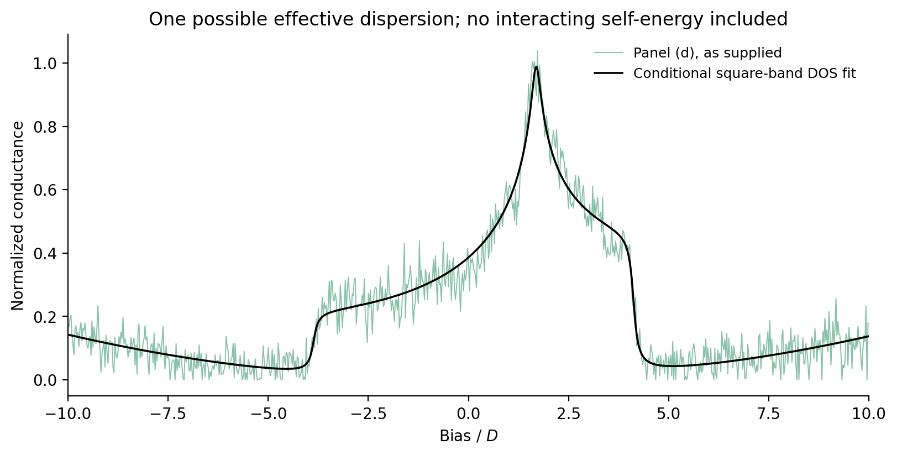
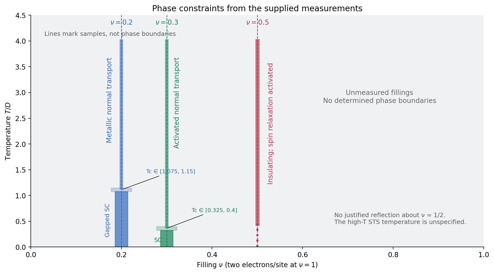
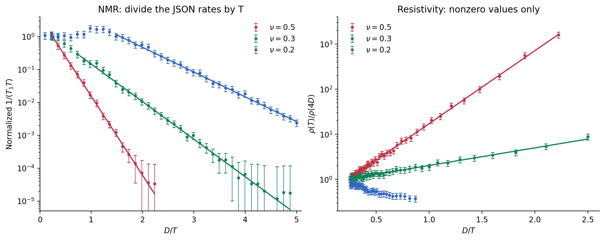
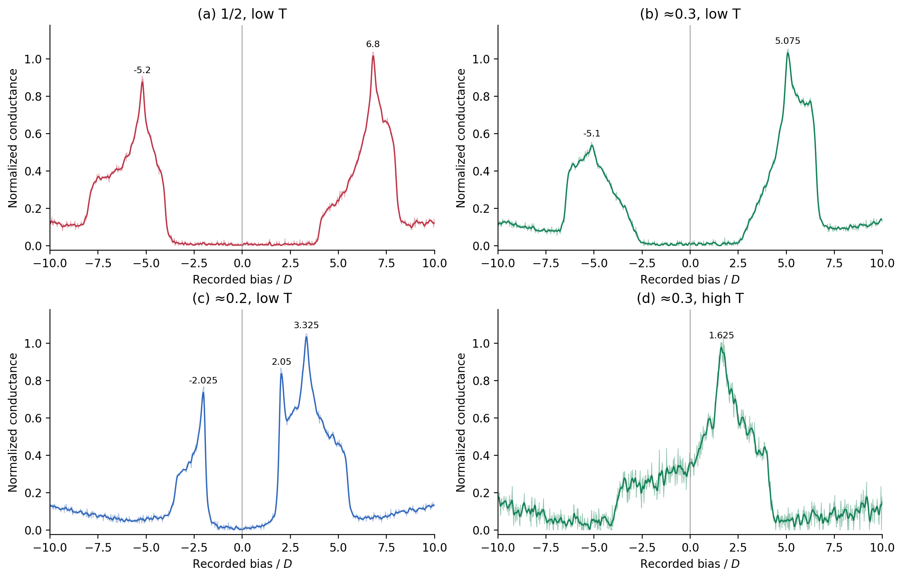
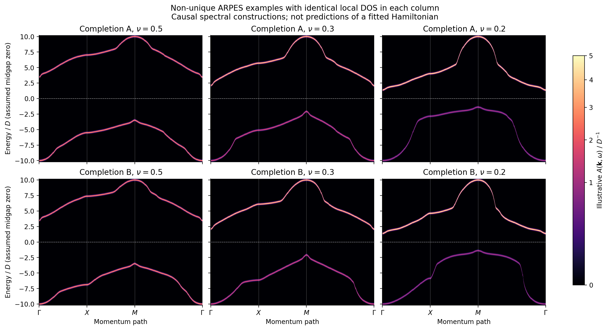
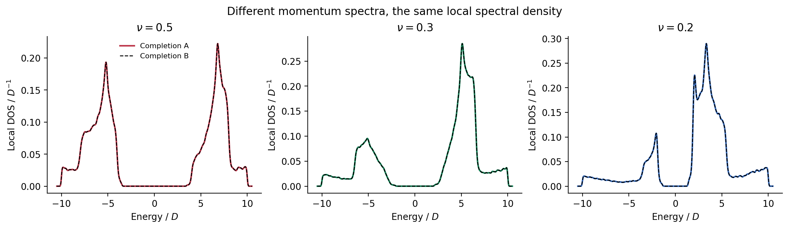
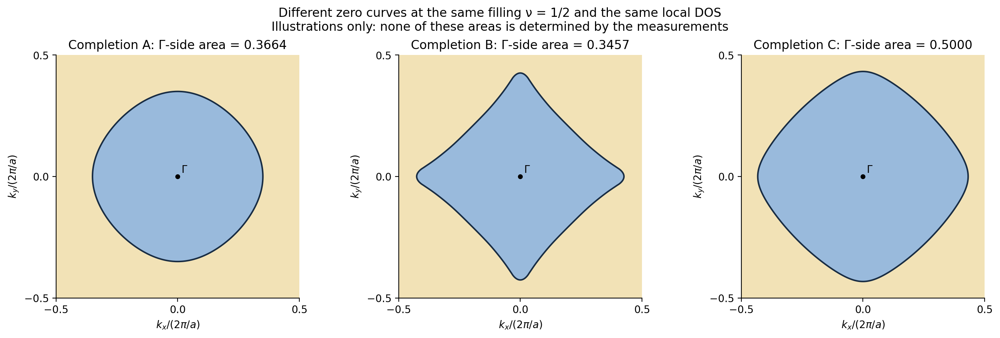

**What the supplied measurements determine about the half-filled oxide**

With a single-layer, one-site description, my preferred qualitative interpretation is a correlation-driven insulator with strongly suppressed spin relaxation at half filling, and fully gapped superconductivity in the two doped crystals. The \(\nu\simeq0.3\) crystal superconducts out of an activated normal state; the \(\nu\simeq0.2\) crystal has a more conventional metallic normal state.

**The measurements do not, however, determine a Hamiltonian with all its coefficients and uncertainties, its complete phase diagram, or a numerical area enclosed by its Green-function zeros.** Choosing a particular Hamiltonian and approximation would make those quantities conditional predictions. It would not make their parameters and uncertainties determinations from these measurements. Below I quantify the actual constraints and demonstrate the lost momentum information explicitly. The ARPES and zero-contour examples are clearly identified as illustrations, rather than presented as a solved microscopic theory.

All numerical material inputs come from [measurements.json](measurements.json). Energies and temperatures are in units of \(D\). The calculations and figures are reproducible with [analyze.py](analyze.py); numerical results, covariances, assumptions, and checks are in [results.json](results.json).

**1. Effective degrees of freedom and the limits of a Hamiltonian inference.** Let \(c_{i\sigma}\) destroy an electron in the transition-metal-dominated Wannier orbital. There are two spin states per site, and

\[
n=\langle n_{i\uparrow}+n_{i\downarrow}\rangle=2\nu.
\]

Thus the three electron densities are approximately \(1,\ 0.6,\ 0.4\), not \(0.5,\ 0.3,\ 0.2\). For one plane, the Bravais lattice is square, with primitive translations \(a\hat x,a\hat y\), one metal site per crystallographic in-plane cell, and Brillouin zone \([-1/2,1/2)^2\) in the stipulated momentum units. A doubled *crystallographic* in-plane cell is inconsistent with the problem. The number of layers in a three-dimensional cell and the interlayer couplings are not specified.

A natural **starting model**, assuming a single isolated plane and negligible spin-orbit coupling, is

\[
\begin{aligned}
K={}&-t\sum_{\langle ij\rangle,\sigma}
 (c^\dagger_{i\sigma}c_{j\sigma}+c^\dagger_{j\sigma}c_{i\sigma})\\
&-t'\sum_{\langle\!\langle ij\rangle\!\rangle,\sigma}
 (c^\dagger_{i\sigma}c_{j\sigma}+c^\dagger_{j\sigma}c_{i\sigma})\\
&+U\sum_i(n_{i\uparrow}-\tfrac12)(n_{i\downarrow}-\tfrac12)
 -\widetilde\mu\sum_i(n_i-1).
\end{aligned}
\tag{1}
\]

Each undirected bond is counted once. The first sum contains axial nearest neighbors; the second contains both diagonal directions. These are **all** the terms in this candidate model. There is no imposed pairing field, staggered potential, or magnetic field. In the convention with interaction \(Un_{i\uparrow}n_{i\downarrow}\), the chemical potential is \(\mu=\widetilde\mu+U/2\).

For real \(t,t'\), equation (1) has charge \(U(1)\), spin \(SU(2)\), time reversal, one-site translations, and the square-lattice \(D_4\) point group, including inversion and reflections. For nonzero \(t'\), it lacks the usual bipartite particle-hole symmetry and the associated pseudospin \(SU(2)\). A superconducting state would additionally involve spontaneous charge-phase ordering, with a BKT interpretation in a strictly two-dimensional short-range model. The real crystal's spin \(SU(2)\), time reversal, inversion, and reflection symmetries are **not established by** a single NMR line and the stated diffraction measurements. They are assumptions in (1).

There is some quantitative information about an *effective* dispersion. I fitted high-temperature STS panel (d) to the broadened density of states of

\[
\epsilon_{\mathbf k}=-2t_{\rm eff}(\cos 2\pi k_x+\cos 2\pi k_y)
 -4t'_{\rm eff}\cos 2\pi k_x\cos 2\pi k_y,
\tag{2}
\]

allowing an overall intensity, a quadratic baseline, a chemical-potential shift, and a constant Lorentzian width. The result is:

| Conditional fit quantity | Value in \(D\) | Formal standard error |
|---|---:|---:|
| \(t_{\rm eff}\) | 0.9986 | 0.0039 |
| \(t'_{\rm eff}\) | 0.1956 | 0.0022 |
| \(\mu_{\rm eff}\), relative to the zero onsite energy in (2) | −0.9072 | 0.0092 |
| Broadening \(\eta\), **not a Hamiltonian coefficient** | 0.0884 | 0.0095 |

The RMS residual is 0.0470 in the recorded conductance units. These errors assume independent, equal-variance STS residuals; the JSON supplies no STS uncertainties. They exclude uncertainty in the tunneling matrix element, background model, longer-range hopping, and temperature-dependent self-energy. Thermal deconvolution does not remove an interacting self-energy. Consequently these are useful starting estimates \(t\sim1,\ t'\sim0.2\), **not measurements of the bare hopping coefficients with the precision in the table**.

The remaining coefficients cannot be supplied as requested:

| Coefficient in (1) | What can actually be said |
|---|---|
| \(t,t'\) | The preceding estimates apply only under the specified DOS assumptions; their full microscopic uncertainties are unidentified. |
| \(U\) | Not determined. The half-filled peak separation is about \(12D\); identifying that with \(U\) requires a Hubbard-band assignment and an approximation. It is not an independently measured interaction or a justified confidence interval. |
| \(\widetilde\mu(\nu,T)\) | Not determined. Putting the half-filled spectral zero at midgap fixes an energy reference, not \(\widetilde\mu\) relative to the onsite term in (1). The doped low-temperature chemical potentials are not supplied. |
| All omitted interactions/couplings | Setting them to zero defines the truncation in (1). The observations do not measure them to be zero or give uncertainties for those choices. |

There is a substantive difficulty with declaring (1), at \(U\simeq12\), a complete explanation. Its strong-coupling exchange scales would be

\[
J_1\simeq 4t^2/U\simeq0.33,\qquad
J_2\simeq 4t'^2/U\simeq0.013.
\]

These are very different from the \(5.54D\) activation scale in half-filled spin relaxation derived below. A charge gap in a repulsive Hubbard model does not remove the low-energy local-moment spin sector. Using a gapped one-electron bubble alone for NMR would omit that problem. The measured activation is not, by itself, a measurement of a spin-excitation gap either: the hyperfine form factor and interacting spin response matter.

Possible resolutions include interlayer singlets, additional interactions or spin anisotropy, or a different correlated state. The supplied data do not select or parameterize them. If one further assumes one spin-\(1/2\) per primitive cell, short-range interactions, a fully gapped spin-singlet ground state, and unbroken spin and translation symmetries, a featureless unique gapped state is obstructed; topological order or another departure from those assumptions must be considered. This is a conditional constraint, not evidence that this sample is a spin liquid. [Hastings, *Lieb–Schultz–Mattis in Higher Dimensions*](https://arxiv.org/abs/cond-mat/0305505).

Thus (1) is a credible starting model class, but claiming that it is a quantitatively established theory of **all** the observations would go beyond the evidence. Nonuniqueness alone would not prevent proposing a model; the additional issue here is that the spin and pairing mechanisms have not been specified or calibrated. Their assumed couplings cannot honestly be reported as measurements. Replacing cations away from the metal also does not guarantee that only \(\mu\), rather than hopping and interaction parameters, changes between crystals.

**2. What can be drawn as a phase diagram.** The data establish the following temperature sequences, with superconductivity the natural interpretation of the zero resistance together with a tunneling gap:

| Crystal | Low temperature | On warming | What is not fixed |
|---|---|---|---|
| \(\nu=1/2\) | Gapped, insulating state; strongly suppressed spin relaxation | Activated resistivity throughout the measured \(0.45\)–\(4D\) interval | Magnetic/topological character, any lower-temperature transition, eventual high-temperature crossover |
| \(\nu\simeq0.3\) | Fully gapped superconducting state | Resistive transition within \([0.325,0.400]D\), then activated normal transport with suppressed spin relaxation; gapless STS at an unspecified high temperature | A numerical pseudogap-closing temperature or additional thermodynamic phase boundary |
| \(\nu\simeq0.2\) | Fully gapped superconducting state | Resistive transition within \([1.075,1.150]D\), then metallic normal transport | Gap representation, microscopic pairing mechanism, precise transition universality |

The transition intervals come directly from the last recorded zero and first nonzero resistivity. Their midpoints are \(0.3625D\) and \(1.1125D\), with sampling half-width \(0.0375D\). These half-widths are **not Gaussian standard errors**.

The narrow colored strips mark the measured compositions, not finite-width phases in doping. “Activated” and “metallic” label transport behavior, not necessarily distinct thermodynamic phases. The dotted half-filled segment extrapolates the insulating branch below the resistivity measurement range. There is no basis for filling the gray region with calculated boundaries, drawing a complete superconducting dome, or reflecting the left half about \(\nu=1/2\). In particular, \(t'\neq0\) in the conditional fit breaks the particle-hole symmetry that such a reflection would require. The figure is the phase information supported by the data; a full phase diagram of a validated Hamiltonian is not identifiable.

**3. How the observations constrain the interpretation.** The NMR JSON contains **\(1/T_1\), not \(1/(T_1T)\)**. I fit the raw rates with their supplied uncertainties to

\[
\frac1{T_1}=T\,e^a e^{-\Delta_R/T},
\]

equivalently \(1/(T_1T)=e^a e^{-\Delta_R/T}\). For nonzero resistivities I fit

\[
\rho=e^b e^{E_\rho/T}.
\]

Free amplitudes account for the normalization. The fits use the supplied errors without shrinking them to match the small residual scatter.

| Filling | \(\Delta_R/D\) | NMR temperature interval used | \(E_\rho/D\) | Resistivity interval used |
|---|---:|---:|---:|---:|
| \(1/2\) | \(5.54\pm0.13\) | 0.4472–4.4318 | \(3.72\pm0.05\) | 0.45–4 |
| \(\simeq0.3\) | \(2.63\pm0.06\) | 0.2052–1.3732 | \(0.900\pm0.044\) | 0.4–4 |
| \(\simeq0.2\) | \(1.735\pm0.039\) | 0.2–0.6747 | No activated fit used | Metallic normal branch |

These are conditional one-standard-error estimates from a diagonal-error fit. Normalization-induced covariances were not provided. With a free prefactor \(1/T_1=e^a T^p e^{-\Delta/T}\), the corresponding estimates become \(5.59\pm0.52,\ 2.67\pm0.30,\ 1.82\pm0.24\). This illustrates why activation slopes should not be quoted as microscopic couplings with only the smallest fitting errors.

For \(\nu\simeq0.2\), an empirical fit to the normal resistivity gives
\(\rho/\rho(4D)\simeq(0.176\pm0.040)+(0.175\pm0.017)\,T/D\).
It establishes increasing normal-state resistivity, without identifying a scattering mechanism.

Diffraction fixes the primitive in-plane translation and supplies no evidence for a new crystallographic modulation or orthorhombic distortion. Uniform STS supplies no evidence for surface patches with different gaps. A single metal NMR line argues against **resolved** inequivalent local environments, but does not establish the absence of every magnetic or electronic order. A uniform chemical shift, unresolved order, or order with symmetry-equivalent sites cannot be classified from the number of lines alone.

STS approximately probes a momentum-weighted local spectral density:

\[
\frac{dI}{dV}\ \propto\
\sum_{\mathbf k}|M_{\rm tun}(\mathbf k,V)|^2
\int d\omega\,A(\mathbf k,\omega)
\left[-\frac{\partial f(\omega-eV)}{\partial\omega}\right],
\tag{3}
\]

with tip density and background effects also possible. In (3), voltage is referenced to the chemical potential. The recorded low-temperature bias is instead referenced to the gap midpoint; identifying it with \(\omega\) requires a midpoint-to-\(\mu\) offset, supplied in the problem only for the half-filled low-temperature limit. The gap indicates suppressed one-electron addition/removal spectral weight. By itself it does not distinguish a Mott gap, pairing gap, or a gap involving additional internal degrees of freedom. Individual maximum normalization does not supply an absolute spectral sum rule. It does preserve within-trace intensity ratios, which could be used if matrix elements, background, and the full spectral range were known.

The dominant peak positions after mild smoothing are:

| Panel | Filling and temperature | Peak positions \(V/D\) |
|---|---|---|
| (a) | \(1/2\), low | −5.20, +6.80 |
| (b) | \(\simeq0.3\), low | −5.10, +5.075 |
| (c) | \(\simeq0.2\), low | −2.025, +2.050, +3.325 |
| (d) | \(\simeq0.3\), high | +1.625 |

The bias sampling interval is \(0.025D\); these positions are numerical descriptors, not microscopic-parameter estimates. The nonzero baseline/noise and unknown nonthermal broadening prevent a statistically defined exact gap-edge determination. For example, changing a sustained onset threshold from 3% to 10% of the recorded conductance scale moves the inferred edges from \((-3.65,3.90)\) to \((-3.925,4.05)D\) in (a), from \((-2.65,2.625)\) to \((-2.975,2.975)D\) in (b), and from \((-1.40,1.225)\) to \((-1.75,1.725)D\) in (c). These are threshold-sensitivity ranges, not error bars on a true gap.

At half filling, the broad removal/addition features are compatible with Hubbard bands. Activated transport with \(E_\rho\simeq3.7D\) is of the scale expected for thermally excited carriers in a gap of order \(8D\) with a midgap chemical potential. Equality \(E_\rho=E_g/2\) additionally requires assumptions about carrier mobility and transport processes. The much stronger suppression of spin relaxation requires an account of the spin sector, rather than merely labeling the tunneling gap “Mott.”

At \(\nu\simeq0.3\), the persistence of suppressed relaxation above the resistive transition and the activated normal resistivity suggest a paired or otherwise correlated pseudogapped normal state. The single-electron, spin-relaxation, and transport activation scales need not coincide. If the tunneling onset near \(2.6D\) is interpreted as a pairing scale, its ratio \(2\Delta/T_c\) is around 14, much larger than weak-coupling isotropic BCS. This motivates a separation of pair formation and phase coherence; it does not determine a pair interaction.

At \(\nu\simeq0.2\), gap-edge peaks near \(\pm2D\), an activated low-temperature relaxation rate, a possible modest relaxation enhancement just below the resistive transition, and metallic normal transport are compatible with a fully gapped singlet superconductor. Interpreting the peaks as \(\Delta\simeq2D\) gives \(2\Delta/T_c\simeq3.6\), close to a conventional BCS value. The higher positive-bias peak could reflect a normal-band DOS feature carried into the paired spectrum. None of these observations measures the phase of the gap or proves an isotropic \(s\)-wave representation.

The distinction between spin and one-electron information is explicit in

\[
\frac1{T_1T}\ \propto\
\sum_{\mathbf q}|A_{\rm hf}(\mathbf q)|^2
\lim_{\omega\to0}\frac{\chi''_{+-}(\mathbf q,\omega)}{\omega}.
\tag{4}
\]

Equation (4) involves a two-particle spin response and a hyperfine form factor. Resistivity involves a current-current response, including scattering and vertex effects. Neither scalar measurement provides a momentum-resolved one-electron self-energy.

**4. ARPES: robust expectations and an explicit ambiguity.** After Fermi-function division, the idealized intensity is

\[
\frac{I(\mathbf k,\omega)}{f(\omega)}
=C\,|M_{\rm ARPES}(\mathbf k,\omega)|^2 A(\mathbf k,\omega),
\qquad A=-\pi^{-1}\operatorname{Im}G^R .
\tag{5}
\]

It is not automatically \(A\): the photoemission matrix element remains. At very low temperature, division by \(f\) cannot experimentally recover substantial unoccupied weight many \(D\) above \(\mu\); that part of a plotted spectrum is a theoretical prediction. [Shen Laboratory, *Angle-resolved photoemission spectroscopy*](https://arpes.stanford.edu/research/tool-development/angle-resolved-photoemission-spectroscopy).

Under the preferred qualitative interpretation, half filling should have separated electron-removal and addition spectra with no Fermi-level crossing. A Hubbard-band interpretation would imply correlation-induced spectral separation, not band folding from a larger crystallographic cell. The doped superconductors should have a full gap in the quasiparticle spectrum. Coherent pairing would produce Bogoliubov branches and coherence-factor weight transfer; back-bending would locate an underlying normal-state Fermi momentum. At \(\nu\simeq0.3\), residual pseudogap and incoherent weight would be plausible. At \(\nu\simeq0.2\), coherent Bogoliubov features would be the more natural expectation.

The data do **not** fix those dispersions, linewidths, back-bending momenta, pockets or arcs, gap anisotropy, or the relative coherent and incoherent weights. In particular, one cannot assign a measured DOS peak to \(X\), \(M\), or a van Hove point without a dispersion assumption. A familiar-looking cuprate spectrum would not be a deduction from these measurements.

To make the mathematical limitation concrete, I generated two causal spectral completions at **each** filling. They illustrate different spectra with the same local DOS and the same filling; they are **not solutions of (1), not asserted superconducting spectra, and not fits of the NMR/current responses**.

The construction works even if we grant more information than the experiment provides: a calibrated local spectral DOS

\[
N_\nu(\omega)=\nu p_-(\omega)+(1-\nu)p_+(\omega),
\quad \int p_\pm(\omega)\,d\omega=1,
\tag{6}
\]

where \(p_-\) and \(p_+\) have support below and above the gap. For the illustration, their shapes are obtained from the low-temperature STS branches, smoothed with \(\sigma=0.05D\), with small-bias noise masked. Each branch is normalized separately. That rescaling explicitly avoids claiming that the measured tunneling intensity already has the spectral sum-rule calibration. The masks \(3.5,\ 2.1,\ 1.4D\) are choices for the illustration, not gap measurements.

Let \(Q_\pm(u)\) be the inverse cumulative distributions of \(p_\pm\). Define the square-symmetric ranking function and its BZ cumulative distribution by

\[
e_b(\mathbf k)=-\cos2\pi k_x-\cos2\pi k_y
-b\cos2\pi k_x\cos2\pi k_y,\qquad
F_b(x)=\langle\Theta(x-e_b(\mathbf k))\rangle_{\rm BZ}.
\]

The variables \(u_b(\mathbf k)=F_b(e_b(\mathbf k))\) are uniformly distributed on \([0,1]\) under a BZ average. Therefore

\[
\begin{aligned}
E_-(\mathbf k)&=Q_-(u_{b_-}(\mathbf k)),\\
E_+(\mathbf k)&=Q_+(u_{b_+}(\mathbf k)),\\
A_\nu(\mathbf k,\omega)&=
\nu\,\delta(\omega-E_-(\mathbf k))
+(1-\nu)\,\delta(\omega-E_+(\mathbf k))
\end{aligned}
\tag{7}
\]

has exactly the local DOS (6), for **any** choices of the two ranking parameters. It is positive, obeys \(\int A_\nu(\mathbf k,\omega)d\omega=1\), and has occupied weight \(\nu\) per spin. It preserves square symmetry, inversion, and spin degeneracy. These facts do not assert a particular local microscopic Hamiltonian.

Completion A uses \((b_-,b_+)=(0.4,0.4)\); completion B uses \((-0.8,0.8)\). These numbers are **freely chosen mathematical parameters, not fitted hoppings**.

The path is exactly \(\Gamma=(0,0)\to X=(1/2,0)\to M=(1/2,1/2)\to\Gamma\). The displayed energy window is approximately \([-10,10]D\). The matrix element is set to one, with Gaussian display width \(0.065D\). For the doped examples, choosing the midgap plotting zero as \(\mu\) is an additional assumption. At half filling it is stipulated by the question.

The dispersing ridges, their positions at \(X\), and the shapes of their contours differ between rows even though their momentum integrals agree:

The ridges in this illustration are poles with arbitrarily assigned momentum dependence. They must not be identified as measured Hubbard or Bogoliubov bands. Their physical lesson is that **one-electron gaps and local peak energies constrain the energy distribution of spectral weight, while momentum assignment is additional information**. NMR and transport do not remove that missing information without specified response vertices and a Hamiltonian.

**5. Kramers–Kronig recovery and the zero-curve area.** With the half-filled chemical potential at the gap midpoint, as requested,

\[
G^R(\mathbf k,z)=\int_{-\infty}^{\infty}
\frac{A(\mathbf k,\omega')}{z-\omega'}\,d\omega',
\qquad
\operatorname{Re}G^R(\mathbf k,0)
=-\mathcal P\int_{-\infty}^{\infty}
\frac{A(\mathbf k,\omega')}{\omega'}\,d\omega'.
\tag{8}
\]

In a true gap there is no singular contribution at \(\omega'=0\), and \(\operatorname{Im}G^R(\mathbf k,0)=0\). The zero condition balances **inverse-energy-weighted** removal and addition weight. Filling instead fixes an **unweighted** occupied integral:

\[
\nu=\left\langle\int_{-\infty}^0 A(\mathbf k,\omega)\,d\omega\right\rangle_{\rm BZ}.
\tag{9}
\]

Equations (8) and (9) are different constraints. Performing a Hilbert transform on STS, even with ideal calibration and unlimited energy coverage, yields a local Green function, not \(G(\mathbf k,0)\).

For either explicit completion at half filling, Kramers–Kronig gives

\[
G^R(\mathbf k,z)
=\frac{1/2}{z-E_-(\mathbf k)}
 +\frac{1/2}{z-E_+(\mathbf k)}
=\frac{z-\tfrac12(E_-+E_+)}
 {(z-E_-)(z-E_+)}.
\tag{10}
\]

Its zero curve at \(\omega=0\) is \(E_-(\mathbf k)+E_+(\mathbf k)=0\). Both constructions have a single closed curve enclosing \(\Gamma\), use the **same midgap chemical potential**, and have exactly \(\nu=1/2\). Nevertheless:

| Illustrative completion | Fraction of the BZ on the side containing \(\Gamma\) | Filling |
|---|---:|---:|
| A | 0.36640 | 0.50000 |
| B | 0.34571 | 0.50000 |
| C, additional construction below | 0.50000 | 0.50000 |

The \(\Gamma\) side has negative \(\operatorname{Re}G(0)\) in A and B; its area is not being silently equated with the positive-\(G\) sign count. Both of those geometric fractions differ from \(\nu\). **Neither is an estimate for the oxide.** Their difference is a constructive demonstration that a common local DOS, filling, lattice symmetry, and midgap \(\mu\) do not fix the requested number. The examples isolate the one-particle inference failure; they do not claim complete microscopic fits to all the experiments.

Equality to \(\nu\) is also possible with the same local DOS. A third positive, normalized spectral function is

\[
A_C(\mathbf k,\omega)=w_b(\mathbf k)p_-(\omega)
+[1-w_b(\mathbf k)]p_+(\omega),
\quad
w_b=\tfrac12+0.15(\cos2\pi k_x+\cos2\pi k_y
+b\cos2\pi k_x\cos2\pi k_y).
\]

Here \(\langle w_b\rangle_{\rm BZ}=1/2\), so both filling and the local DOS remain unchanged. Writing \(c_-=\int p_-/|\omega|=0.171471D^{-1}\) and \(c_+=\int p_+/\omega=0.152967D^{-1}\), its Kramers–Kronig value is \(G_C(\mathbf k,0)=w_b c_--(1-w_b)c_+\). The zero occurs at \(w_b=0.471482\). Choosing \(b=0.30676695\) gives a single closed curve with a \(\Gamma\)-side area exactly \(1/2\) by numerical quadrature; \(G_C(0)\) is positive on that side. This choice is made to demonstrate equality, not fitted to a measurement. Consequently the data do not determine even whether the requested area equals or differs from \(\nu\).

The usual metallic Fermi-volume argument cannot simply be applied to this insulating zero contour. A particle-hole-symmetric special case can enforce a half-BZ result, but that symmetry is not given here. Conversely, a particular illustrative spectrum with a non-half area is not experimental proof of a violation of a Luttinger relation. Such a claim needs a specified theory and the relevant assumptions. [Rosch, *Breakdown of Luttinger's theorem in two-orbital Mott insulators*](https://arxiv.org/abs/cond-mat/0602656).

There is also a useful approximation check. At half filling a Hubbard-I Green function can be written

\[
G_{\rm HI}(\mathbf k,z)=
\frac{z+\delta}
{(z+\delta)^2-\epsilon_{\mathbf k}(z+\delta)-U^2/4},
\]

with \(\delta\) the chemical-potential displacement from its atomic symmetric value. At \(z=0\), its numerator is momentum-independent: it vanishes everywhere if \(\delta=0\), and nowhere if \(\delta\ne0\) in the insulating gap. Thus Hubbard-I cannot be used to claim the closed zero curve stipulated in the question. A momentum-dependent self-energy or an appropriately justified larger internal structure is required. Assigning arbitrary dispersions to two “Hubbard bands” is already an additional model assumption.

The numerical calculations are workstation-scale quadratures, **not** an exact-diagonalization or Monte Carlo solution of an interacting lattice. The conditional DOS fit uses 512 \(k_x\) points and an analytic \(k_y\) integral. The illustrative spectra and zero contours use a \(1024\times1024\) BZ mesh; A and B were checked on \(1536\times1536\), changing their areas by less than \(10^{-5}\). C's area is additionally computed by one-dimensional adaptive quadrature. The path contains 684 momentum points. Direct Kramers–Kronig quadrature for A and B on 9,601 energies over \([-12,12]D\), using \(0.025D\) Gaussian broadening for this check, agrees with the zero-width pole result within \(7.2\times10^{-6}D^{-1}\). Spectral normalization and the occupied half-filled weight agree to about \(10^{-15}\). The displayed widths are numerical choices, not inferred lifetimes.

A model-specific answer to the remaining requests would require selecting and validating an interaction/stacking/spin Hamiltonian and response approximations, constraining its coefficients beyond a local DOS fit, and calculating its ordered states and full momentum-dependent spectrum. The supplied measurements support the quantitative scales and phase sequences above; they do not support a fully parameterized microscopic theory or a unique numerical zero-curve area.
