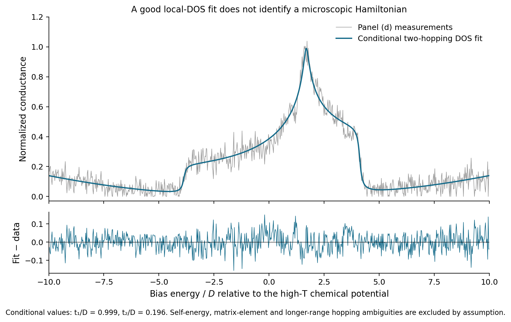
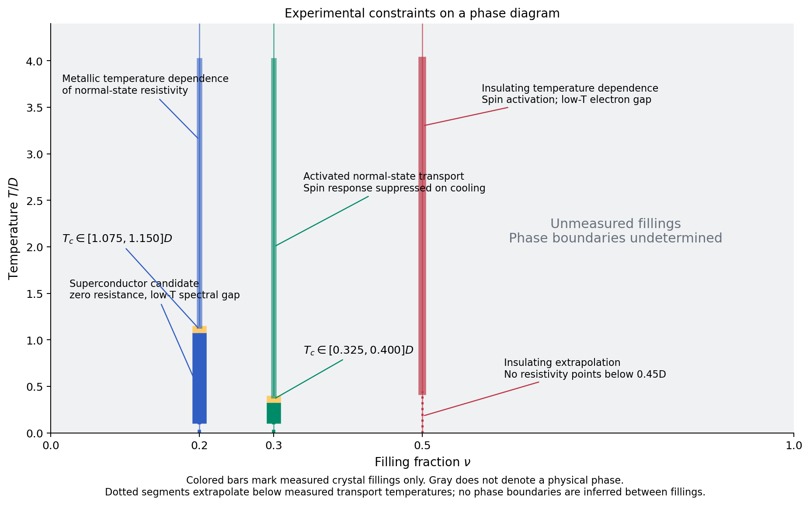
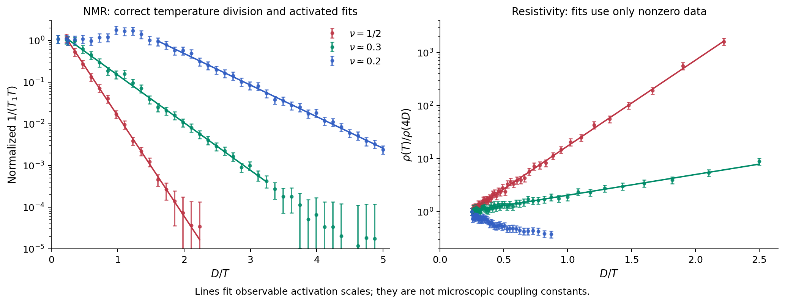
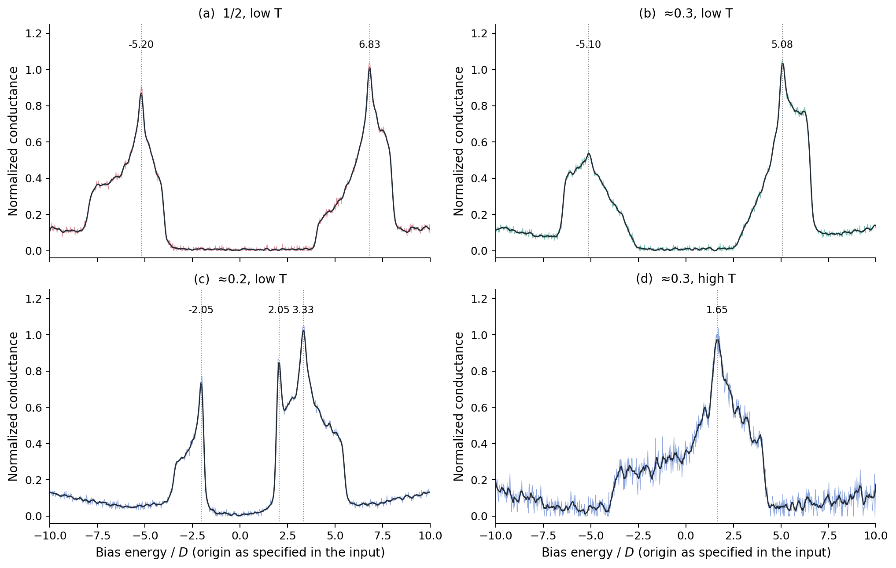
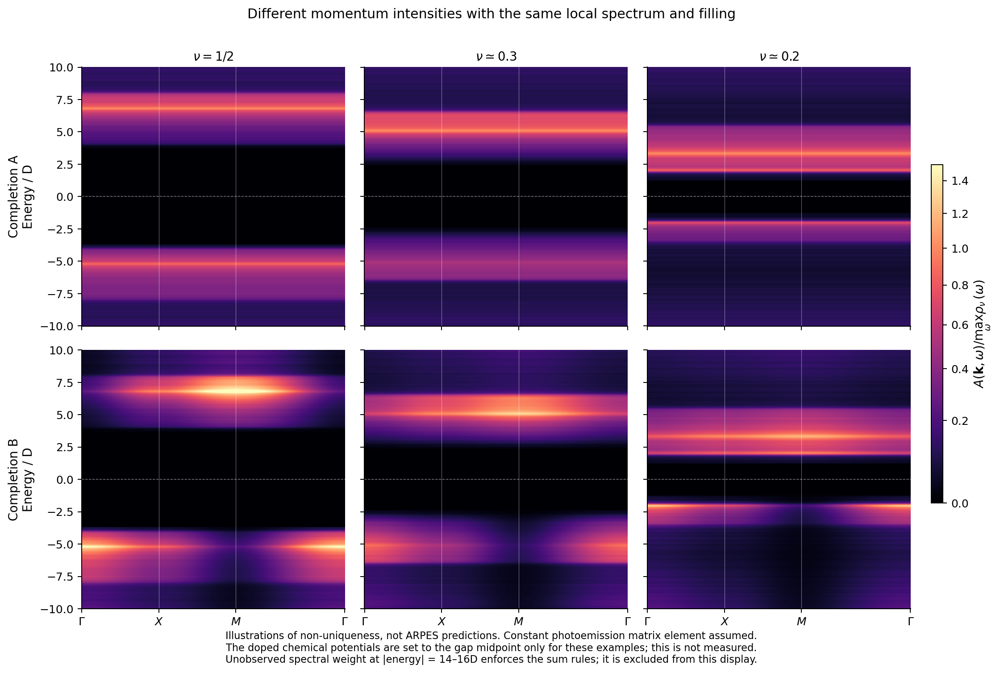
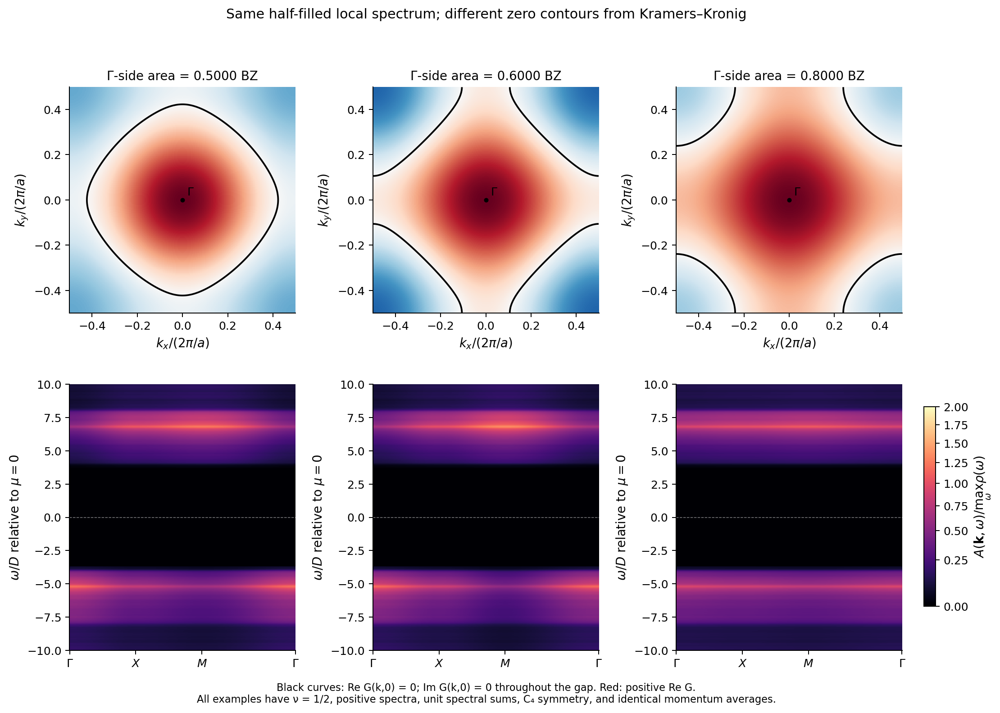

Analysis of the supplied layered-oxide measurements

**The most plausible interpretation is a correlated insulator with strongly suppressed low-energy spin response at half filling, and fully gapped superconductivity in the two doped crystals. The data do not, however, determine a microscopic Hamiltonian, its full phase diagram, momentum-resolved spectra, or a numerical Green's-function zero area.** In particular, proposing one Hamiltonian does not make all its coefficients measurable from these observations. Reporting finite uncertainties for every coefficient, or a unique answer to item 5, would require additional assumptions.

Below I give a candidate effective-theory framework, quantify what can actually be extracted, explain the observations within that interpretation, and demonstrate the spectral ambiguity constructively. The density plots and zero contours explicitly labelled as examples are **not predictions of a fitted interacting Hamiltonian**. They show why the requested inference is not determined even after imposing positivity, causality, the spectral sum rule, the correct filling, and square-lattice symmetry.

All experimental numbers below come from `measurements.json`. External references support general theoretical statements only; no named compound supplies parameters.

**1. Effective theory, lattice, symmetries, and parameter information**

For a single-plane approximation, use spinful fermions in a Wannier orbital dominated by the stated transition-metal orbital. There is one such orbital per metal site, on a square Bravais lattice with primitive translations \(a\hat x,a\hat y\). The minimal **in-plane** unit cell contains one metal site, and

\[
 n=\langle n_{i\uparrow}+n_{i\downarrow}\rangle=2\nu.
\]

Thus half filling is one electron per site, not half an electron. There is no justification for imposing an in-plane doubled cell, a staggered site energy, or alternating strong and weak bonds. The stated crystallography also requires symmetry-equivalent hopping along the two axes. It does not specify the number of layers in the three-dimensional primitive cell or their electronic coupling. Neglecting those layers is an approximation, not an experimental conclusion.

A reasonable family to investigate is a frustrated, extended one-orbital Hubbard model. One explicitly defined version is

\[
\begin{aligned}
H={}&-t_1\sum_{\langle ij\rangle,\sigma}
 (c^\dagger_{i\sigma}c_{j\sigma}+c^\dagger_{j\sigma}c_{i\sigma})\\
&-t_2\sum_{\langle\!\langle ij\rangle\!\rangle,\sigma}
 (c^\dagger_{i\sigma}c_{j\sigma}+c^\dagger_{j\sigma}c_{i\sigma})\\
&+U\sum_i n_{i\uparrow}n_{i\downarrow}\\
&+J_1\sum_{\langle ij\rangle}
 \left(\mathbf S_i\!\cdot\!\mathbf S_j-\frac14 n_i n_j\right)\\
&+J_2\sum_{\langle\!\langle ij\rangle\!\rangle}
 \left(\mathbf S_i\!\cdot\!\mathbf S_j-\frac14 n_i n_j\right)
 -\mu\sum_i n_i,
\end{aligned}
\]

where \(\mathbf S_i=\tfrac12c^\dagger_{i\alpha}\boldsymbol\sigma_{\alpha\beta}c_{i\beta}\), and each unordered bond is counted once. The second-neighbor sums include **both** diagonals of every square. All the displayed coefficients have energy units. The exchange terms here are independent residual interactions; they are not an instruction to count the superexchange generated by \(U\) twice. Setting \(J_1=J_2=0\) gives the simpler Hubbard subfamily.

With real coefficients this model has charge \(U(1)\), spin \(SU(2)\), time reversal, primitive translations, and the square-lattice point group \(D_4\). It lacks generic particle-hole symmetry when \(t_2\ne0\), continuous spatial rotation symmetry, and Galilean invariance. Spin \(SU(2)\), mirror symmetries, the absence of spin-orbit interactions, and the neglect of interlayer coupling are choices of this model: the measurements do not establish all of them. Superconductivity can break charge \(U(1)\) in the appropriate thermodynamic description without a structural supercell. Possible symmetry breaking of a state must be distinguished from the symmetries of its Hamiltonian.

This family accommodates charge localization, frustrated spin correlations, and pairing channels. **I have not established that any particular member reproduces all the data.** A spin gap cannot simply be asserted to follow from a repulsive square-lattice Hubbard Hamiltonian. If the half-filled, one-site-per-cell system really preserves translations and spin rotation and is fully gapped, a trivial singlet product state is excluded by the Lieb–Schultz–Mattis constraint. A gapped spin liquid is then a candidate, but these experiments do not establish topological order or exclude every form of electronic order. An even number of spins in an actual multilayer unit cell changes this constraint. [Else and Thorngren, *Topological theory of Lieb–Schultz–Mattis theorems*](https://arxiv.org/abs/1907.08204).

The parameter information is as follows:

| Coefficient | What the supplied data determine |
|---|---|
| \(t_1\) | A **conditional band-DOS fit** gives \(0.999\pm0.004\,D\); this is not an unconditional estimate of bare hopping. |
| \(t_2\) | The same conditional fit gives \(0.196\pm0.002\,D\). Longer-range hopping and interaction effects were excluded by assumption. |
| \(U\) | Not identifiable. Neither the tunneling gap nor the separation of two peaks equals \(U\) without a spectral calculation in a specified model. No data-based finite uncertainty interval follows. |
| \(J_1,J_2\) | Not individually identifiable. An activated NMR rate is not a measurement of either exchange coefficient. No data-based finite intervals follow. |
| \(\mu(\nu,T)\) | Not determined relative to the bare orbital energy. At half filling the problem fixes the *spectral frequency origin* at the low-temperature gap midpoint. The doped low-temperature chemical potentials are not supplied. |

To obtain the conditional hopping numbers I fitted panel (d) to the broadened DOS of

\[
 \epsilon_{\mathbf k}=-2t_1[\cos(2\pi k_x)+\cos(2\pi k_y)]
       -4t_2\cos(2\pi k_x)\cos(2\pi k_y),
\]

allowing a common intensity scale, a quadratic background, and a constant Lorentz width. The other fitted quantities are \(\mu=-0.906\pm0.009\,D\) relative to this band's onsite-energy convention and a width \(0.088\pm0.009\,D\). These are parameters of the **high-temperature DOS ansatz**, not low-temperature Hamiltonian estimates. The STS temperature is only labelled “high,” so a thermal number equation was not imposed. The quoted errors come from residual scatter and omit self-energy, tunneling-matrix-element, background-model, and hopping-truncation uncertainties.

For intuition, if the apparent features near \(-4D,4D,1.6D\) were respectively the \(\Gamma\) edge, \(M\) edge, and \(X\) saddle of this bare band, then

\[
 t_1=\frac{E_M-E_\Gamma}{8}\simeq D,
 \qquad
 t_2=\frac{E_X-(E_M+E_\Gamma)/2}{8}\simeq0.2D.
\]

The momentum assignments and the absence of a substantial self-energy are precisely the extra assumptions. A high-temperature, thermally deconvolved STS spectrum is still an **interacting** spectrum; deconvolving the Fermi kernel does not remove interactions.

Choosing \(U\) from a nominal \(12D\) peak separation and then setting \(J=4t_1^2/U\) would not complete this inference. That expression is a strong-coupling approximation for a specified Hubbard model, not an independent fit to the observed spin relaxation. Adding exchange terms, spin anisotropy, phonons, disorder, or interlayer hopping creates further coefficients for which these measurements give no independent determination. Setting them to zero is a modeling choice, not a measured value with zero uncertainty.

**2. Temperature and filling dependence**

The data constrain the three measured vertical cuts, rather than a phase diagram over all \(0\leq\nu\leq1\). In the most plausible superconducting interpretation, the sequences on warming are:

| Crystal | Low temperature | On warming | Higher measured temperatures |
|---|---|---|---|
| \(\nu=1/2\) | Gapped correlated-insulator candidate with suppressed spin response | Activated, nonzero resistivity over \(0.45\leq T/D\leq4\) | No thermodynamic transition or high-temperature metallic phase is established for this sample. |
| \(\nu\simeq0.3\) | Gapped superconductor | Zero resistance ends between \(0.325D\) and \(0.400D\); the normal-state resistivity is activated | Panel (d) has no hard gap at its unspecified high temperature; NMR approaches a roughly constant \(1/(T_1T)\). A crossover is plausible, but its temperature is not fixed. |
| \(\nu\simeq0.2\) | Gapped superconductor | Zero resistance ends between \(1.075D\) and \(1.150D\) | Normal-state resistivity has a metallic temperature dependence; NMR is approximately Korringa-like at high temperature. |

The transition brackets are sampling bounds, not statistical error bars. They can be summarized as \(T_c\simeq0.363\pm0.038\,D\) and \(1.113\pm0.038\,D\), respectively, **only if that meaning of the ± signs is retained**. Exact zero-resistance entries with zero quoted errors were used to bracket the change, not put into a least-squares fit.

Zero resistance together with a spectral gap and the NMR behavior makes superconductivity the natural interpretation. The dataset does not contain a Meissner or stiffness measurement. Likewise, the half-filled resistivity is not measured below \(0.45D\): its insulating ground state is a credible extrapolation, not a direct exclusion of every still-lower-temperature transition.

The plot deliberately leaves other fillings unassigned. A superconducting dome, its endpoints, competing orders, or a mirror image about \(\nu=1/2\) would be assumptions. Generic \(t_2\ne0\) does not provide particle-hole symmetry to justify that mirror image. Spin activation and a resistivity upturn also do not, by themselves, define phase boundaries. For a strictly two-dimensional model, phase coherence and a possible BKT transition require information about stiffness; weak coupling between layers can instead produce a three-dimensional transition. Neither is determined here.

**3. What features account for the measurements?**

The NMR data in the JSON are \(1/T_1\), explicitly **not** \(1/(T_1T)\). I first formed

\[
 R(T)=\frac{1/T_1(T)}{T},\qquad
 \sigma_R(T)=\frac{\sigma_{1/T_1}(T)}{T}.
\]

I fitted the observable forms

\[
 R(T)=a\exp[-E_N(1/T-1/(4D))],\qquad
 \rho(T)=b\exp[E_\rho(1/T-1/(4D))],
\]

with free amplitudes. Numerical temperatures and energies in the calculation are expressed in \(D\). Fits minimize residuals in the **linear measured ordinate**, weighted by the supplied errors. This avoids taking logarithms of rates at their noise floor.

| Observable | Filling | Fitted temperature range, \(T/D\) | Activation energy, in \(D\) | Energy if a free \((T/4D)^p\) prefactor is allowed, in \(D\) |
|---|---:|---:|---:|---:|
| \(1/(T_1T)\) | 0.5 | 0.4472–4.4318 | \(5.54\pm0.13\) | \(5.59\pm0.52\) |
| \(1/(T_1T)\) | ≈0.3 | 0.3085–4.4318 | \(2.631\pm0.050\) | \(2.65\pm0.15\) |
| \(1/(T_1T)\) | ≈0.2 | 0.2000–0.6220 | \(1.746\pm0.042\) | \(1.73\pm0.27\) |
| \(\rho\) | 0.5 | 0.45–4.00 | \(3.722\pm0.049\) | \(3.76\pm0.16\) |
| \(\rho\) | ≈0.3 | 0.40–4.00 | \(0.900\pm0.044\) | \(0.94\pm0.14\) |

These are conditional one-standard-error estimates using the supplied marginal uncertainties as independent; their covariance after normalization is not supplied. I did not shrink the errors to force reduced \(\chi^2=1\). The very small ν≈0.3 rates below the stated fitting window are shown in the figure but do not determine the fitted activated regime. The free-power column illustrates the dependence of inferred energies on the assumed prefactor. It is not a complete systematic-error budget.

**Diffraction and spatial uniformity.** A translation-preserving correlation gap or uniform superconducting state does not require any new crystallographic period. This accounts naturally for the unchanged diffraction, equivalent sites, and spatially uniform STS. A single NMR line establishes one *resolved* local nuclear environment; it does not establish spin rotation, time reversal, absence of all magnetic order, or absence of topological order. In particular, it is insufficient to select a spin liquid over every alternative.

**STS.** With a featureless tip and a sufficiently simple tunneling matrix element,

\[
 \frac{dI}{dV}(V)\ \propto\ \int d\omega\,
 \left[-f'(\omega-eV)\right]
 \int_{\rm BZ} d^2k\,|M_{\rm tun}(\mathbf k,\omega)|^2 A(\mathbf k,\omega).
\]

The half-filled gap is consistent with a charge-addition/removal gap in a correlated insulator. The doped gaps, together with zero resistance, are consistent with pairing gaps. At ν≈0.3 the strong spin suppression above its low \(T_c\) and activated normal transport make a regime with pairing correlations but poor phase coherence plausible. At ν≈0.2 the sharper gap-edge peaks and the NMR maximum close to \(T_c\) favor a more conventional gapped superconducting interpretation. These are physical interpretations, not a determination of the sign, angular dependence, or microscopic origin of pairing.

Descriptive features extracted from a short smoothing window are:

| Panel | Prominent peak biases, in \(D\) | Qualitative information |
|---|---|---|
| (a), half filled | approximately −5.20 and +6.83 | Two asymmetric groups of spectral weight, separated by a broad depleted interval on the scale of \(8D\). |
| (b), ν≈0.3 | approximately −5.10 and +5.08 | A smaller depleted interval, of order \(5D\), and unequal removal/addition intensities. |
| (c), ν≈0.2 | approximately −2.05, +2.05, and +3.33 | Gap-edge peaks and an additional positive-energy structure. Peak positions are not identical to gap onsets. |
| (d), ν≈0.3, high T | approximately +1.65 | Finite conductance near the chemical potential and an asymmetric broad band. |

The STS has no uncertainty array, exact measurement temperatures, resolution function, or background specification. Consequently those peak positions and depletion widths are descriptive, not precisely inferred excitation thresholds. They should not be assigned fictitious Hamiltonian-parameter confidence intervals. The three low-temperature bias origins are gap midpoints; only the half-filled one is explicitly identified with the chemical potential. Also, normalization by each trace's maximum removes an absolute spectral-weight calibration, although it retains relative intensities within that trace.

**NMR.** The relaxation probes a weighted low-frequency spin response,

\[
 \frac1{T_1T}\propto\sum_{\mathbf q}|A_{\rm hf}(\mathbf q)|^2
 \lim_{\omega\to0}\frac{\chi''_{+-}(\mathbf q,\omega)}{\omega}.
\]

Depleting thermally available spin-carrying excitations suppresses this quantity exponentially. This can occur through singlet correlations or gapped electronic quasiparticles. The activation slope need not equal a bare exchange, a pair binding energy, or a singlet–triplet gap without specifying the excitations, their dispersion, and the relaxation mechanism. The connection to fluctuating local magnetic fields is the general basis of the relaxation calculation. [Moriya, *Nuclear Magnetic Relaxation in Antiferromagnetics*](https://academic.oup.com/ptp/article/16/1/23/1861315).

For ν≈0.2, \(R\) rises to about 1.8 near \(T=1.02D\), just below the resistive transition bracket, before decreasing on further cooling. A superconducting coherence enhancement followed by quasiparticle depletion is a credible explanation. A coherence peak alone is not a complete pairing-symmetry measurement. [Hebel and Slichter, *Nuclear Spin Relaxation in Normal and Superconducting Aluminum*](https://journals.aps.org/pr/abstract/10.1103/PhysRev.113.1504).

**Resistivity.** A suppressed population of mobile charge carriers gives activated transport at half filling. The roughly \(3.7D\) transport scale is comparable to one side of its tunneling gap, but \(2E_\rho\) equals a full gap only in an additional intrinsic-carrier approximation with suitable mobility behavior. At ν≈0.3 the \(0.90D\) transport barrier is much smaller than the NMR scale. Charge transport and spin relaxation therefore need not involve the same elementary excitation. Mobile pairs with a small coherence scale are one possible explanation. At ν≈0.2 the normal state has \(d\rho/dT>0\); a condensate explains the transition to zero resistance. The normalized resistivity does not separately determine carrier density, mass, scattering time, or a microscopic hopping amplitude.

The separation of pairing and phase-coherence scales is a useful organizing idea, but it does not establish a BEC–BCS crossover here. Locating the chemical potential relative to the band extrema, measuring stiffness, and resolving the momentum of the minimum gap would test that proposal. Such distinctions can arise in explicit lattice models of the superconductor–insulator transition. [Loh et al., *Superconductor–Insulator Transition and Fermi–Bose Crossovers*](https://doi.org/10.1103/PhysRevX.6.021029).

**4. Momentum-resolved intensity: what can and cannot be predicted**

In the usual sudden approximation,

\[
 I(\mathbf k,\omega)/f(\omega,T)
    \propto |M_{\rm pe}(\mathbf k,\omega)|^2 A(\mathbf k,\omega),
 \qquad A=-\frac1\pi\operatorname{Im}G^R.
\]

Division by the Fermi function does not remove the photoemission matrix element. Nor does it recover unoccupied intensity at strictly zero temperature, where the measured intensity there vanishes. A theoretical density plot can show \(A\) on both sides of the chemical potential, but that requires a specified theory.

Even if the tunneling matrix element were constant and the entire local DOS were known, STS would give only

\[
 \rho_\nu(\omega)=\int_{\rm BZ}d^2k\,A_\nu(\mathbf k,\omega),
\]

where the Brillouin-zone area is one in the question's momentum units. This integral has no unique inverse. NMR and transport are other momentum-integrated response functions; without specified interaction vertices, hyperfine form factors, and scattering mechanisms, they do not supply the missing momentum labels.

The following plots show this ambiguity for **each of the three fillings** on the requested path

\[
 \Gamma=(0,0)\longrightarrow X=(1/2,0)
 \longrightarrow M=(1/2,1/2)\longrightarrow\Gamma.
\]

The displayed energy window is \([-10D,10D]\). In these examples only, the doped chemical potentials are chosen at their gap midpoints; that choice is not inferred from the measurements. Rows A and B have identical local spectra and identical filling, but different momentum intensities.

Here is the precise construction. Let \(p_-(\omega)\) and \(p_+(\omega)\) be nonnegative functions, each of unit integral, supported below and above a central gap respectively. Let \(h(\mathbf k)\) have zero Brillouin-zone average. Then

\[
 A_{\nu,\lambda}(\mathbf k,\omega)
 = [\nu+\lambda h(\mathbf k)]p_-(\omega)
   +[1-\nu-\lambda h(\mathbf k)]p_+(\omega)
\]

is positive whenever both bracketed weights are nonnegative. It has unit spectral sum at every momentum, occupation \(\nu\) per spin after momentum averaging, and

\[
 \rho_\nu(\omega)=\nu p_-(\omega)+(1-\nu)p_+(\omega)
\]

**independent of \(\lambda\)**. A positive normalized spectral function defines a causal retarded Green's function by its spectral representation.

For the plotted examples, the functions are built from the smoothed STS shapes, with small central noise removed to implement the stated hard gaps. Half the canonical spectral weight is assigned to the observed window; additional weight in unmeasured intervals \([-16D,-14D]\) and \([14D,16D]\) enforces the exact filling and normalization. These choices are expressly arbitrary, not a claim that such satellites were detected. They are allowed because the supplied traces have neither absolute weight calibration nor measurements outside ±10D. Equality of the local spectra **between the alternative examples** is exact. Their use of smoothed data is not a claim of a pointwise microscopic fit to every noisy datum. The mathematical momentum ambiguity also exists if the complete local spectrum is known, without any freedom to add satellites.

Row A uses \(\lambda=0\). Row B uses \(h=[\cos(2\pi k_x)+\cos(2\pi k_y)]/2\) and \(\lambda=0.75\min(\nu,1-\nu)\). These are spectral counterexamples, not solutions of the candidate Hubbard/exchange Hamiltonian, and they have not been fitted to two-particle observables. Their purpose is to expose information absent from STS, not to propose flat bands as a physical explanation of this oxide.

Within a chosen pairing theory, physically significant features to look for would be Bogoliubov branches, their coherence-factor weight transfer, and back-bending. For example,

\[
 E_{\mathbf k}=\sqrt{\xi_{\mathbf k}^2+|\Delta_{\mathbf k}|^2},\qquad
 A(\mathbf k,\omega)=u_{\mathbf k}^2\delta(\omega-E_{\mathbf k})
                   +v_{\mathbf k}^2\delta(\omega+E_{\mathbf k}),
\]

\[
 u_{\mathbf k}^2=\frac12\left(1+\frac{\xi_{\mathbf k}}{E_{\mathbf k}}\right),
 \qquad v_{\mathbf k}^2=1-u_{\mathbf k}^2.
\]

Back-bending at a finite-momentum normal-state Fermi contour would support a BCS-like interpretation. In a simple fully gapped BEC-limit model with the chemical potential outside the band, the minimum instead lies at a band extremum. At half filling, separated Hubbard-like continua, reduced coherent weight, or folded bands could distinguish correlation and ordering mechanisms. None of the supplied observations locates these features along \(\Gamma X M\Gamma\). In particular, neither the absence nor the location of back-bending, nodes, shadow bands, and zero surfaces can be extracted from the STS peaks. Drawing definite dispersions for these crystals would introduce unsupported information.

**5. Kramers–Kronig reconstruction and the zero-contour area**

For a fully specified, canonically normalized spectral function,

\[
 G^R(\mathbf k,\omega)=
 \int_{-\infty}^{\infty}\frac{A(\mathbf k,\epsilon)}
 {\omega-\epsilon+i0^+}\,d\epsilon,
\]

\[
 \operatorname{Re}G^R(\mathbf k,\omega)
 =\mathcal P\int\frac{A(\mathbf k,\epsilon)}{\omega-\epsilon}\,d\epsilon,
 \qquad
 \operatorname{Im}G^R(\mathbf k,\omega)=-\pi A(\mathbf k,\omega).
\]

At the specified half-filled chemical potential, \(\omega=0\) lies inside the gap, so

\[
 G^R(\mathbf k,0)=
 \int_{-\infty}^{0}\frac{A(\mathbf k,\epsilon)}{|\epsilon|}\,d\epsilon
 -\int_{0}^{\infty}\frac{A(\mathbf k,\epsilon)}{\epsilon}\,d\epsilon.
\]

This is an inverse-energy-weighted balance between removal and addition spectra. It is not fixed by the occupation

\[
 \nu=\int_{\rm BZ}d^2k\int_{-\infty}^{0}A(\mathbf k,\epsilon)\,d\epsilon.
\]

The chemical-potential convention in the question removes one possible ambiguity; it does **not** remove this one. Moreover, three one-dimensional momentum cuts would not supply the entire two-dimensional contour even if their spectra had been measured, and a finite energy window does not supply the full Kramers–Kronig integral.

To demonstrate the ambiguity while respecting the stipulated closed curve, specialize the preceding construction to half filling:

\[
 A_\alpha(\mathbf k,\omega)=
 \frac{1+\alpha h_\beta(\mathbf k)}2p_-(\omega)
 +\frac{1-\alpha h_\beta(\mathbf k)}2p_+(\omega),
\]

\[
 h_\beta(\mathbf k)=\frac{\cos(2\pi k_x)+\cos(2\pi k_y)}2
 +\beta\cos(2\pi k_x)\cos(2\pi k_y).
\]

This \(h_\beta\) is even in momentum, invariant under \(C_4\), and has zero Brillouin-zone average. Define

\[
 C_-=\int\frac{p_-(\epsilon)}{|\epsilon|}\,d\epsilon,
 \qquad C_+=\int\frac{p_+(\epsilon)}{\epsilon}\,d\epsilon.
\]

Kramers–Kronig then gives, directly,

\[
 G^R_\alpha(\mathbf k,0)
 =\frac{C_--C_+}{2}
  +\frac{\alpha(C_-+C_+)}2h_\beta(\mathbf k).
\]

Consequently the zero curve is

\[
 h_\beta(\mathbf k)=-\frac{C_--C_+}{\alpha(C_-+C_+)}.
\]

For the explicit completion in the code, \(C_-=0.1186677/D\) and \(C_+=0.1100052/D\). Three permissible choices give:

| \(\beta\) | \(\alpha\) | Fraction of BZ on the Γ side, on a 1600×1600 grid | Actual filling |
|---:|---:|---:|---:|
| 0.2 | 0.317910 | 0.500023 | 0.5 |
| 0 | 0.355212 | 0.599989 | 0.5 |
| 0 | 0.081357 | 0.799973 | 0.5 |

All three have the **same local spectral function, same gap center, same particle count, and positive, normalized spectra**. Each has a closed zero contour in the periodic Brillouin zone. In the last two panels the curve crosses the edges of the displayed square; those edges are identified, so the pieces form a closed curve on the Brillouin-zone torus. The Γ side has positive real Green's function in these examples.

These fractions were chosen as counterexamples, not fitted to the oxide. The last digits are quadrature accuracy, not experimental precision. Direct integration of the displayed construction agrees with the analytical Kramers–Kronig expression to better than \(3\times10^{-16}/D\); grid comparisons put the area discretization variation below about \(1.3\times10^{-4}\).

Thus **neither equality of this fraction to \(\nu=1/2\), nor a definite violation of that equality, follows from the measurements**. A zero is not a quasiparticle pole or a conventional Fermi surface. Applying a Luttinger-volume formula to a gapped, possibly symmetry-broken or topologically ordered state requires additional hypotheses; it cannot replace the missing spectral information. The limitations of such an extension are illustrated by explicit Mott-insulator models. [Rosch, *Breakdown of Luttinger's theorem in two-orbital Mott insulators*](https://arxiv.org/abs/cond-mat/0602656).

**Calculation and reproducibility.** Run `python3 analyze.py` from this directory. It regenerates every figure, `results.json`, and `conditional_band_fit.json` using only NumPy, SciPy, and Matplotlib. Figure PDFs are also supplied for export. This is a phenomenological fit and a constructive spectral calculation, **not** exact diagonalization, DMFT, or a finite-cluster solution of the proposed Hamiltonian. The conditional bare-band DOS uses 420 midpoint nodes for one momentum component and an analytic integral over the other. Spectral examples use 2,881 frequency points over ±18D, with spacing 0.0125D, and 541 points along the requested momentum path. Zero areas were checked on 400×400, 800×800, and 1600×1600 momentum meshes. These meshes are integration grids, not interacting many-body system sizes.

To turn the candidate framework into quantitative predictions would require, at minimum, a specified microscopic model class and layer structure, momentum-resolved electronic information, calibrated occupied and unoccupied spectral weights, and constraints on spin interactions and superconducting stiffness. The present dataset establishes the observable regimes and energy scales above; it does not supply those missing model inputs.
