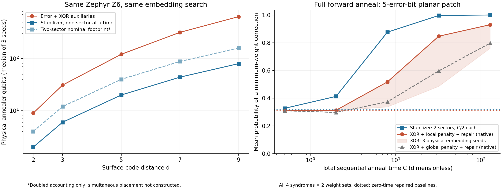

# Surface-code encodings within quantum annealing

Completed 2026-10-08. Supervised follow-up research, not a fresh autonomous
benchmark test or difficulty-calibration result. No QPU was used.

**结论：在本次理想测量、单个 Pauli sector 的 surface-code 比较中，直接的
stabilizer/dual-Ising 编码是更好的退火起点。它显著节省退火物理比特，避免
syndrome 惩罚压缩能量尺度；在完成的微型系统前向量子退火模拟中，也比
错误位加 XOR 辅助变量的编码更容易命中最小权解。这一判断已计入两个
逻辑类别的搜索，并给通用编码使用了改进惩罚和简单经典修复。它尚不是
大距离、真实 D-Wave 器件或任意退火参数下的速度定理。**

## Controlled question

The user asks which encoding is preferable within quantum annealing, before
comparing with classical MWPM. The dictated “surface hole” is interpreted as
surface code from the preceding discussion. The geometry is a planar patch
with one encoded logical qubit, not a many-hole code.

Both methods minimize `w·e` subject to `He=s mod2`. Assumptions are ideal syndrome
measurements, independent errors, positive additive weights, one X/Z error
sector, and unrotated rectangular planar patches with rough left/right
boundaries. All tied minimum-weight corrections count as success. No hidden
true error is given to the decoder. The score is minimum-weight optimization,
not a measured logical error rate or a threshold.

**A: error variables plus sequential XOR/carry auxiliaries.** This is the
lab002 construction, with both generic `Lambda=sum(abs(weights))+1` and
geometry-aware `Lambda=R+1` penalties. Here R is the maximum weighted distance
from a check to a rough boundary.

**B: reference correction plus stabilizer spins.** A weight-independent GF(2)
solve supplies a feasible reference e0; then

\[
e=e_0\oplus Bx\oplus\ell L,\qquad\ell=0,1.
\]

For fixed logical class, all spin configurations are feasible. Each error edge
meets at most two retained face generators, giving only fields or pair couplings:

\[
Q_{B,\ell}=\frac12\sum_a w_a
-\frac12\sum_a w_a(-1)^{e_{0,a}+\ell L_a}
\prod_{f:B_{af}=1}\sigma_f,\qquad \sigma_f=(-1)^{x_f}.
\]

Both classes are searched. A sample from a losing class need not be optimal
within that class if the other sample is already a global optimum. Selection
uses the original correction weight. Complete proofs are in [THEORY.md](THEORY.md).

## Hardware resources: the same automatic embedding for both

Both encodings use ideal Zephyr Z6 (1,248 qubits, 11,400 couplers), minorminer
seeds 11/29/47, timeout 5 seconds, and 4 tries. Direct penalty variants share
placements; both dual classes share a placement. There is no clique-template
versus automatic-search confound.

| Distance d | Original error bits | A: Ising spins | B: spins per class | A: physical qubits, median [range] | B: physical qubits per class, median [range] |
|---:|---:|---:|---:|---:|---:|
| 2 | 5 | 9 | 2 | 9 [9–10] | 2 [2–2] |
| 3 | 13 | 29 | 6 | 31 [30–32] | 6 [6–6] |
| 5 | 41 | 105 | 20 | 121 [119–143] | 20 [20–20] |
| 7 | 85 | 229 | 42 | 319 [316–339] | 44 [44–49] |
| 9 | 145 | 401 | 72 | 639 [581–646] | 80 [76–80] |

B reuses the one-class hardware twice sequentially. Parallel use nominally
doubles its footprint, but simultaneous disjoint placements were not
constructed. Decoding both Pauli sectors adds corresponding work to both.

For this square patch family the exact counts are

\[
N_A=6d^2-10d+5,\qquad N_B=d(d-1).
\]

A adds `4(d-1)^2` auxiliary bits. The ratio approaches six per class or three
for simultaneous two-class registers. Both are O(d²); the savings are constant
factors. Additional routing explains the measured physical ratios around 5–8
for d=3..9. These are not globally minimal embeddings.

Common parametric limits are `|h|<=1`, `|J|<=1`, and signed Zephyr coupling-group
sums `[-13,10]`, not a live-device export. Fields are split uniformly across
branches; chain trees use sufficient strength `K_i=|h_i|+sum_j|J_ij|+1`.
All coefficients are uniformly scaled, allowing upscaling. Both B classes use
the smaller of their permitted scales.

For d=5, B's scale per original unit error weight is 2, versus 0.064516 for
geometry-aware A; for d=9, the scales are 1/3 versus 0.039216. These are energy
ratios, not speedups. Penalties, chains, and field allocation are not optimized.
Scale results use one declared syndrome per distance, not a noise-distributed
ensemble. Details: [RESOURCE_REPORT.md](RESOURCE_REPORT.md).

## Improving the direct baseline is essential

We proved that `Lambda>R` is sufficient. An error with q violated checks can be
repaired along boundary paths for an added cost at most Rq. Its XOR penalty is
at least Lambda q; exact auxiliary minimization gives exactly one unit per
violated check. Thus invalid errors cannot be ground states when Lambda>R.

For unit weights, `R=floor(d/2)`. The bound is tight over all syndromes for a
uniform penalty: one central defect costs at least R to repair, while the zero
error with one final-check violation costs Lambda. The tested R+1 remains a
certified choice, not a dynamically optimized one. At d=9 it increases A's
physical scale about 28.6-fold over its generic penalty. Comparing B only with
the generic penalty would overstate B's advantage.

## Full forward-anneal experiments

We evolve the full state vector from uniform |+> under

\[
\mathcal H(u)=-(1-u)\sum_iX_i+u\alpha H_P,
\qquad u=t/T,\quad\hbar=1.
\]

Alpha saturates the common coefficient limits, with a common scale for B's two
classes. This is an ideal closed-system, dimensionless schedule, not D-Wave's
calibrated A/B schedule or microsecond timing. Per-spin driver strength is held
fixed; different register sizes still give different total driver norms.

Native experiments treat each logical graph as available. Tiny physical
experiments instead evolve actual saved Zephyr subgraphs including chain spins.

**Time:** for total budget C, B gets two sequential runs of C/2. A is tested
with one run C and two independent runs C/2. Tables use the better A strategy
per instance after inspecting probabilities. This deliberately generous
post-hoc comparison is not a deployable oracle policy. Programming/readout
overhead is omitted.

**Readout:** A's primary score marginalizes all auxiliary outputs whenever the
original error is feasible and optimal. Incorrect auxiliaries do not invalidate
a recovered correction. Chains use majority readout, with ties to bit zero.
A separately scored variant applies fixed, weight-independent GF(2) syndrome
repair. It does not minimize cost. Invalid raw outputs are discarded before
selecting the minimum-weight raw correction.

### Five-error-bit square patch

All four syndromes × two weight sets (uniform and `[1,1.25,1.5,0.75,1.75]`) give
eight equally weighted cases. A has nine logical spins; B has two per class.
All three physical embeddings are simulated: seed11 uses ten A qubits;
seeds29/47 realize native nine-spin placements. B uses two for every seed.

Mean probability of finding a globally minimum-weight correction:

| Total C | B: two classes | A: geometry penalty + repair, best strategy, native | Same A across three physical placements |
|---:|---:|---:|---:|
| 0.5 | 32.67% | 31.03% | 31.03–31.05% |
| 2 | 41.26% | 31.27% | 31.00–31.27% |
| 8 | 87.59% | 51.72% | 33.71–51.72% |
| 32 | 99.61% | 84.66% | 48.55–84.66% |
| 128 | 99.993% | 92.97% | 75.94–92.97% |

Differences within 0.1 percentage point are treated as ties. No larger reversal
appears in the tested grid, including against A's best repaired strategy. This
is not a universal ordering. For context, at C=32 native A's unrepaired one/two
run means are 73.08%/73.33%; repair improves the strongest baseline to 84.66%.

At zero anneal time, two repaired uniform A samples already succeed with mean
31.05%, versus B's 32.03%. This difference is class stratification, not quantum
dynamics. The much larger C=32 results demonstrate dynamical improvement beyond
that baseline, but do not isolate tunnelling or establish a quantum speedup.

### Eight-error-bit rectangular patch

A 2x3 patch has 8 error bits, 16 direct spins, and 4 stabilizer spins per class.
All eight syndromes are tested with unit weights. These are native dynamics.

| Total C | B: two classes | A: geometry penalty + repair, best strategy | A: generic penalty + repair, best strategy |
|---:|---:|---:|---:|
| 1 | 17.60% | 13.15% | 12.85% |
| 4 | 51.63% | 15.60% | 10.51% |
| 16 | 98.43% | 52.27% | 23.34% |

Zero-time repaired baselines are 13.43% for B and 13.38% for A. This second
geometry supports the conditional ranking. Its minimum code distance is still
two; it does not establish large-distance QA scaling.



Data: [summary](results/comparison_summary.json),
[native square](results/dynamics_square2.json),
[native rectangle](results/dynamics_rectangle23.json), physical square
[seed11](results/dynamics_physical_square2.json),
[seed29](results/dynamics_physical_square2_seed29.json),
[seed47](results/dynamics_physical_square2_seed47.json).

## Why the mappings have different dynamics

These structural statements are proved in the theory report:

1. B has only feasible decoded states and no syndrome penalty.
2. One B transverse-spin flip is a full stabilizer update in error variables.
   For A, let P project onto valid errors with their unique correct auxiliary
   completion. Every individual encoded bit flip leaves this subspace:
   `P X_j P=0`.
3. When penalty excitations are well separated, A transitions between valid
   completed states therefore involve higher-order multibit processes. This is
   conditional perturbation reasoning, not a full-anneal gap or runtime bound.
4. Changing B's canonical reference is a spin gauge transformation and/or swap
   of logical class labels. With the ideal uniform driver, |+> state and matching
   readout, forward spectra and success are unchanged. A clever initial pairing
   cannot alone improve this ideal dynamics.

The measured curves support B in the declared pilot. They do not establish that
every B instance, schedule or physical placement outperforms A.

## Advantages of A and limits

- A covers both classes in one optimization and supports arbitrary sparse H.
  B uses code structure. With k logical bits, naive class enumeration needs
  2^k runs per Pauli sector; this experiment has k=1.
- A can traverse syndrome-violating intermediate states. B can still have
  frustrated domain walls and difficult collective rearrangements.
- The comparator is sequential XOR, not every penalty encoding. Low-degree
  checks admit integer-slack quadratizations using fewer auxiliaries but denser
  couplings. They were not tested.
- Schedules, penalties, chains and postprocessing are not globally tuned.
- No large-distance quantum dynamics, finite temperature, analog noise,
  measured precision, live programming/readout overhead or QPU sampling was
  tested. The d=9 evidence concerns resources only.
- Equally weighted syndrome ensembles do not define a physical noise threshold.
  Noisy repeated measurements, joint X/Z correlations, and maximum-likelihood
  logical-class decoding require different modelling.

The supported decision is to prefer B as the structured baseline for
ideal-measurement surface-code QA, while keeping A as the general-H baseline
and tunable competitor. No superiority over MWPM is asserted.

## Validation and reproduction

- Theory: 36 geometries, 8,192 expanded XOR assignments, 128 reference-gauge
  comparisons, repair-radius checks and a below-threshold penalty counterexample.
- Hardware: 30 embeddings, 60 resource programs, 960 consistent-state energy
  checks and exact rational coefficient/range/rounding certificates.
- Physical dynamics: 96 programs across three seeds, 57,728 checked assignments;
  energy identities and sector-specific ground projections pass.
- Every dynamics score uses doubled-step convergence checks. Maximum change is
  below `4.78e-5`. Independent adaptive DOP853 integration agrees on representative
  direct/dual cases within `4.20e-6`. These are numerical checks, not rigorous
  integration-error bounds.
- An initial physical validation assertion incorrectly required every losing
  class's ground state to be globally optimal. It was corrected to require the
  appropriate class optimum; all reported physical runs completed afterward.
  No failed instance was discarded.

Audit files: [theory](results/theory_audit.json),
[resource](results/resource_saved_validation.json),
[dynamics](results/dynamics_validation.json).

From this lab directory:

```sh
python3 scripts/theory_checks.py
python3 scripts/resource_comparison.py
OPENBLAS_NUM_THREADS=1 OMP_NUM_THREADS=1 python3 scripts/dynamics.py --suite square2
OPENBLAS_NUM_THREADS=1 OMP_NUM_THREADS=1 python3 scripts/dynamics.py --suite rectangle23
OPENBLAS_NUM_THREADS=1 OMP_NUM_THREADS=1 python3 scripts/physical_dynamics.py --seed 11
OPENBLAS_NUM_THREADS=1 OMP_NUM_THREADS=1 python3 scripts/physical_dynamics.py --seed 29
OPENBLAS_NUM_THREADS=1 OMP_NUM_THREADS=1 python3 scripts/physical_dynamics.py --seed 47
python3 scripts/theory_checks.py
python3 scripts/validate_dynamics.py
python3 scripts/summarize.py
```

The second theory check includes physical artifacts. Previous lab002 modules are
imported read-only with dependency hashes recorded. No benchmark prompt or
previous lab was modified. Fresh heuristic placements may vary; saved witnesses
define the reported results. Rectangle classical simulation took about 412 s,
which is not the simulated anneal duration.

## Sources

- [Dennis et al., Topological quantum memory](https://arxiv.org/abs/quant-ph/0110143): homology and disordered-spin mapping.
- [Takeuchi et al., Comparative study of decoding the surface code using simulated annealing under depolarizing noise](https://arxiv.org/abs/2311.07973): constrained versus constraint-free formulations, tested with classical simulated annealing and Digital Annealer; not evidence for quantum-annealing speed.
- [D-Wave embedding guidance](https://docs.dwavequantum.com/en/latest/quantum_research/embedding_guidance.html): chain and coefficient-range considerations.

The count formulas, repair-radius proof and quantum simulations are derived and
executed in this lab, not inferred from classical-annealing timings.
