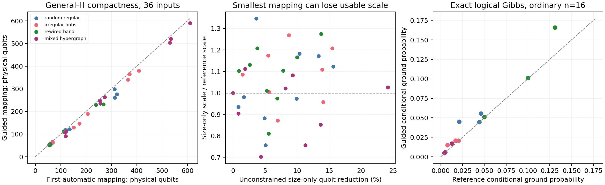

# General-H evaluation-guided compact embedding: research report

## Main finding

This round closes a limited but substantive loop on ordinary sparse matrices:
a tree-repair certificate controls chain defects and logical-Gibbs distortion
without solving decoding, and its certified scale guides more compact valid
minor embeddings. On 36 routine inputs from 4 distinct sparse-matrix generators,
the guided method reduced qubits relative to the first compact automatic
minorminer embedding on 33/36, averaging 6.57% (median 4.79%). All 24 held-out inputs
remained valid;22/24 improved, averaging 6.83%. Every selected program preserves
or increases the reference effective logical scale and satisfies a certified
terminal-equilibrium chain-defect bound below 5% at the declared beta 20.

These are endpoint thermal/static guarantees. They do not establish real-QPU,
finite-time quantum-annealing, bath-mixing, or logical-observable superiority.
An improved certificate is not automatically an ordering of actual success.

## Scientific method and guarantee

The full derivation, input fidelity, programming model, costs and numerical
scope are in `THEORY.md`. A general sparse-H XOR-chain compiler fromLab 002 is
reused read-only with recorded SHA-256 provenance. It assumes no code geometry,
column-degree bound or independent checks. Negative/zero dyadic weights and
feasible syndromes are included. Penalty M>sum|w| preserves all minimum-cost
feasible projected ground states; every actual interaction, auxiliary and
isolated variable is embedded.

Choose a spanning tree and weighted-centroid root in each minor branch. Split
logical couplings across hardware contacts and place the logical field at the
root. If L_e is the descendant absolute external load, chain strength F_e gives
repair margin delta_e=F_e-alpha L_e. A wall-set/root-spin bijection proves

    E(sigma)-E(repair sigma) >= 2 sum_walls delta_e,
    P(any chain broken) <= 1-product_e(1+exp(-2 beta delta_e))^(-1).

Positive margins certify faithful physical ground states. In terminal classical
Gibbs equilibrium, conditioning on all branches consistent gives the exact
logical Gibbs law at beta*alpha (up to an audited rounding correction). The
root-decoded law is within the defect bound in total variation of that logical
Gibbs law. Full logical-model ground-state probability is monotone in alpha,
including degeneracy. This connects the cheap criterion to a meaningful
conditional equilibrium sampling quantity without computing a global partition
function. It does not order the larger event of projected original-error
optimality in the presence of excited compiler auxiliaries.

For K chain edges, set a common physical margin d=log(K/epsilon)/(2beta), then
F_e=alpha L_e+d. Maximizing alpha under all individual and group ranges is a
one-dimensional intersection of affine constraints. The evaluation returns
inconclusive if this certificate cannot fit the ranges. The main hardware model
is ideal Zephyr g=6,t=4 with 1248 sites and full node/edge/group lists saved. Ranges
h∈[-4,4],J∈[-1,1] and signed coupling groups∈[-13,10] are illustrative declared
constraints, not properties downloaded from a particular device.

An optional rigorous local-driver-removal correction extends chain-consistency
bounds to quantum Gibbs equilibrium. For branch C, remove its transverse driver,
use the repaired-block bound, and restore it with correction
cosh(beta*sum_{q in C}|Gamma_q|)-1, capped by a Pinsker alternative and unioned
across branches. Outside branches can retain quantum drivers. This requires
equilibrium and does not transfer the classical conditional-success ordering
to a nonzero-driver anneal.

## Frozen main experiment

`PROTOCOL.md` predates results. Four fully specified generators cover uniform
random degree-four checks, irregular degree 2–7 checks with hub columns, rewired
banded checks, and graph-incidence matrices augmented with hyperchecks and a
dependent row. Sizes are n=16/32/64 with m≈n/2. The suite has 12 development inputs
(seed 1101) and 24 held-out inputs (seeds 2203/3307). There are 46–314 compiled logical
variables and 52–590 final guided physical qubits. The labels were frozen before
runs; no methods or thresholds were fitted to the held-out outcomes.

Each instance receives the SAME eight minorminer seeds,5-second timeout and
2 tries per seed. All 288 main candidate searches returned valid embeddings.
The first-valid candidate is the reference. Guided pool selection minimizes
qubits subject to the first-valid certified alpha floor. The unconstrained
size-first control uses the same candidate pool, breaking qubit-count ties by
larger alpha (a favorable control). Both have identical embedding proposals.
A deterministic one-pass deletion refinement then compares constrained and
unconstrained acceptance from the same start; adaptive trajectories can in
principle differ, so their actual proposals/costs are charged separately.
A supplementary common one-step deletion pool tests both rules on exactly the
same proposals, as documented by the protocol clarification.

| Main outcome | Development 12 | Held-out 24 | All 36 |
|---|---:|---:|---:|
| Guided qubit reduction, mean |6.06%|6.83%|6.57%|
| Guided qubit reduction, median |4.88%|4.59%|4.79%|
| Inputs with fewer guided qubits |11|22|33|
| Size-first pool choices losing reference alpha |4|9|13|
| Median evaluator time |20.8 ms|17.4 ms|18.6 ms|

Per-family average reductions are random-regular 6.13%, irregular-hubs 6.99%,
rewired-band 5.78%, mixed-hypergraph 7.38%. These are gains against an already
compact automatic mapping; no clique-template baseline is used to inflate them.

Uniform guided pool selection alone averages 5.87% fewer qubits. The final
guided deletion pass raises this to 6.57%. Unconstrained minimum-size pool
selection gives more compact mappings on average, but loses certified alpha
on 13/36. The constrained and unconstrained deletion trajectories were identical
on all main cases: the acceptance constraint did not add a refinement benefit
beyond pool selection in this suite. The exact common one-step control has 109
proposals across 15 instances; both acceptance rules find a deletion on all 15.
This null result is retained.

Physical allocation matters separately. On identical first-valid embeddings,
cut-based strengths increase usable alpha by an average 2.98× relative to the
standard whole-logical-load chain condition with the same contact/field policy
and thermal margin. This is a programming/certificate gain, not a qubit reduction
or an observed annealing speedup. Actual final guided alpha ranges.00346–.05749;
large penalty and problem sizes still compress the logical cost scale.

## Cost and validation

The 36-instance round takes 197.7 s of measured per-instance work:179.3 s in the
common automatic embedding pools and 6.70 s in their evaluation, with remaining
cost including compilation, refinements, sensitivity checks and saving witnesses.
The evaluator uses sparse tree/contact/group arithmetic, not Hilbert-space
simulation or decoding optimization. Its current implementation scans the full
cached target-group list on every call; the 18.6 ms median includes that overhead.
Cost is output/target linear on bounded-degree Zephyr; deletion passes can be
quadratic and are reported separately.

All 180 saved main selected programs pass exact-rational checks of actual binary 64
coefficients, ranges, tree margins and projected ground-state fidelity. Maximum
coefficient L 1 error against the authoritative companion is 1.12e-14. The
conservative logical-Gibbs rounding correction is below 4.48e-13. Independent
root review separately verifies all 180, including outward-rounded exponential
bounds; maximum outward main global defect bound is.04876656. No guided final
alpha is strictly below its reference, despite the implementation's declared
1e-10 acceptance tolerance. Positivity/validity alone are not treated as a
quantum-performance theorem.

Local checks enumerate 100 arbitrary frustrated physical tree models at 3 beta
values (300 cases), checking the pointwise repair inequality, actual Gibbs
failure probability, physical ground states and conditional law. Twenty-four
small compiler cases include dependent rows, zero/negative weights and ties.
Independent review additionally checks 270 dense quantum-Gibbs cases with
outside quantum drivers. These small checks validate the mathematics; ordinary
coverage and compactness claims come from the 36-instance general-H suite.

At the main beta 20, all 36 final quantum-Gibbs union bounds are nonvacuous for
Gamma=.001: maximum.33937 (the guarantee is weaker than 95% consistency).
At Gamma=.0001 maximum is.05288. Main 95% consistency is the classical terminal
certificate at Gamma=0. Larger driver/temperature values can be inconclusive;
no device schedule, freezeout point or temperature is inferred from these units.

## Actual terminal-quality checks and a ranking limitation

Exact original-error enumeration plus per-row auxiliary transfer matrices
computes the full logical partition function for all 12 ordinary n=16 matrices.
This reference calculation takes 3.88 s and is NOT used during construction or
selection. Full-model conditional ground probability improves on 10/12 and
never decreases, as predicted by alpha monotonicity. First-valid values range
.00433–.13110; guided values range.00467–.16564. These modest probabilities make
clear that chain consistency does not ensure high decoding probability.

Independent outward interval transfer calculations certify a strict ordering
of the event "chain-consistent full-model ground readout" on 8/12, including 6/8
held-out inputs, using lower_new=(1-defect_new)*g_new_lower and
upper_old=g_old_upper plus rounding corrections. They certify no unconditional
root-decoded optimum ordering on these 12. Thus the formal result sometimes
orders an actual terminal event, while returning inconclusive for the more
inclusive error-readout event.

Supplemental n=6 general-H inputs permit exact physical-state enumeration in 3/4
families (11–20 physical sites, up to 2^20 states). The hypergraph case has 28–30
sites and is skipped under the frozen 22-site limit. Exact conditional projected
and full-model-ground probabilities agree with their separate transfer
predictions. A useful limitation occurs for random-regular n=6: both selected
embeddings use 20 qubits and have the SAME.04819 defect certificate, yet actual
chain defects increase.01201→.02082 while root-decoded optimum probability
increases.48605→.67246. Therefore neither shorter chains nor the certificate
alone orders actual defect rates, and quality measures can trade off. Rewired
n=6 has 20→17 qubits and actual optimum probability.72253→.87641, but this small
comparison is validation only and does not establish general-QA superiority.

A first assertion conflated full-model ground readout with original-error
optimality through excited auxiliaries; the assertion and event accounting were
corrected. The failed trace is preserved. No central repair/Gibbs inequality
failed.



The figure concerns the declared endpoint model; its right panel is full-model
conditional ground mass, not finite-time annealing success.

## Scaling, defects and reuse extension

`EXTENSION_PROTOCOL.md` was frozen after main results and uses new seeds.
On the SAME 1248-site g=6 target, n=128 fits 3/4 families: random-regular 716→678
qubits, irregular-hubs 817→759, rewired-band 555→528, preserving/increasing alpha.
Mixed-hypergraph n=128 exhausts all 8 heuristic searches. All 4 n=256 inputs also
exhaust the 8×5 s search budget. These are heuristic failures, not certified
impossibility. They bound practical coverage of this implementation on this
fixed target; no larger target is silently introduced.

With 5% synthetic qubit deletions and 1% surviving-edge deletions, all 4 new n=64
inputs fit and guided selection reduces first-valid qubits 337→305,332→323,
276→246,623→553 while preserving the scale floor. Signed groups are regenerated
on the defective graph. This is a synthetic-defect test, not a real-device
working graph. Total scaling/defect extension cost is reported in the saved
summary, including failed searches.

For 160 new feasible-syndrome/weight updates across 4 n=64 development matrices,
fixed H/M and the saved guided embedding remain valid in every case. Shuffling
weights preserves the penalty envelope. Compilation, explicit embedding
revalidation and reevaluation take a median 25.7 ms/update, total 5.34 s including
bookkeeping. No new minor search is used. This demonstrates the stated reuse
model, without claiming arbitrary H/window changes can reuse the same embedding.

## Supplemental sparse LP allocator

`LP_PROTOCOL.md` separately freezes a fixed-pool contact-allocation experiment.
For fixed roots and trees, physical contact magnitudes, chain strengths and
alpha obey linear conservation, repair-margin and programming constraints.
The ideal LP optimum cannot be worse than uniform splitting within this fixed
class. HiGHS outputs are treated as feasible numerical candidates, with margin
reserve, alpha backoff and exact-rational final audits; no exact optimality
certificate or global embedding optimum is claimed.

The 288 unchanged main candidate embeddings need 4.33 s of LP solving/allocation;
the complete supplementary round takes 11.16 s including uniform reevaluation,
selected audits and output. Average candidate scale gain is 10.32% (median 8.33%),
including tiny backoff losses for exact ties. LP permits a smaller candidate
than uniform guided pool selection on 7/36 and reaches the unconstrained
minimum-qubit pool choice on 28/36. Its mean reduction versus original first-valid
is 6.49%, compared with 5.87% for uniform pool selection alone. This comparison
holds embedding proposals and quality floor fixed and isolates allocation-guided
selection. All 36 selected LP witnesses pass the exact-rational fidelity audit. Independent
interval transfer checks additionally prove strict chain-consistent full-model
ground-readout ordering versus first-valid on 11/12 ordinary n=16 inputs for
LP-selected programs, compared with 8/12 for uniform guided-pruned programs.
The same audit proves 0/12 unconditional root-decoded-optimum orderings; that
comparison remains inconclusive. See
`results/independent_logical_gibbs_intervals.json` for the interval evidence.

A bounded exploratory LP+deletion combination is recorded separately in
`LP_REFINEMENT_PROTOCOL.md`. On 12 development cases it improves all 12 versus
first-valid, averaging 7.00% fewer qubits; pruning adds a gain beyond LP-only on 5.
On 8 entirely new inputs (seed 7703,n=32/64,all 4 generators), the unchanged combined
rule improves 7/8 versus first-valid, averaging 5.53% (median 4.74%), with no scale
floor loss and exact-rational fidelity checks passing for every final program.
LP-only reduction on these new inputs averages 4.80%; pruning improves 3/8 further.
The guided pruning work takes 1.08 s for 27 graph-valid proposals on the new inputs.
The full exploratory round takes 48.72 s including new automatic candidate pools,
LP allocation, both pruning controls and output. Again constrained and
unconstrained pruning outcomes coincide (all 20 cases), preserving the null
refinement-control result. These new inputs validate this adaptively chosen
combination; previously seen main held-out rows are not relabeled as fresh
validation for it.

## Reproducibility and retained scope

For arbitrary input matrices, the reusable constructor accepts only n,rows,
syndrome and weights (plus optional declared target/ranges), as explained in
`README.md`. A smoke run on the saved irregular 16 -variable example returns a
67-qubit program with exact-rational static fidelity; empty, isolated-variable,
dependent-row and tied-weight interface cases also pass.

From this lab directory, run:

```text
python3 scripts/construct.py --input results/input_example.json --output results/constructor_example.json
python3 scripts/run_suite.py
python3 scripts/postprocess.py
python3 scripts/theory_checks.py
python3 scripts/logical_gibbs.py
python3 scripts/physical_gibbs.py
python3 scripts/run_extension.py
python3 scripts/update_audit.py
python3 scripts/run_lp.py
python3 scripts/lp_refinement.py
```

Pin packages using `requirements.txt`; graph versions and exact source hashes
are in `results/target.json` and `results/source_provenance.json`. Each routine
instance JSON saves sparse H, syndrome, weights, feasibility witness, the full
compiled model, all candidate embeddings, selected physical coefficients,
offsets, trees, roots, margins and timings. The source imports the two hashed
Lab 002 modules read-only; no prior lab or original prompt is edited. Independent
review code/results are separately owned by the parent agent and identified in
the lab's root report.

The result is a useful endpoint/static evaluation-and-construction loop under
explicit assumptions, with modest compactness gains and actual conditional
thermal implications. Remaining limitations are severe for dynamical claims:
no finite-time relaxation/QA theorem, real-device calibration/noise, large-scale
actual-success ordering, globally optimal contacts/roots/embeddings, arbitrary
window-change routing guarantee, or observable-class decoding analysis.
