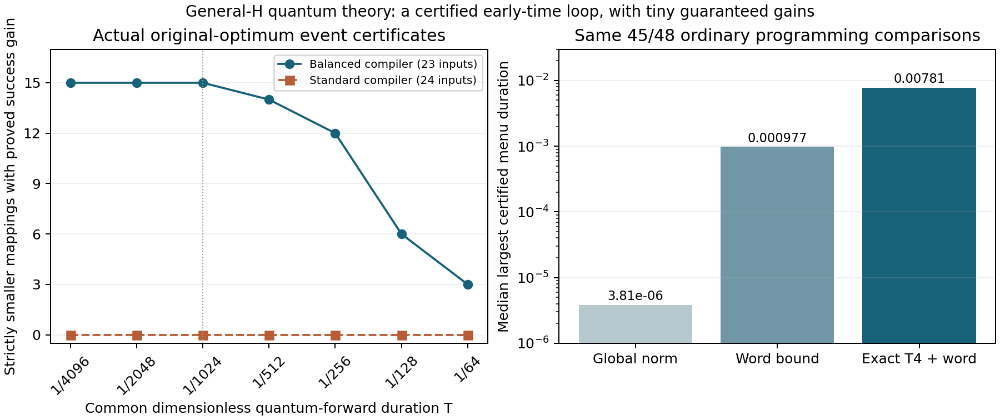

# General-H readout, finite quantum criteria and a SciCode2 issue

## Findings: outcome and remaining gap

This round develops reusable general-H repair and evaluation algorithms, proves new endpoint and finite-forward statements, and constructs an English standalone [research issue](../../problem/ISSUE-general-h-finite-annealing.md). The issue passes the local creation screen as a plausible research question. It is not yet a calibrated or organizer-approved benchmark.

The strongest new result is an actual ORIGINAL-OPTIMUM probability certificate-guided compact-mapping loop for generalH, in an explicitly early-time quantum regime. Within the balanced compiler, it selects15 strictly smaller mappings on23 ordinary inputs, mean4.075% fewer qubits across all23, while proving higher success probability at common dimensionlessT=1/1024. The basic standard-compiler selector is inconclusive on24/24; a later optimal-set relaxation certifies3/24, all at n16, with charged feasible-search preprocessing. The guaranteed relative gains are tiny, and balanced compilation costs about twice the standard hardware. This is a genuine restricted closed loop, not practical annealer decoding.

Supporting advances include a weighted GF2 repair witness, exact balanced thermal compiler, sparse quantum readout moments, rare-event-relative word majorants and exact program-specific T²/T⁴ coefficient bounds. An earlier T^4-only selector found9 smaller standard mappings out of24, mean2.73%; those quality predictions remain heuristic and are distinct from the final certified balanced loop.

The main unresolved question remains a useful, inexpensive theory criterion that orders ACTUAL ORIGINAL-ERROR optimum probability over a meaningful finite-anneal regime and guides compact mappings without excessive compilation overhead on ordinary generalH. Endpoint certificates, conditional mean-cost improvements and unconditional local-cost orderings each establish different facts. None may silently replace that target.

| Result | Evidence | Main limit |
|---|---|---|
| General-H repair penalty and exact balanced thermal law | General proofs; exact/exhaustive small audits | Static/endpoint claims alone do not establish dynamics |
| Same-mapping actual optimum-event quantum order |48/48 after zero-search feasible upper control; median certifiedT=.015625 | Early dimensionless time; no practical absolute-success guarantee |
| Balanced compact mapping loop |15/23 smaller mappings; mean4.075%; actual event certificates atT1/1024 | About2× standard compiler hardware; tiny proved gain |
| Standard compact mapping follow-up | Exact optimal-set relaxations and charged feasible-witness controls | 1/24 with zero-search upper witness+LP;3/24 with charged search+LP; all larger standard cases inconclusive |
| Full physical quantum anchors |16/16 positive at all five original times;8/8 atT32/64/128 | Numerical tractable anchors, not ordinary-size proof |
| Finite classical dynamics | Endpoint compiler ordering reverses under matched finite work | Classical dynamics do not establish quantum ordering |
| SciCode2 issue | Self-contained English text/PDF; editorial pass-to-testing | Difficulty, fair useful-regime feasibility and organizer acceptance unassessed |

## Motivation

The user wants a reusable sparse-H decoding-to-annealer algorithm and cheap theoretical quality evaluation that helps ordinary instances, rather than a named-code construction or toy-only comparison. Prior endpoint certificates did not settle actual decoding under finite quantum dynamics. This round targets that gap while formulating a self-contained research issue.

## Design and authorization

The user allocated three hours beginning2026-10-16T08:57:05Z, ending11:57:05Z, and requested continued research plus an English SciCode2 issue. This is continuing author-context research with an existing scientific child and parent collaboration; neither a fresh autonomous model trial nor calibration. No QPU, paid API, external issue publication or automation was used. Original TASK.md/prompt.md and prior labs remain unchanged, with dependency hashes checked at closeout.

The scientific child independently chose thermal entropy/readout analysis, a balanced compiler and local classical dynamics. The parent developed weighted repair penalties, independent audits and full quantum-forward criteria. Subsequent exchanged ideas/proof reviews are documented collaboration, not human expert interventions. Development/held-out labels apply only to the originally frozen child main protocol; later parent extensions reuse data exploratorily and do not inherit a held-out claim.

Frozen/adaptive protocols: [main](PROTOCOL.md), [parent repair penalty](independent/PENALTY_PROTOCOL.md), [full forward](independent/FORWARD_PROTOCOL.md), [sparse moments](independent/FOURTH_ORDER_PROTOCOL.md), [mapping selection](independent/MOMENT_SELECTION_PROTOCOL.md), [local remainder](independent/LOCAL_FORWARD_PROTOCOL.md), [longer forward](independent/LONG_FORWARD_PROTOCOL.md). Failures, unsuccessful bounds and integration levels are retained. The original budget was never restarted.

## General-H repair algorithm and reduced penalties

[independent/penalty_bound.py](independent/penalty_bound.py) accepts arbitrary binary sparse rows, feasible syndrome and finite signed weights. It greedily finds a minimum-total-|w| column basis B, chooses independent original rows R and computes the GF2 inverse H[R,B]^(−1). A saved exact reconstruction identity verifies that this is a right inverse on imH. Its repair columns Delta_j have loads L_j=Σ_{i in Delta_j}|w_i|. Any syndrome residual repairs at objective-cost increase at mostΣ_j L_j v_j≤C|v|, C=max_jL_j≤Σ_{i inB}|w_i|≤Σ_i|w_i|.

Therefore M>C suffices for the unchanged parity compiler's projected ground fidelity; the study uses M=C+1 and recomputes the rational coefficient gap and actual physical rounding certificate. This is not classical minimum-weight decoding. It works with dependent rows, irregular/higher-order columns, zero/signed weights and all feasible syndromes. The algorithm's costs are bitset Gaussian elimination and output-size dependent; no claim of linear-time elimination follows from sparsity alone.

[Validation](results/penalty_checks.json) covers120 small matrices,6,650 original-error repairs,108 full-QUBO ground enumerations and40 independent minimum-column-basis checks. In the [48-input study](results/penalty_summary.json),36 historical inputs and12 fresh seed8809 inputs use identical mappings per penalty comparison. Mean logical-scale gains are6.02× and6.51× respectively, with median witness calculation about1ms. There is no qubit reduction from this programming-only intervention.

For the16 n16 inputs, outward endpoint intervals prove13 strict ORIGINAL-ERROR optimum probability improvements(10/12 historical,3/4 fresh), zero strict reversals and3 inconclusive comparisons. Auxiliary excitations count as successful when the roots give an optimal feasible correction. These are terminal-Gibbs statements; larger alpha alone is not a decoding-probability ordering across different penalties.

## Balanced compiler and inexpensive endpoint readout evaluation

[Child theory](THEORY.md) and [report](RESEARCH_REPORT.md) prove that four even-flipped independent-hidden XOR factors at strengthM/4 have actual interaction graphK3,4, valid partition factora=(1+r)^4 and invalid factorb=8r(1+r²), r=exp(−beta alpha M). Row-prefix transfer gives exact soft-parity factors. Conditioned on H e=s, the original-error marginal is exactly the intended additive-cost Gibbs law, including all excited auxiliaries. The ordinary compiler can have auxiliary free-energy bias within the feasible set.

A GF2 repair bijection gives a cheap syndrome feasibility bound and, with chain/rounding/entropy terms, an original-error distribution TV certificate. Balanced post-witness evaluation is linear in row/output size. The ordinary row-envelope audit can costO(Σd2^d); it explicitly returns inconclusive above degree20. Measured balanced witness+readout evaluation is median0.98ms, versus3.84ms ordinary, with ordinary worst case343ms at degree17.

The main study has24 new ordinary matrices: four unrelated sparse generators, n16/32/64, seeds8807(development) and9901(reserved). Standard fits24/24; balanced fits23/24 within the same eight-seed search budget. The balanced failure is a heuristic search failure, not proved impossibility. On23 common inputs it uses1.998× physical qubits and1.806× logical scale. It improves beta20 TV≤.25 coverage from8/23 to16/23, but is not a compact representation win.

Independent [positive interval transfer](results/independent_readout_intervals.json) checks64 actual n16 programs. Strict balanced root-decoded-optimum endpoint orders are3/8 at beta10,6/8 at20,8/8 at40 and8/8 at80, with no strict reverse. The balanced transfer is independently checked by a70-digit full256-state physical sum. Separately, [373 saved-program audits](results/independent_child_program_audit.json)(309 distinct core witnesses) check rational reduction fidelity, physical ranges, chain margins and outward rounding/defect terms. These program sets differ from the child's188 beta-curve audits; their maxima must not be pooled as one audit.

## A rigorous dynamics warning and finite classical evidence

The child proves a random-scan local heat-bath/Metropolis mixing obstruction: a physical original-root flip must cross a broken-branch endpoint. Reversibility bounds indicator conductance by branch-defect probability divided by the number of physical spins. A general-H kernel witness bounds the root marginal away from0 and1; a spectral/mixing lower bound follows. This concerns a terminal CLASSICAL hold, not coherent quantum dynamics, typical-start decoding time or optimum failure probability.

The strongest beta20 example uses a nonzero-cost kernel pair[14,41], cost1.75, and yields a1.68e15-sweep worst-case mixing lower bound. Certified chain relaxation reduces that bound to660 sweeps while preserving the requested consistency budget. A smaller obstruction bound does not prove faster actual mixing.

Finite-work classical anneals provide an important negative result. Under matched attempted physical-site-update budgets, mean n16 optimum success is0.00757 ordinary versus0.00195 balanced; their terminal references are0.04352 and0.12039. The compiler ordering reverses. Equal attempts mean different sweeps when physical sizes differ, which is explicitly charged. All109,824 saved physical outputs pass independent rescoring. n32 exact optima yield0/4096 at the largest budget; n64 optimum success is unassessed, rather than called failure. These are CLASSICAL results and cannot establish quantum ordering.

## Actual full quantum-forward theory and anchors

The parent uses the complete physical closed-system schedule K(u)=−(1−u)ΣX+uE(Z), initial|+> on EVERY active spin, durationT, and declared root readout. All auxiliary/branch excitations are included in the original-error success event. Fields/couplers are actual programmed coefficients. This is a defined research model, not a validated commercial-device noise model.

[FORWARD_THEORY.md](independent/FORWARD_THEORY.md) proves the relative T² original-optimum coefficient under fixed-coupler objective amplification is Delta_eta(Σw−2C*)/12. Affine feasible-cost moments give a cheap optimum upper bound without solving decoding. An exact-rational global Dyson remainder plus actual field-rounding correction proves strict finite-forward optimum orders on45/48 ordinary pairs. The3 inconclusive cases are retained. Certified durations are only1.19e−7 to3.05e−5(median3.81e−6); their effects are operationally tiny. This is a genuine finite-QA theorem, but not a practical closure.

[Sixteen full physical anchors](results/forward_anchor_summary.json), four matrix generators at n6/n8 and two seeds, use9–18 physical spins. At all five durations(.05,.25,1,4,16), amplified programs numerically improve the actual original-optimum probability on16/16. AtT16 cohort mean success changes0.10355→0.19460. All160 program-duration runs converge by step doubling. A separate adaptive DOP853 [40-case audit](results/forward_ode_audit.json) agrees with the independent Strang backend within2.50e−6 in optimum probability. These tractable general-H anchors are validation, not large-instance proofs.

The [longer-duration extension](results/long_forward_summary.json) retains all eight original n6 anchors atT32/64/128, both programs, with separate budget/convergence limits. All24 longer-duration pairs converge and favor amplification. AtT128 the eight-input mean optimum probability is0.53717→0.69526. An independent eight-program T128 DOP853 audit agrees within4.80e−6; maximum norm error is3.12e−7. These are numerical anchor results, not ordinary-size proofs.

## Sparse quantum moments and compact mapping decisions

[QUANTUM_MOMENT_THEORY.md](independent/QUANTUM_MOMENT_THEORY.md) derives q2=LE/12 and the linked log-probability q4=−L³E/1344+LB/2240+C/576−D/1344. For pairwise physical interactions these are sparse local-star Walsh polynomials. GF2 kernel characters compute feasible probability and conditional feasible mean-cost coefficients without enumerating errors or physical states. Arithmetic operation count isO(N+|J|+Σdegree³+nP), plus elimination; the implementation's wide integer masks carry additional bit costs.

Fixed-coupler objective amplification changes the conditional mean-cost T² coefficient by−Delta_eta Var_F(cost)/6≤0, valid for generalH and signed weights. This is a quantum coefficient identity, not a Gibbs statement or an unconditional optimum ordering. [Exact independent Dyson checks](results/fourth_order_checks.json) pass24 arbitrary physical models/278 basis states. [143-program evaluation](results/quantum_moment_summary.json) takes median10–14ms, maximum118ms. Independent ODE anchors retain the failure of truncated predictions at longer durations.

The [compact selection study](results/moment_selection_summary.json) reconstructs all192 programs from the24 saved eight-candidate STANDARD pools. AtT=.25 it keeps only candidates with no more qubits than the first automatic candidate and nonworse T^4-predicted feasibility/conditional cost. Ten selections change;9 strictly reduce qubits; mean reduction is2.73% across all24. Median moment calculation is9.96ms; all candidate reconstruction/selection takes10.87s. There is no extra minor search or decoding solve. The comparison is against FIRST candidate, not the prior compactness/alpha-selected mapping. Because no useful T^4 transfer remainder is supplied for these joint events, this is an implemented exploratory heuristic with theoretical coefficients, not proved finite-time decoding gain.

## Local-observable finite-T remainder

[LOCAL_FORWARD_THEORY.md](independent/LOCAL_FORWARD_THEORY.md) proves a bound from termwise nested commutators, support growth and local incident strength gE=max_q(|h_q|+Σ|J_qr|). A support-s diagonal observable's remainder beyondT^4 is bounded by the even negative-binomial tail atx=(1+gE)|T|<1. For a single-root observable the tail isx^6/(1−x²), independent of total physical spin count.

Using exact rational coefficients of the actual binary64 programs, this certifies UNCONDITIONAL original-error MEAN-COST improvements on48/48 ordinary pairs at menu durations.0125 or.025(median.025), median174ms evaluation. Independent adaptive ODE checks pass24 anchor program/time combinations. This greatly improves the time regime for a local observable; it does not certify syndrome feasibility or minimum-cost feasible-error probability. A low mean cost may come from invalid corrections. The unresolved global decoding event must not be replaced by this result.

## Refined original-event bounds and a certified compact-mapping loop

The isolated [child extension](theory_extensions/RESEARCH_REPORT.md) proves a uniform-diagonal L1 operator norm that retains the unknown initial event massP0, a local original-readout support remainder, and schedule-aware driver/energy word majorants. It never divides a loose operator bound by rare-eventP0. A final [proof clarification](independent/PROOF_CLARIFICATION.md) tracks each displacement term's UNION of diagonal-function and flipmask support; the frozen phrase about function-dependence growth alone was too strong. The corrected argument preserves every recurrence, constant and result, and all frozen snapshots remain unchanged. Exact even orders through12 plus the proved remaining tail certify45/48 actual optimum-event orders at medianT1/1024,256× the original global bound. Independent explicit-word integration agrees on18 rational coefficients;64 exact operator coefficients throughT8 and64 zero odd coefficients pass.

[The final parent event theorem](independent/CERTIFIED_EVENT_THEORY.md) computes the exact T4 original-root polynomial by averaging every nonroot and XOR-convolving equal unobserved-character groups. Its constant minus nonconstant coefficient L1 norm bounds the unknown optimum-set average. A one-dimensional exact cost Lagrange bound handles T² coefficients across DIFFERENT mappings and physical sizes, using only a cheap C* upper bound. No decoding oracle, optimum-event enumeration or state vector enters selection.

For48 fixed-coupler programming comparisons, this certifies45 strict actual optimum orders at largest dyadic durations.00390625–.03125, median.0078125: median2048× larger than the original global-norm certificate and8× the word-only extension. The same3 cases remain inconclusive. Median calculation is177ms, max766ms. An increased certified duration is not an assertion of larger absolute success.

The [final mapping study](results/certified_mapping_summary.json) keeps compiler/penalty unchanged, using375 successful candidates from24 standard and23 balanced models on the same24 originalH inputs. The first automatic candidate is the baseline. Every common menu duration uses exact actual-program event bounds; choose minimum qubits within the baseline cap only on a strict certificate, otherwise fall back. At the predeclared primaryT1/1024, balanced gives17/23 certified changes,15 strict smaller mappings, mean4.075% qubit reduction across all23. The basic cost-Lagrange standard criterion gives0/24 certified changes at every duration: retained inconclusiveness, not evidence no better mapping exists. AtT1/64 only4 balanced changes/3 reductions survive; at1/256,14/12. The full frontier is saved.

The primary selected relative probability lower gains are3.06e−12–6.18e−8, median2.62e−10. Actual absolute guarantees multiply by unknownP0, which can be extremely small. Balanced physical cost remains about twice standard. The result closes an EARLY-TIME theoretical guidance loop, not a useful general annealing regime. All pools are reused exploratorily, without a new held-out claim.

Criterion work across375 candidates costs34.67s, median0.608s per model pool. Incremental program reconstruction costs5.90s; standard LP programs are reused from the earlier10.87s moment-selection work, so that earlier cost is not hidden. Overall final study takes45.32s including serialization/audits. Exact-fraction tie selection was independently verified on329 model-duration decisions and the implementation then made exact sorting explicit. Every candidate, including every baseline, passes a [separate actual-program audit](results/independent_certified_mapping_audit.json):375 programs and329 exact-rational selection decisions, zero sorting mismatches. Large exact rational witnesses are serialized as hexadecimal numerator/denominator strings; all95 projected-event/mapping files parse with default Python integer limits.

[Independent projected-event checks](results/event_projection_checks.json) pass24 arbitrary physical program pairs with different sizes/roots:2,688 basis states,352 exact projected coefficients and24 independent adaptive-ODE event inequalities. Only this validation enumerates optima. These checks supplement, rather than substitute for, the general proof.

## Standard-compiler optimal-set relaxation and controls

The [final isolated extension](standard_extension/RESEARCH_REPORT.md) strengthens optimal-set character bounds using fundamental/pair kernel-move necessary inequalities and valid three-character tetrahedron facets. HiGHS proposes nonnegative multipliers; an exact rational dual box formula verifies each bound independently of numerical LP optimality or primal feasibility. Every unknown optimum satisfies the inequalities, including ties. This is general-H theory, not a named-code argument.

With only the moment upper bound, all192 standard candidates remain inconclusive, although164 lower bounds improve and the maximum improvement is.5207. The negative-curvature diagnostic also gives no adverse-order certificate. Adding the already computed particular cost and the strongest LP certifies1/24 smaller standard mappings (mean.4032% across24); adding a separately charged16-start bounded feasible kernel descent certifies3/24 (mean.6563%). All3 have n16: mixed_hypergraph_s8807,111→110; rewired_band_s8807,58→55; rewired_band_s9901,62→56. Their primary relative event advantage lower bounds are4.44e−8,1.25e−8,5.56e−8. All16 n32/64 standard models remain inconclusive.

The mechanism controls matter: cost-only bounds with either improved upper witness still give0 changes; basis-only and basis+pairs controls also give0. Only the evaluated triangle-augmented combination yields the1/3 changes. This establishes what explains these measured certificates, not logical necessity for every possible method. All duration outcomes remain retained; no new minor search or full quantum evolution was run.

The searched feasible witness costs median14ms,total1.39s, with715,220 evaluated kernel moves and no accepted-move cap hits. It is charged approximate classical cost search and is never called optimal; it is used only as an upper witness. Particular cost costs median.142ms and zero search. Initial24-pool three-method LP evaluation takes3.76s; strongest-LP runs with particular/search upper witnesses take2.52s/3.30s incrementally. Prior embedding/programming/GF2/q4 work is not included again. Exact finite binary64 weights are supported via integer-denominator scaling; larger bit precision may cost much more.

Child audits verify1,728 exact dual witnesses,12,096 gap updates and48 ordinary feasible witnesses. A separate [parent audit](results/independent_standard_extension_audit.json) reconstructs192 actual root polynomials,960 primary/control dual bounds,11,368 nonzero multiplier rows,2,688 gap updates,336 exact selections and all48 feasible witnesses, without LP/reference solves. Sixty arbitrary small matrices independently validate75 optimal patterns,2,084 necessary inequalities and480 dual bounds; only validation enumerates optima. These are substantive retained negative/positive findings, not model-difficulty evidence.

## Zero-search upper-bound refinement

The affine particular solution was already computed for the repair/moment witness. Its exact feasible cost gives C*≤w·e0 atO(n) extra arithmetic, without any search or optimum claim. The [frozen control](independent/PARTICULAR_UPPER_PROTOCOL.md) replaces U* by the minimum of this cost and the earlier moment bound, leaving every physical program and saved T4 coefficient unchanged. It improves47/48 upper bounds and certifies48/48 actual programming orders, including the3 previously inconclusive cases. Largest certified durations remain.00390625–.03125, median.015625. Additional upper-bound computation is median0.153ms; incremental certificate control takes1.23s, reusing the separately charged physical/coefficient work. Earlier45/48 results remain preserved, not retroactively overwritten. [Results](results/particular_upper_summary.json).

## Issue, requirements assessment and evidence status

The standalone English [issue](../../problem/ISSUE-general-h-finite-annealing.md) and [PDF](../../problem/issue-general-h-finite-annealing.pdf) state generalH,s,w, hardware input, the full finite quantum schedule, primary original-error success event, open algorithmic choices and independently checkable claims. Only public references are required. No private proposal, research answer or old conversation is an input.

The [author-only assessment](../../evaluation/ISSUE-ASSESSMENT-general-h-finite-annealing.md) recommends **pass-to-testing**, with useful-regime feasibility and difficulty still uncertain. The old broad problem allowed a conditional result and was provisionally solved in Lab002; that success is preserved. This continuation cannot become evidence of fresh-agent failure, formal A/B calibration, human expert intervention or organizer approval. The complete linked organizer template remains inaccessible; no guarantee of acceptance is claimed. A trial-specific input/protocol manifest is later execution preparation, not a gate for this creation-stage issue.

## Wiki ingest handoff

Canonical sources remain in this lab. [Child report](RESEARCH_REPORT.md), [theory](THEORY.md), [environment](results/research_environment.json), protocol files, actual coefficient/embedding witnesses, integration levels and classical outputs support the claims above. Parent independent code is underindependent/; scripts/ is the child's study. Only reference scoring enumerates optimal original errors or full quantum states. Construction/selection does not consume those answers.

Scientific branches are complete within the original three-hour allowance. Closeout verifies source hashes/manifests, preserves exact visible conversation/tool transcript lines with source line maps (original runtime logs remain unchanged; private/runtime records are excluded from the scoped export), updates run.json and ingests only supported claims into the benchmark wiki. Structural closeout results are recorded in results/closeout_checks.json. Strengthen the thesis with general-H repair/readout and finite-quantum primitives; retain the practical finite-time decoding gap, classical ordering reversal, balanced resource overhead, heuristic compact selection and calibration uncertainty. Do not promote proxy improvements into actual success guarantees.

The figure uses the frozen cost-Lagrange mapping criterion. It separates actual optimum-event certificates from the earlier unbounded T^4 heuristic and retains zero standard-compiler coverage. The right panel concerns the same45/48 programming comparisons; increased certified time is not a measured practical success claim.
