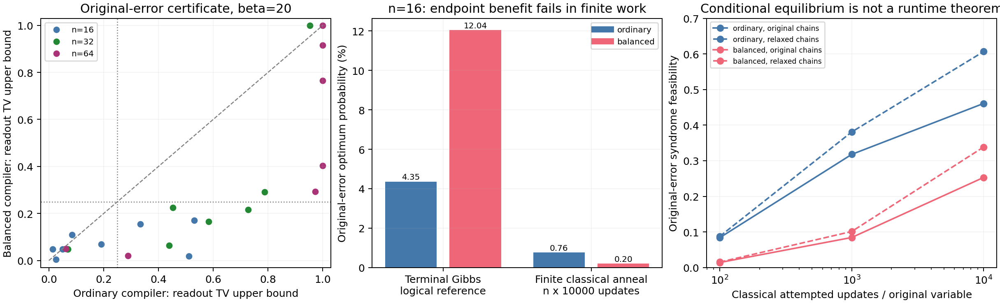

# General-H original-error readout and annealing relevance

## Outcome

This round derives an exact original-error thermal description, develops a cheap
syndrome/readout certificate, and identifies a rigorous local-dynamics obstruction.
Controlled ordinary-instance experiments show why a better endpoint model need
not improve finite-work annealing. Practical finite-time quantum comparison
remains open; the parent agent investigates separate coherent-forward results.

The principal new compiler has an auxiliary partition function depending only
on original parity. Conditioned on the syndrome, it samples the intended
feasible-error cost Gibbs law exactly, including all excited auxiliaries. On
23 matched sparse-H instances it uses about twice the physical qubits and gives
1.81 times the logical scale. At the declared beta = 20, its inexpensive readout
TV bound is at most .25 on = 16/23, versus 8/23 for the ordinary compiler. Exact n = 16
references improve minimum-cost ORIGINAL-ERROR probability on 8/8 inputs.

Finite-work CLASSICAL simulations reverse the observed compiler ordering:
with equal attempted-update budgets, mean n = 16 optimum success is .00757 for the
ordinary compiler and .00195 for the balanced compiler, while their terminal
logical-Gibbs references are .04352 and .12039. Both fail to approach equilibrium.
The balanced compiler's exact thermal law is a useful analytical control; these
results do not establish it as a practical replacement for the smaller compiler.

## Model, event and research conditions

The input is general sparse binary H, feasible syndrome s and finite signed
additive weights w. The scored error event is He=s and w·e=C*, with all tied
minima counted. No observable map or hidden true error enters construction or
scoring. A feasibility witness is saved with generated data for audit, but the
construction never uses its error values. Logical-observable correction success
and observable-class maximum likelihood are outside the measured event.

The endpoint model is Gibbs equilibrium for the programmed Ising Hamiltonian,
with beta in reciprocal programmed-energy units. Relative to the prompt's
Hamiltonian B/2 convention, beta=beta_physical B/2 at Gamma=0. No physical time,
bath, device temperature or freezeout point is asserted to produce equilibrium.
Source-level rational fidelity and physical hardware ranges remain separate
from thermal and dynamical claims.

The explicit dynamical extension is CLASSICAL random-scan single-site heat-bath
updating. A fixed-beta terminal hold supplies the mixing theorem. Finite-budget
forward simulations start from independent uniform physical spins and use
beta(u)=20u, Gamma=0 throughout, with midpoint schedule values per attempted
update. These simulations are not quantum dynamics and do not estimate QPU
performance. Parent coherent-forward investigations are separately owned and
reported in the root report and independent/ artifacts.

This is user-authorized continuing reference research, with inherited context
and parent scientific collaboration. It is not a clean autonomous model test,
SciCode2 calibration or acceptance evidence. Methods and all protocol changes
are preserved. Prior labs and the original problem/prompt remain unchanged.

## Exact thermal balancing and general-H fidelity

The full argument is in THEORY.md. The ordinary intermediate XOR factor is
M(x+y-p-2a)^2. Valid visible triples have hidden energies {0,4M}; invalid triples
have {M,9M} or{M,M}. Thus local validity is balanced, but summing invalid prefix
paths can bias equal-parity original-error inputs.

The balanced compiler sums four independent-hidden copies under all even flips
of (x,y,p), each at strength M/4. Visible-visible couplings/fields cancel and the
actual interaction graph is K3,4. A valid triple has one zero-energy extension;
any invalid triple or wrong valid-triple extension costs at least M. Degree-d
rows use d−2 intermediate gates plus a final two-bit parity factor. Variable
counts are n+2Σ(d−2)+ versus n+5Σ(d−2)+; physical routing is charged separately.

With t=beta alpha and r=exp(−tM), a balanced gate has valid factor
(1+r)^4 and invalid factor 8r(1+r²). The latter includes an entropy factor 8.
Summing prefixes gives two row factors (V,I), initialized at (1,r) and repeatedly
updated by (V,I)←(aV+bI,aI+bV). Hence the exact original-error marginal is

    P(e) proportional exp[−t w·e−Σ_r kappa_r 1{(He)_r≠s_r}],
    kappa_r=log(V_r/I_r)≥0.

Conditioned on He=s, all row factors are constant, so the original-error law is
exactly intended feasible cost Gibbs. Minimum-cost-error probability in that
conditional law increases with t, including degeneracy. This concerns original
errors rather than full-QUBO-ground readout. It is valid for dependent rows,
arbitrary column degrees, irregular matrices and all feasible syndromes.

Both main compilers use the SAME M=W+1, W=Σ|w|, and have minimum nonzero parity
penalty M. Ground-state fidelity follows by comparing infeasible penalties with
the total objective range. The parent-collaboration follow-up uses a stronger
repair argument and separately recomputes the coefficient gap for M=C+1.

No priority claim is made for parity symmetrization, Boltzmann hidden units or
chain-strength tuning. The scientific result is their proved, resource-accounted
integration into a general-H readout evaluation and its validated limitations.

## Cheap original-error evaluation

The parent's independently verified weighted GF2 right inverse supplies
independent original rows R and repair columns Delta_j with loads
L_j=Σ_{i in Delta_j}|w_i|. Every error repairs to a feasible error with cost
increase at most Σ_j L_j v_j for residual basis bits v_j. The feasible-space/
residual map is bijective. For balanced soft-parity factors this proves

    P(He=s)≥Π_{j in R}[1+exp(t L_j−kappa_j)]^(−1).

For the ordinary compiler, exact local row transfers give the valid-sector log
factor range R_aux and conservative soft penalties. They yield a syndrome
feasibility lower bound and conditional feasible-law TV error at most
tanh(R_aux/4). Nonbasis negative penalties are explicitly retained as a worst-case
correction; the implementation does not drop them incorrectly.

Composing chain consistency, syndrome feasibility and auxiliary entropy gives
root-decoded TV distance from intended feasible cost Gibbs bounded by

    epsilon_chain+epsilon_syndrome+delta_aux+delta_rounding,

capped at one. This is a distribution-fidelity statement without a decoding
solve. It exposes a monotone intended cost-Gibbs family; it does not estimate
its unknown optimum probability cheaply. A multiplicative optimum lower bound
is also available once that reference probability is known or bounded.

Measured witness+row-envelope+bound cost is median .98 ms for balanced models
(max 3.02 ms) and median 3.84 ms for ordinary models. The ordinary worst case is
343 ms at row degree 17, reflecting its O(Σ d2^d) local enumeration. It returns
inconclusive beyond degree 20. Balanced formulas and post-witness evaluation
are linear in row/output size and do not have that exponential-degree audit.
These costs exclude physical embedding, which is charged below.

The ordinary conditional entropy bias at beta = 20 is already small on n = 16:
actual maximum TV is .000979 and its conservative certificate maximum is .00369.
Therefore entropy removal alone does not explain the larger observed endpoint
optimum gains. Logical scale and soft-syndrome suppression also change. At
beta = 10 the ordinary bias can be substantial; all temperature points are retained.

## Frozen ordinary-instance experiment

PROTOCOL.md precedes results. Four fully specified generators reused read-only
from Lab004 cover random degree-four checks, irregular hub checks, rewired bands,
and graph incidence augmented with hyperchecks and a dependent row. Original
sizes n = 16, 32, 64 and new seeds 8807 (development), 9901 (held-out) give 24 input matrices
and 48 compiler models. Neither code geometry nor one named code is required.

Both compilers use the SAME ideal Zephyr g6,t4 target, 1248 sites, h in [-4,4], J in [-1,1]
and signed coupling-group range [-13,10]. These are illustrative declared bounds,
not a device export. All node/edge/group lists and versions are saved. Eight
identical minorminer seeds have 5 s timeout and 2 tries. Selection among the
finite candidate pool minimizes qubits subject to each compiler model's own
first-uniform-candidate alpha floor and requested .05 chain-defect budget. Coefficient allocation and actual fields,
couplings, offsets, branches, trees, margins and source graphs are saved.

Ordinary compilation fits 24/24. Balanced fits 23/24; mixed-hypergraph n = 64 seed 8807
exhausts all eight heuristic searches. This is a search failure, not a proved
resource impossibility. Matched comparisons use the 23 common successful inputs,
with the missing balanced case retained. Balanced physical-qubit ratio averages
1.998 (median 1.982), while alpha ratio averages 1.806. Added qubits are an explicit
resource tradeoff, not an embedding compactness improvement.

Selected mappings are reprogrammed at beta = 10/20/40/80. The following coverage
uses the original-error TV certificate, rather than mere positivity of a bound.

| beta | Ordinary TV≤.25 | Balanced TV≤.25 | Ordinary TV≤.10 | Balanced TV≤.10 |
|---:|---:|---:|---:|---:|
|10|0/23|2/23|0/23|0/23|
|20|8/23|16/23|7/23|10/23|
|40|22/23|23/23|21/23|22/23|
|80|23/23|23/23|23/23|23/23|

At beta = 20 median TV bounds are .4528 ordinary and .1546 balanced. At beta = 40 the
ordinary median is tighter (.0390 versus .04875), because some ordinary LP programs
have much stronger chain bounds. There is no universal winning compiler.

Exact original-error enumeration for all eight n = 16 inputs sums every auxiliary
state by row transfers. At beta = 20 balanced improves original-optimum probability
on 8/8, with mean per-instance ratio 3.52. The parent
independently enclosed all 64 actual beta-specific n = 16 programs with outward
intervals, including chain and coefficient-rounding errors. Strict actual
root-decoded-optimum orders favor balanced on 3/8, 6/8, 8/8 and 8/8 at beta
10, 20, 40 and 80 respectively, with no strict reverse orders. These include
excited compiler auxiliaries and possible chain breaks in the readout event;
they are terminal Gibbs statements. See
[the independent interval audit](results/independent_readout_intervals.json).
All 32 reference temperature comparisons retain feasibility, original optimum,
full-QUBO-ground mass and conditional original-error law as separate events.

Main per-model work totals 359.5 s: 121.5 s ordinary and 238.1 s balanced, including
searches, failed searches, allocations, row audits, exact references and saved
witnesses. Readout evaluation itself uses no original-error enumeration or
Hilbert-space simulation. Reference solves and their timings remain separate.

## Parent-collaboration penalty follow-up

Parent independently derived and checked a minimum-|w| basis repair condition
M>C, with C=max_j L_j≤W. The implementation and proof provenance are explicit;
this report does not attribute that method to the child agent.
REPAIR_COMPILER_PROTOCOL.md separately freezes reuse on the same selected
mappings of both compilers. Exact rescaling updates all rational coefficients and explicit gate
scales, and replaces the old M−W gap with min(weight lattice,M−C).

For both compiler types, each violated original row costs at least M. Parent
repair changes original cost by at most C per violated syndrome bit. Thus M>C
suffices even when M<W; valid original errors with wrong auxiliaries are repaired
at fixed original error. Twenty-four small full-model enumerations independently
check this extension and its gap bound, including negative/zero weights.

The 47 successful selected mappings are reprogrammed at M=C+1 without new
embedding searches. This follow-up costs 30.8 s. At beta = 20 n = 16 mean original-optimum
probabilities improve ordinary .04352→.34538 and balanced .12039→.56561. Cross-penalty
alpha alone is not a theorem; actual row-transfer references supply the evidence.

The cheap readout-TV certificate gets MORE conservative despite these actual
optimum gains: at beta = 20 its median is .9909 ordinary and .8772 balanced after
repair penalties. Amplifying the objective increases tL_j and makes the repair
bound weak, while actual optimal-error mass can rise. This is a substantive
limitation of treating robustness/TV fidelity as a universal success score.
The original global-M outcomes are preserved; the follow-up is subsequent
collaboration and exploratory reuse of already observed inputs.

## Local-dynamics limitation

DYNAMICS_PROTOCOL.md freezes a separate classical terminal-hold model. For a
nonsingleton original-variable branch, any root flip has a broken endpoint.
Reversibility and random-scan update rate 1/N give stationary cut flow
Q(S,S^c)≤P(branch broken)/N. The indicator Rayleigh quotient then upper-bounds
the spectral gap by epsilon_branch/[N p(1−p)]. A verified kernel vector containing
the original variable bounds its balanced logical marginal by
logistic(±tΣ|w_i|); subtract the global chain/rounding-TV error for the physical
root variance. Fundamental kernel vectors are computed algebraically, not by
solving minimum-weight-codeword or decoding optimization.

This yields nonvacuous worst-case mixing-time LOWER bounds on all 23 balanced
programs at beta = 20, median 231 sweeps. At beta = 10/40/80 coverage is 23/21/17;
variance bounds correctly become inconclusive on some cold cases. The largest
beta = 20 bound is 1.68×10^15 sweeps, and the same program reaches 8.90×10^61 at beta = 80.
Its verified kernel support [14,41] has nonzero absolute weight cost 1.75; no
zero-cost or named-code structure is required. Three tiny compiled-model
finite-state calculations separately verify flow, Rayleigh/gap and a conditional
warm-wrong-root readout bound. Ordinary coverage comes from the 23 full inputs,
not these proof-validation examples.

These are worst-case equilibrium mixing bounds for the DECLARED local classical
kernel. They do not order actual gaps, quantum tunneling or decoder success.
A slow marginal can be unrelated to the optimum event, and an anneal need not
start in a worst-case state. Coherent and collective dynamics can evade the
single-site obstruction. This theorem tests a thermalization assumption rather
than proving a QPU slowdown.

## Chain relaxation and finite-work simulations

CHAIN_RELAXATION_PROTOCOL.md follows the observed LP tie issue: maximizing alpha
can leave unnecessary F near one. Keep all nonchain coefficients, alpha, embedding
and target fixed, and minimize total F under the original margin/range/group
constraints. Consistent-state logical energy is unchanged after offset adjustment.
The requested 95% consistency guarantee remains; an overstrong program's tighter
bound can worsen. All 23 actual relaxed programs pass rational fidelity audits.
Only 5/23 meaningfully change; average total chain-strength reduction is 8.32%.

In the strongest-obstruction case, the mixing lower bound weakens from 1.68×10^15
to 660 sweeps, while its chain-defect bound worsens .000744→.04876, within the frozen
budget. This removes a proved obstruction; it does not prove faster mixing.
Observed maximum-budget feasibility stays 0/128 before and after in that case.

Finite-work simulations use n×100/1000/10000 single-site attempts per replica,
512 replicas for n = 16/32 and 128 for n = 64, with identical initial/proposal streams
within each chain-allocation pair. Exact minimum cost is reference-only when
affine nullity ≤ 18; n = 64 optimum success is unassessed. Individual physical/error
states and scores are saved. The backend matches exact two-site finite-step
evolution within Monte Carlo error, and all saved outcomes are rescored from
physical strings: 109,824 outputs pass independent rescoring by the child audit. Wilson intervals and paired outcome counts are retained.

Balanced simulation costs 225.7 s. At its maximum budget, n = 16 mean chain agreement
is 1.000 before relaxation, yet original feasibility is only .2532 and optimum
success .00195, against terminal logical references .9839 and .12039. Chain agreement
therefore does not establish either compiler-auxiliary equilibration or decoding.
Relaxation raises observed n = 16 feasibility to .3386 and optimum success to .00415;
that remains far below equilibrium. On n = 32, optimum counts are 0/4096 before/after.
On n = 64, feasibility rises .00781→.01339 and optimum remains unassessed.

CLASSICAL_COMPILER_PROTOCOL.md then freezes an explicitly exploratory standard
comparison on all 24 programs, using the same work budgets and relaxation rule.
Standard simulations cost 214.6 s. At the maximum budget, ordinary n = 16 feasibility
is .4609 and optimum success .00757; relaxed values are .6067 and .00903. Thus ordinary
outperforms balanced in the observed finite-work mean, reversing their terminal
logical optimum ordering. Ordinary n = 32 also has 0/4096 optimum successes. Larger
instances retain feasibility/cost data rather than invent optimum labels.

Equal attempted updates charge computational work; balanced models have about
twice the physical sites and receive fewer sweeps at that same work budget.
These data do not isolate intrinsic gadget barriers at equal sweep count or
represent equal analog-hardware time. Both physical resources and measured
wall time are explicit. The relaxation/standard extensions reuse previously
observed matrices and are exploratory rather than fresh held-out confirmation.
All budget points, unchanged cases, failures and uncertainty are preserved.

The endpoint bars are logical Gibbs references including all auxiliaries. The
finite-work bars are physical classical samples with root readout. Blue/ordinary
and red/balanced share H,s,w and target/ranges; their physical qubit counts differ.

## Validation, reproducibility and remaining gap

THEORY.md contains the complete proof and complexity scope. Local checks cover
64 row-partition cases (degrees 1–4, both syndromes, both compilers, four tM values),
full projected original-error events on dependent/negative-weight examples,
24 repair-penalty full-model enumerations, exact local Markov flow/gap/readout,
and an exact finite-step sampler cross-check. Actual physical coefficients,
source graphs and compiler rounding are audited with exact rational arithmetic.
Per-beta full programs and corrected rounding-aware TV bounds are saved in
results/readout_audits/. The parent separately audited 373 saved physical-program records (309 distinct
core witnesses) using exact-rational ground-fidelity checks and outward
chain/rounding bounds; maximum rounding TV is 1.85e-12. The independent readout
audit rigorously encloses the 64 n = 16 temperature-specific original-error
comparisons. Other floating reference outputs retain their numerical status. See
[physical audits](results/independent_child_program_audit.json) and
[readout intervals](results/independent_readout_intervals.json).

The artifact manifest hashes child-owned sources and saved results; inherited dependency hashes are recorded in source_provenance.json. models.py accepts arbitrary sparse rows,
syndrome and weights; evaluate_readout.py provides a reusable decoder-free CLI.
The caller must supply independently certified physical chain/rounding bounds
if asking for a physical readout guarantee. No hidden answer or reference solve
enters that evaluator. The README records commands, versions, native sampler
build flags, units and artifact locations. Technical import-collision attempts
are preserved; they are engineering errors, not evidence of scientific model
failure or SciCode2 difficulty.

The result advances actual original-error thermal readout and provides a general
local-dynamics limitation. The inexpensive certificate can be useful on ordinary
inputs in declared temperature regimes, but becomes conservative precisely when
some penalty improvements make actual success much better. Additional qubits can
improve endpoint sampling while hurting finite-work local annealing. A useful,
ordinary-instance finite-time QUANTUM comparison under realistic resources
remains the central open gap for the issue; neither these simulations nor a
small-time curvature theorem automatically supplies it.
